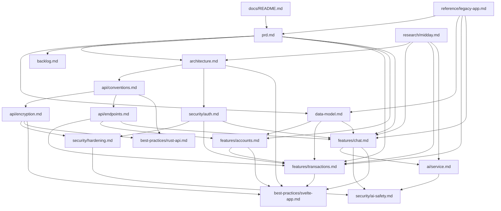

# oewang Docs

Status: draft v0.1, 2026-11-02. Owner: Azlan. Entry point for every oewang document.

oewang is a personal finance tracker. This repository is a ground-up rewrite of the previous implementation (kept at [references/oewang-old](../references/oewang-old), described in [legacy app](reference/legacy-app.md)). The rewrite keeps two features, transactions and AI chat, on three apps: a SvelteKit web app, a Rust Axum API, and a Python FastAPI service that owns all LLM work.

## Reading order

1. [PRD](prd.md): problem, goals, scope, requirement IDs (AUTH, WS, WAL, CAT, TXN, VLT, CHAT, AI, UI, OPS), milestones.
2. [Architecture](architecture.md): the three apps, request lifecycles, repo layout, local development, the decision log.
3. [Data model](data-model.md): every table, tenancy, IDs, balance arithmetic, indexes.
4. [API conventions](api/conventions.md): base path, response envelope, error catalog, pagination, headers.
5. [Payload encryption (OWE1)](api/encryption.md): how every request and response is encrypted and decrypted, and which hops are protected.
6. [API endpoints](api/endpoints.md): the full endpoint catalog, grouped by module.
7. [Auth and access control](security/auth.md): JWT, session cookie, roles, the permission matrix.
8. [Hardening](security/hardening.md): input validation, uploads, headers, secrets, limits, dependencies.
9. [AI safety](security/ai-safety.md): prompt injection, tool abuse, blast-radius caps.
10. [Transactions](features/transactions.md): the transaction feature end to end, API to UI.
11. [Accounts](features/accounts.md): the wallets screen, its figures, its table and how a balance is corrected.
12. [Chat](features/chat.md): the chat feature end to end, including receipt OCR.
13. [Telegram](features/telegram.md): the Apps page, linking a chat, receipts saved from a photo, and the assistant in Telegram.
14. [Overview](features/overview.md): the front page, its two tabs, the floating composer, and where each figure comes from.
14. [AI service](ai/service.md): the Python service, its tool catalog, prompt, and streaming protocol.
15. Best practices: [Rust API](best-practices/rust-api.md) and [Svelte app](best-practices/svelte-app.md).
16. [Backlog](backlog.md): the implementation stories, in order, each mapped to requirement IDs.
17. [Legacy app](reference/legacy-app.md): what the old implementation contains, what the rewrite takes from it, what it drops.
18. [Midday research](research/midday.md): reverse engineering of a second reference implementation, and the proposals taken from it.

## Doc map

## All documents

### Product

| Doc | What it answers |
|---|---|
| [prd.md](prd.md) | Problem, goals and non-goals, personas, scope decisions, requirement IDs, success metrics, milestones, risks, open questions. |
| [backlog.md](backlog.md) | Every implementation story in order, with acceptance criteria and the requirement IDs it satisfies. |

### Architecture and data

| Doc | What it answers |
|---|---|
| [architecture.md](architecture.md) | The three apps and their boundaries, request lifecycles (page load, mutation, chat stream, receipt OCR), repo layout, Rust crate layout, local development, deployment, the decision log (D1 to D75). |
| [data-model.md](data-model.md) | Every table and column, tenancy, CUID2 IDs, soft delete, wallet balance arithmetic, indexes, seed data. |
| [ENV_VARS.md](ENV_VARS.md) | Every environment variable each of the three services reads, with its default. Generated by `scripts/env-vars.py` from the configuration modules; CI fails when it is stale. |
| [deployment.md](deployment.md) | What runs where on Coolify, the environment variables each service needs, the OWE1 signing keys, migrations as a separate role, Cloudflare R2, health checks, the reverse proxy and the routes that must never be routable. |

### API and security

| Doc | What it answers |
|---|---|
| [api/conventions.md](api/conventions.md) | Base path, the `{data, error, meta}` envelope, the error catalog, validation, pagination, money and date encoding, idempotency, rate limits. |
| [api/encryption.md](api/encryption.md) | OWE1: which hops are protected and why, the handshake, key derivation, message format, associated data, query strings, stream events, file bytes, replay protection, plaintext exceptions, cost. |
| [api/endpoints.md](api/endpoints.md) | Every route with its method, role gate, request and response shape, grouped by module. |
| [security/auth.md](security/auth.md) | Password hashing, JWT claims and lifetime, the session cookie, workspace switching, the role and permission matrix, service-to-service auth, the threat model. |
| [security/hardening.md](security/hardening.md) | Input validation and injection, file uploads, outbound calls, browser headers, CORS, secrets, logging, dependencies, every limit and timeout, how each control is tested. |
| [security/ai-safety.md](security/ai-safety.md) | Prompt injection through receipts and statements, the four control layers, blast-radius caps, confirmation scoping, what is deliberately not built, the injection test corpus. |

### Features

| Doc | What it answers |
|---|---|
| [features/transactions.md](features/transactions.md) | The transaction feature: data, business rules, endpoints, screens, the UI port map from the old app, CSV export and import, attachments, line items. |
| [features/accounts.md](features/accounts.md) | The accounts screen: why wallets left Settings, the three cards and where each figure comes from, the measured table, the two sheets, how a balance adjustment is recorded as a transaction, the UI port map. |
| [features/chat.md](features/chat.md) | The chat feature: sessions, streaming, the tool loop, role gating of writes, receipt OCR, the analysis canvas, the UI port map, settings. |
| [features/overview.md](features/overview.md) | The overview: the greeting, range and tabs, the cards and charts and their sources, starting a conversation from the composer. |
| [features/telegram.md](features/telegram.md) | Telegram: the Apps page, the one-time link, who a message is from, receipts saved on arrival and their reply, the buttons, the assistant in a chat. |
| [ai/service.md](ai/service.md) | The Python service: responsibilities, endpoints, the eleven-tool catalog, the system prompt, the SSE event protocol, safety rules, testing with a mocked model. |

### Best practices

| Doc | What it answers |
|---|---|
| [best-practices/rust-api.md](best-practices/rust-api.md) | Crate layout, the handler to service to repository flow, error handling, sqlx usage, transactions and locking, tenancy, logging, testing, tooling. |
| [best-practices/svelte-app.md](best-practices/svelte-app.md) | SvelteKit route structure, Svelte 5 runes, the BFF pattern, component organization, forms, the i18n dictionary, money and date rendering, testing. |

### Reference

| Doc | What it answers |
|---|---|
| [reference/legacy-app.md](reference/legacy-app.md) | The old implementation: its seven apps, its schema, its feature docs, which parts the rewrite reuses, which it drops, and where to look when porting a screen. |

### Research (sources for the decisions above)

| Doc | Topic |
|---|---|
| [research/midday.md](research/midday.md) | Midday reverse engineered: the MCP-backed chat and its tool selection, the system prompt, entity deep links, tool call presentation, cache invalidation, the canvas as a real component, AI column mapping for CSV import, deterministic deduplication, the four-pass extraction ladder, embedding-free receipt matching, the slots pattern. Eighteen numbered proposals with verdicts (D27 to D35). |

## Rules for these docs

- Every doc starts with a status line and ends with **Related docs**. Link with relative paths, and to sections with heading anchors.
- Requirement IDs (for example `TXN-7`) are defined in the [PRD](prd.md). Other docs reference them instead of restating the requirement.
- Decisions go in the [architecture decision log](architecture.md#decision-log) as `D1`, `D2` and so on. Feature docs reference a decision; they do not re-argue it.
- The source of truth for a table is [data-model.md](data-model.md). The source of truth for a route is [api/endpoints.md](api/endpoints.md). No other doc repeats a column list or a route table.
- House style: English, short sentences, active voice, no em dashes and no en dashes. Use commas, semicolons or parentheses.
- When behaviour changes in code, update the doc that owns it in the same change. Each feature doc carries an "Update this doc when" list at the top.

## Related docs

- [PRD](prd.md) is the next thing to read.
- [Legacy app](reference/legacy-app.md) explains where the rewrite comes from.
