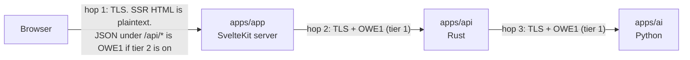

# Payload Encryption: oewang Envelope v1 (OWE1)

Status: draft v0.1, 2026-11-02. Part of the [oewang docs](../README.md). Implements [PRD](../prd.md) SEC-1 to SEC-8. Supersedes decision D9 (see D22 in the [decision log](../architecture.md#decision-log)).

Every request body and every response body on a protected hop is encrypted at the application layer, on top of TLS 1.3. The receiver decrypts and gets the standard envelope from [API conventions](conventions.md).

## Update this doc when

- Changing the handshake, the key derivation, the associated data, or the message format.
- Adding a plaintext exception. Each one needs a row in [exceptions](#plaintext-exceptions) and a decision record.
- Changing the protected hops.

## Summary

- Keys come from a per-session handshake: X25519 key agreement, HKDF-SHA-256, two AES-256-GCM keys, one per direction.
- The server signs the handshake with a long-term Ed25519 key that every client pins. A client that cannot verify the signature stops. It never falls back to plaintext.
- Each message is bound to its session, method, path, request ID, timestamp and HTTP status through AEAD associated data. A message cannot be replayed, moved to another endpoint, or have its status swapped.
- Query strings travel encrypted in a header, so filters and search text are protected too.
- Chat events and file bytes are sealed with the same keys.
- A short list of bootstrap endpoints stays plaintext ([exceptions](#plaintext-exceptions)).

## Which hops are protected

This is the part that decides how much the scheme is worth. Read it before anything else.



### Tier 1, specified and built: hops 2 and 3

Every call from the SvelteKit server to the API, and from the API to the AI service, uses OWE1. Both ends are servers, so there is no browser version floor, no Web Crypto limitation, and no bundle cost. This tier is unconditional.

### Tier 2, decided against: hop 1

Hop 1 is the hop with the real adversary: a public network, a CDN, a corporate TLS-inspecting proxy, a logging reverse proxy. It is also the hop OWE1 can protect least, because of SSR (D5).

**Under SSR, most data reaches the browser inside rendered HTML.** A `+page.server.ts` load fetches transactions over hop 2 (encrypted), then renders them into the HTML document. That HTML is the response body on hop 1. It cannot be encrypted and still render. Encrypting only the `/api/*` JSON surface while the same rows travel in plaintext HTML on the next request is not a security control; it is a mislabel.

So hop 1 has two honest options:

| Option | What happens | Cost |
|---|---|---|
| **1A. Leave hop 1 on TLS alone** | SSR stays. Data is plaintext between browser and SvelteKit, encrypted everywhere behind it. | None. The gap is a terminating proxy in front of the web app. |
| **1B. Encrypt hop 1 too** | Data fetching moves out of SSR loads and into client-side OWE1 calls to `/api/*`. Pages render a shell, then fetch. D5 stays (the browser still talks only to SvelteKit) but SSR stops carrying data. | Slower first paint, more client code, a browser floor of Chrome 137 / Firefox 130 / Safari 17 for X25519 and Ed25519 in Web Crypto, and the loss of SSR's main benefit. |

**Decision: 1A, confirmed by the owner on 2026-11-02 (D26).** The reasoning: the web app and the API are deployed together behind the same proxy, so hop 1 and hop 2 share a trust boundary in practice, and 1B pays for hop 1 with the page-load behaviour the whole frontend choice was made for. Revisit 1B if the web app is ever served from a CDN that terminates TLS.

The rest of this document specifies the protocol once. Applying it to hop 1 later is a configuration flag plus a change to the data-loading pattern, not a different design.

**What this leaves open, stated plainly:** between the browser and the web app, transaction data travels as plaintext inside TLS. Anything that terminates TLS in front of the web app, or logs its response bodies, can read it. That is the accepted gap.

## What it buys, and what it does not

Beyond TLS 1.3, on the protected hops:

- A terminating intermediary (load balancer, service mesh sidecar, inspecting proxy) sees ciphertext bodies only.
- Bodies accidentally captured by an APM agent, an access log, or a packet dump leak nothing readable.
- Tampering with a body, swapping a response between two requests, or changing an HTTP status is detected.
- Replaying a captured request is rejected.

It does not protect against:

- A compromised server. Whoever controls the API controls the plaintext.
- SSR HTML on hop 1 under option 1A.
- Metadata: paths, sizes, timing, status codes.
- A compromised deployment secret store, which holds the signing key.

Costs accepted: no HTTP caching on protected routes (`Cache-Control: no-store`), one extra round trip per session, and a decrypt step in every development debugging session ([debugging](#debugging)).

## Primitives

| Purpose | Algorithm | Rust | Node (SvelteKit) | Python |
|---|---|---|---|---|
| Key agreement | X25519 | `x25519-dalek` | `node:crypto` `generateKeyPairSync('x25519')`, `diffieHellman` | `cryptography` |
| Key derivation | HKDF-SHA-256 | `hkdf`, `sha2` | `node:crypto` `hkdfSync` | `cryptography` |
| Encryption | AES-256-GCM, 96-bit random nonce, 128-bit tag | `aes-gcm` | `node:crypto` `createCipheriv('aes-256-gcm')` | `cryptography` AESGCM |
| Handshake signature | Ed25519 | `ed25519-dalek` | `node:crypto` `sign`, `verify` | `cryptography` |
| Randomness | CSPRNG | `rand` | `crypto.randomBytes` | `os.urandom` |

No third-party crypto library on any side beyond those. Node and Python both cover the whole scheme with their standard offering, which is the reason these primitives were chosen over JWE or HPKE.

Encoding: every binary value is base64url without padding (RFC 4648 section 5).

### Why this and not something else

| Option | Verdict |
|---|---|
| A static shared key in configuration, as in the old app | Rejected. Both ends held the same long-lived key, so a leak of either end's configuration decrypts every past capture. No forward secrecy, no replay protection, no binding to the request. |
| JWE per message | Workable but heavy: JOSE headers, too many algorithm choices, larger bodies. |
| HPKE (RFC 9180) per request | Stateless and standard. No forward secrecy if the server's static key leaks, and the Rust and Python libraries are less mature than the primitives above. Kept as the documented alternative. |
| **Session X25519, HKDF, AES-256-GCM (chosen)** | One key agreement per session, then fast symmetric work. Ephemeral keys on both sides give forward secrecy once a session ends. Every language in the stack has it natively. |

## Server signing keys

- The API holds one or more Ed25519 signing keys. The key ID is derived from the public key: `kid = "k-" || first 12 characters of base64url(SHA-256(public_key))`.
- The private key is a PKCS#8 PEM file at `CRYPTO_SIGNING_KEY_FILE`, mounted from the deployment secret store. In development the API creates it with mode `0600` on first start.
- Public keys are published at `GET /.well-known/oewang-keys` (plaintext) and pinned by every client through `CRYPTO_SIGNING_PUBLIC_KEYS`.
- A production client with no pinned key refuses to start. A development client with none trusts what the local API publishes.
- Rotation: publish the new key, deploy clients that pin both, switch signing, remove the old key after 90 days.

## Handshake

`POST /v1/handshake`, plaintext JSON, no authentication required.

Request:

```json
{ "v": 1, "client_public_key": "<32 bytes X25519, base64url>", "client_nonce": "<16 random bytes, base64url>" }
```

Server steps:

1. Validate `v == 1` and a 32-byte key. Rate limit 30 per minute per IP.
2. Generate an ephemeral X25519 key pair and a 16-byte `server_nonce`.
3. `shared = X25519(server_private, client_public)`. Reject a low-order result.
4. `session_id = "cs_" || CUID2`.
5. `salt = client_nonce || server_nonce`.
6. `PRK = HKDF-Extract(SHA-256, salt, shared)`.
7. `k_c2s = HKDF-Expand(PRK, "oewang/owe1/c2s/" || session_id, 32)`.
8. `k_s2c = HKDF-Expand(PRK, "oewang/owe1/s2c/" || session_id, 32)`.
9. `transcript = "oewang/owe1/handshake" || client_public_key (32) || server_public_key (32) || client_nonce (16) || server_nonce (16) || session_id (ASCII) || "|" || expires_at || "|" || server_time`. Every binary part has a fixed size, so the byte string is unambiguous.
10. `signature = Ed25519-Sign(signing_key, transcript)`.
11. Store the session in memory: both keys, expiry, a message counter per direction, and a recent request-ID set. Discard the ephemeral private key.

Response, in the standard plaintext envelope:

```json
{
  "data": {
    "v": 1,
    "session_id": "cs_h6wqk2m0v9s1t4y7u3i8o5pa",
    "server_public_key": "<base64url>",
    "server_nonce": "<base64url>",
    "server_time": 1762070400,
    "expires_at": 1762156800,
    "kid": "k-bI-GB9vocHem",
    "signature": "<base64url>"
  },
  "error": null,
  "meta": { "request_id": "01JC0…" }
}
```

Client steps:

1. Verify `signature` against the pinned key for `kid`. On failure, stop. Never fall back to plaintext.
2. Derive the same two keys.
3. Keep both keys in process memory with `session_id` and the clock offset (`server_time - local_time`). In a browser (tier 2), import them as non-extractable `CryptoKey` objects.

### Session lifetime

- A crypto session lasts at most 24 hours or 2^24 messages per direction, whichever comes first.
- After that the server answers `CRYPTO_SESSION_UNKNOWN`. The client runs one new handshake and retries the request once.
- A server restart drops every session. Clients recover through the same path. A shared session store is needed only when the API runs on more than one instance, and that is a later change with its own decision record.
- The crypto session is independent of the auth session. It is established before login and survives it. Logout does not end it, because it carries no user identity.

## Messages

### Request

```http
POST /v1/transactions HTTP/1.1
Content-Type: application/vnd.oewang.owe1+json
X-Owe-Session: cs_h6wqk2m0v9s1t4y7u3i8o5pa
X-Owe-Request-Id: 01JC0ZYQ8K3M5N7P9R1T3V5W7Y
X-Owe-Timestamp: 1762070523
X-Owe-Query: <nonce>.<ciphertext>
Authorization: Bearer <jwt>

{"n":"<12-byte nonce, base64url>","c":"<ciphertext with 16-byte tag, base64url>"}
```

- Plaintext is the JSON request body, UTF-8.
- `AAD = "OWE1|req|" || session_id || "|" || METHOD || "|" || path || "|" || request_id || "|" || timestamp`, where `path` carries no query string.
- Encrypted with `k_c2s`.
- A request with no body (`GET`, `DELETE`) sends no body but still sends the `X-Owe-*` headers, so the response is bound to them.
- The `Authorization` header stays outside the envelope. It is already a bearer credential protected by TLS, and the middleware needs it before it can decide anything about the session.

### Query strings

Filters, search text and pagination are query parameters ([conventions](conventions.md#pagination)), and intermediaries read URLs.

- The client sends the path only, plus `X-Owe-Query: <nonce>.<ciphertext>`, where the plaintext is the raw query string (`type=expense&search=lunch&page=2`, possibly empty).
- `AAD = "OWE1|qry|" || session_id || "|" || METHOD || "|" || path || "|" || request_id || "|" || timestamp`, encrypted with `k_c2s`.
- The header is required on every OWE1 request, even when the query is empty, so an intermediary cannot strip a filter unnoticed.
- The middleware decrypts it and populates the request's query map, so handlers read parameters normally.
- A plaintext query string on a protected route is rejected with `CRYPTO_QUERY_NOT_ENCRYPTED`.

### Response

```http
HTTP/1.1 201 Created
Content-Type: application/vnd.oewang.owe1+json
X-Owe-Request-Id: 01JC0ZYQ8K3M5N7P9R1T3V5W7Y
Cache-Control: no-store

{"n":"<12-byte nonce>","c":"<ciphertext with tag>"}
```

- Plaintext is the envelope `{ "data", "error", "meta" }`.
- `AAD = "OWE1|res|" || session_id || "|" || request_id || "|" || http_status`.
- Encrypted with `k_s2c`.
- Binding the status means a proxy cannot turn a 403 into a 200 or replay a 200 body onto a different request.

### Nonces and limits

- A fresh random 96-bit nonce per message, from the CSPRNG.
- Separate keys per direction, so the two sides never share a nonce space.
- The 2^24 message cap per key keeps the random-nonce collision probability far below the NIST limit for GCM.

### Replay protection

- `X-Owe-Timestamp` must be within 120 seconds of server time, after the client applies its stored clock offset. Otherwise `CRYPTO_CLOCK_SKEW`, with the server time in the plaintext error so the client can correct and retry once.
- `X-Owe-Request-Id` must be a ULID not seen in the last 5 minutes for that session. Freshness comes from the timestamp, not from the ID. Seen IDs live in an in-memory LRU. A duplicate returns `CRYPTO_REPLAY_DETECTED`.
- A retry always uses a new request ID. Safe retries of creates rely on `Idempotency-Key` ([conventions](conventions.md#idempotency)).

### Chat stream events

The chat stream ([AI service](../ai/service.md#streaming-protocol)) is `text/event-stream`, not a single body. Each event is sealed individually:

- Event data is `{"n":"…","c":"…"}` instead of the plain JSON object.
- `AAD = "OWE1|sse|" || session_id || "|" || request_id || "|" || event_seq`, where `event_seq` starts at 0 and increases by one per event on that stream.
- Encrypted with `k_s2c`.
- The request ID acts as the stream ID, so events from two concurrent streams of one session cannot be swapped. The sequence number makes a dropped or reordered event fail to open.

Each hop seals for the next one. The API opens the AI service's events, re-seals them for the SvelteKit server, and so on. This costs one decrypt and one encrypt per token chunk. Tokens are chunked, not per character, so the cost is a few microseconds per event on AES-NI hardware.

### File bytes

File bytes are receipt images and bank statements. They carry exactly the data the rest of this scheme protects, so they do not get an exception.

- Upload: `POST /v1/vault/files` sends `{ filename, content_type, size_bytes }` and gets back `{ id, chunk_size, chunk_count, status: "pending" }`. The client then sends `PUT /v1/vault/files/{id}/chunks/{index}` with the JSON body `{"data": "<standard base64 of 512 KiB>"}`, as a normal OWE1 request, then `POST /v1/vault/files/{id}/complete`.
- Download: `GET /v1/vault/files/{id}/chunks/{index}` answers `{ "index", "data" }` inside OWE1. The client assembles the bytes.
- The request AAD already covers the path, so a chunk index cannot be moved. The last chunk is known from `size_bytes`.
- At 10 MB maximum ([data model](../data-model.md#vault_files)) a file is at most 20 chunks.
- A 512 KiB chunk fits the 1 MiB body limit with room to spare, and the arithmetic is worth writing down because it is what sets the chunk size: base64 takes 512 KiB to about 683 KiB, the seal adds a 16-byte tag, and base64 over the ciphertext brings the body to about 911 KiB.

**This replaces signed URLs.** The original VLT-3 ("a signed URL valid for 15 minutes") is incompatible with the scheme: a signed URL hands the browser a path to object storage, where the bytes travel outside the envelope and the URL itself leaks into history and logs. Serving chunks through the API costs API bandwidth and rules out a CDN for file delivery. That is the price of encrypting file bytes, and it is stated here rather than discovered later (D23).

## Errors

- Errors from normal handlers are encrypted like any other response.
- Only `CRYPTO_*` errors are plaintext, because the client may have no working key. They use the normal envelope with `Content-Type: application/json` and contain no user data.

| Code | Status | Meaning | Client behaviour |
|---|---|---|---|
| `CRYPTO_SESSION_UNKNOWN` | 401 | No such session, or it expired | One re-handshake, one retry |
| `CRYPTO_DECRYPT_FAILED` | 400 | Tag check failed, or malformed message | Surface it. Do not retry |
| `CRYPTO_REPLAY_DETECTED` | 400 | Request ID seen already | Surface it. A correct client cannot hit this |
| `CRYPTO_CLOCK_SKEW` | 400 | Timestamp outside the window | Update the offset, retry once |
| `CRYPTO_QUERY_NOT_ENCRYPTED` | 400 | Plaintext query on a protected route | Surface it |
| `CRYPTO_VERSION_UNSUPPORTED` | 400 | Unknown `v` | Surface it |

A response that is neither OWE1 nor a plaintext `CRYPTO_*` error, for example an HTML 502 from a proxy, is treated as `TRANSPORT_UNEXPECTED_RESPONSE` with a generic message.

## Plaintext exceptions

| # | Endpoint | Why |
|---|---|---|
| E1 | `GET /health`, `GET /health/ready` | No data. Used by the load balancer |
| E2 | `GET /.well-known/oewang-keys` | Public signing keys |
| E3 | `POST /v1/handshake` | It creates the keys. Signed instead of encrypted |
| E4 | `CRYPTO_*` error responses | See [errors](#errors) |

Any new exception needs a row here and a decision in the [decision log](../architecture.md#decision-log).

## Rules for URLs

Intermediaries see paths even with OWE1.

- API paths carry IDs only, never names, labels or free text.
- Query strings are encrypted, so filters and search text are safe there.
- The web app's own address bar holds the same filters in plain form (TXN-9). That URL stays in browser history and reaches the proxy. So never put a secret or a token in an app URL, and configure the proxy not to log query strings for app routes.

## Efficiency

The scheme is cheap, and the places where it is not are listed here so nobody is surprised.

| Cost | Size |
|---|---|
| Handshake | One extra round trip per process per 24 hours. Negligible, amortized across thousands of requests |
| Symmetric work | AES-256-GCM on AES-NI runs at gigabytes per second. A 50 KB transaction list adds tens of microseconds per hop |
| Body size | Nonce plus tag plus base64 expansion: about 33 percent larger bodies |
| Chat stream | One decrypt and one encrypt per event per hop. Measured against the under-2-second first-token target |
| File bytes | Base64 inside the envelope costs 33 percent bandwidth, and the API now serves bytes a CDN used to serve |
| HTTP caching | `no-store` on every protected route. No loss here: every route is dynamic and workspace-scoped |

Guardrails: the first-token latency test in [chat testing](../features/chat.md#testing) runs with OWE1 on, and the transaction list performance target in [PRD success metrics](../prd.md#7-success-metrics) is measured end to end, not at the repository layer.

## Debugging

- A development-only panel in the web app shows decrypted request and response pairs.
- Plaintext mode exists only when `APP_ENV=development` and the server listens on localhost. The server refuses to start with plaintext mode in any other environment.
- Logs record `request_id`, status, error code and timings. Never decrypted bodies (OPS-3).

## Implementation map

| Piece | Location |
|---|---|
| Rust protocol: key derivation, transcript, associated data | `apps/api/crates/domain/src/owe1/` |
| Rust handshake: signing key, sessions, replay cache | `apps/api/crates/server/src/owe1/` |
| Rust middleware: decrypt query and body, encrypt response | `apps/api/crates/server/src/middleware/owe1.rs` |
| Rust client transport, used to call the AI service | `apps/api/crates/clients/src/owe1_client.rs` |
| Node protocol and client, used by the SvelteKit server | `apps/app/src/lib/server/owe1/` |
| Python protocol and server middleware | `apps/ai/app/core/owe1.py` |
| Shared test vectors | `apps/api/crates/domain/testdata/owe1-vectors.json` |

Interop is tested three ways: every side runs the same vectors, and an integration test drives the Node client and the Python client against a live Rust API.

## Related docs

- [Docs index](../README.md) and [PRD](../prd.md)
- [API conventions](conventions.md) and [endpoints](endpoints.md)
- [Auth and access control](../security/auth.md)
- [Hardening](../security/hardening.md) (the controls this one does not cover)
- [Architecture](../architecture.md) and the [decision log](../architecture.md#decision-log)
- [Rust API best practices](../best-practices/rust-api.md) and [Svelte app best practices](../best-practices/svelte-app.md)
