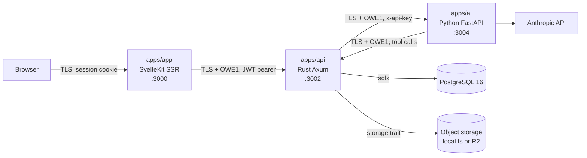

# Architecture

Status: draft v0.1, 2026-11-02. Part of the [oewang docs](README.md). Implements [PRD](prd.md) PLT-1 to PLT-5.

This doc describes the shape of the system: the three apps, what each one owns, how a request travels, and every decision that produced that shape.

## Update this doc when

- Adding, removing or renaming an app or a Rust crate.
- Changing a request lifecycle, in particular the chat stream path.
- Changing what a process is allowed to talk to.
- Making a decision worth keeping. Add it to the [decision log](#decision-log).

## System context



Four rules hold the shape together.

1. **The API is the only process with a database connection** (D3, PLT-2). The AI service is never given a `DATABASE_URL`.
2. **The AI service performs side effects by calling back into the API** (D4, PLT-3). It holds no storage credentials and no user JWT.
3. **The browser never talks to the API or the AI service** (D5, PLT-4). SvelteKit server routes are the only client of the API.
4. **Every body on the two service hops is encrypted at the application layer** with OWE1 (D22, SEC-1), on top of TLS. Specification in [payload encryption](api/encryption.md). The browser hop stays on TLS alone for v1 (D26), for the reason given in [which hops are protected](api/encryption.md#which-hops-are-protected).

## What each app owns

| App | Stack | Owns | Does not own |
|---|---|---|---|
| `apps/app` | SvelteKit 3, Svelte 5 runes, Tailwind 4, shadcn-svelte | Rendering, the session cookie, form handling, proxying to the API | Business rules, database access, LLM calls |
| `apps/api` | Rust, Axum, sqlx, tokio | Every business rule, all database access, file storage, tool execution, audit logging, async jobs | Prompt construction, LLM calls |
| `apps/ai` | Python 3.13, FastAPI, Anthropic SDK | System prompts, the tool loop, streaming, receipt OCR, statement extraction, title generation | Database access, storage, authorization decisions |

### Landed versions

Recorded at scaffold time (US-001, 2026-11-02) so later drift is visible. The docs name the major version; these are what the lockfiles resolved to.

| Component | Version |
|---|---|
| Rust | 1.x via the `rust:1-bookworm` image, `rust-version` pinned at 1.84 |
| Axum | 0.8 |
| sqlx | 0.8 |
| SvelteKit | 3.0 |
| Svelte | 5.57 |
| Vite | 8.3 |
| TypeScript | 6.0 |
| Tailwind | 4.3 |
| Bun | 1.3 |
| Python | 3.13 |
| FastAPI | 0.162 |
| Pydantic | 2.14 |
| anthropic | 2.3 |
| PostgreSQL | 16.15 |

One deviation from the plan: `httpx` is pinned below 1.0, because only pre-releases satisfy `>=0.30` today.

## Repo layout

```
oewang/
├─ apps/
│  ├─ app/              SvelteKit web app
│  ├─ api/              Rust cargo workspace
│  └─ ai/               Python service, uv managed
├─ docs/                this documentation
├─ infra/
│  └─ docker-compose.yml   PostgreSQL 16, MinIO
├─ references/
│  └─ oewang-old/       the previous implementation, read-only
├─ .env.example
├─ CLAUDE.md
└─ README.md
```

There is no shared package layer (D18, PLT-5). The apps agree on HTTP contracts documented in [api/endpoints.md](api/endpoints.md), not on imported types. A generated OpenAPI client is a later optimization, not a day-one requirement.

## Rust crate layout

```
apps/api/
├─ Cargo.toml              [workspace]
├─ crates/
│  ├─ server/              binary: router, middleware, extractors, main()
│  ├─ domain/              types, errors, money, role and permission rules
│  ├─ db/                  sqlx pool, repositories
│  └─ clients/             HTTP clients: ai-service, storage
└─ migrations/             sqlx SQL migrations
```

Layer flow, carried over from the old ElysiaJS discipline, which was sound:

```
Router -> Auth extractor -> Handler -> Service -> Repository -> PostgreSQL
```

- **Handlers** parse, validate and map to HTTP. Nothing else.
- **Services** hold business rules and are the only layer that opens a database transaction.
- **Repositories** are the only code that imports `sqlx`.
- **`domain`** has no dependency on `db` or on Axum, so rules are unit-testable without a database.

The detailed rules are in [Rust API best practices](best-practices/rust-api.md).

## Request lifecycles

### Page load

```
Browser
  -> SvelteKit +page.server.ts load
     reads the oewang-session cookie
     fetch(API, Authorization: Bearer <jwt>)
  -> API: auth extractor -> handler -> service -> repository -> PostgreSQL
  <- JSON envelope
  <- SSR HTML
```

### Mutation

```
Browser (form action or +server.ts)
  -> SvelteKit server
  -> API: auth extractor -> role guard -> handler -> service
     BEGIN
       SELECT ... FOR UPDATE on affected wallets
       write rows
       write audit_logs row
     COMMIT
  <- JSON envelope
  <- redirect or invalidated load
```

The audit row is written inside the same database transaction as the mutation (D14, OPS-1). The old app wrote it after commit, which could drift from reality when the commit failed.

### Chat stream

```
Browser (fetch with a streaming body reader)
  -> SvelteKit /api/chat/stream
     attaches the JWT from the cookie, pipes the SSE response through unchanged
  -> API POST /v1/ai/chat/stream
     verifies the JWT, resolves workspace_id and role
     loads session history, wallets and categories
     persists the user message
     POST to the AI service with x-api-key and an explicit workspace context
     pipes the SSE response through unchanged
     persists the assistant message when the stream ends
  -> AI service POST /chat/stream
     builds the system prompt
     runs the Claude tool loop, at most 8 rounds
     for each tool call: POST API /v1/internal/tools/execute
     emits SSE events: token, tool_call, tool_result, receipt_draft, done, error
```

Buffering is disabled at every hop. The event protocol is specified in [AI service](ai/service.md#streaming-protocol); only the chat UI parses it.

### Receipt OCR

```
Browser uploads an image
  -> SvelteKit
  -> API POST /v1/vault/files           store the blob, insert a vault_files row
  -> API POST (AI) /receipt/parse       image bytes to a structured draft
  <- draft plus vault_file_id, nothing persisted as a transaction
  Browser shows the confirmation sheet, user edits
  -> API POST /v1/transactions          with attachment_ids
```

The draft is never auto-committed (AI-2). This matches the old receipt confirmation flow.

### Async statement import

```
Browser uploads a statement
  -> API POST /v1/transactions/import
     insert transaction_import_jobs row (status pending)
     spawn a tokio task
     return 202 { job_id }
  tokio task:
     POST (AI) /import/extract
     create transactions row by row, each in its own database transaction
     a failed row is counted as skipped, never aborts the job
     update the job row with imported and skipped counts
  Browser polls GET /v1/transactions/import/:job_id every 2 seconds
```

The old app ran this in a Go worker (D10). A tokio task is enough at this size, and the job row keeps the same polling contract, so the UI is unchanged.

## Configuration

All configuration comes from environment variables, validated at startup. A missing required variable fails the process immediately rather than at first use.

| Variable | Used by | Notes |
|---|---|---|
| `DATABASE_URL` | api | PostgreSQL connection string. Never set on the AI service (D3). |
| `JWT_SECRET` | api, app | HS256 signing secret, at least 32 characters. |
| `ACCESS_TOKEN_TTL` | api | Access JWT lifetime, default 15 minutes (D38). |
| `REFRESH_TOKEN_TTL` | api | Refresh token lifetime, default 30 days. |
| `RESEND_API_KEY` | api | Transactional email, for password reset (D40). |
| `EMAIL_FROM` | api | Sender address on a DNS-verified domain. |
| `FX_API_URL` | api | Exchange rate source, default `https://api.exchangerate.host` (D44). No key required. |
| `FX_REFRESH_CRON` | api | Daily job that fills the rate cache, default `0 1 * * *`. |
| `API_URL` | app | Base URL of the API, server-side only. |
| `APP_URL` | api | Used for invite links. |
| `AI_SERVICE_URL` | api | Base URL of the AI service. |
| `AI_SERVICE_API_KEY` | api, ai | Shared service-to-service key. |
| `API_INTERNAL_URL` | ai | Base URL the AI service calls back on. |
| `ANTHROPIC_API_KEY` | ai | Provider key (A1). |
| `AI_CHAT_MODEL` | ai | Default `claude-sonnet-5-5`. |
| `AI_VISION_PRIMARY` | ai | Default `claude-haiku-5-5`. Pass 1 of the [extraction ladder](ai/service.md#extraction-quality-ladder) (D36). |
| `AI_VISION_SECONDARY` | ai | Default `claude-sonnet-5-5`. Pass 2 and targeted re-extraction. |
| `AI_VISION_TERTIARY` | ai | Default `claude-opus-5`. Pass 2 when pass 1 scored very low. |
| `AI_QUALITY_THRESHOLD` | ai | Default 70. The score at which the ladder stops escalating. |
| `AI_EXTRACTION_BUDGET_MS` | ai | Default 45000. Wall-clock budget per document. |
| `AI_MAX_STEPS` | ai | Tool-loop cap, default 8 (CHAT-5). |
| `CRYPTO_SIGNING_KEY_FILE` | api | Ed25519 private key, PKCS#8 PEM, mode `0600`. Created on first start in development (D22). |
| `CRYPTO_SIGNING_PUBLIC_KEYS` | app, ai | Pinned public keys, `kid:base64url` pairs. A production client with none refuses to start. |
| `OWE1_ENABLED` | api, app, ai | Default true. Plaintext mode only when `APP_ENV=development` on localhost. |
| `STORAGE_BACKEND` | api | `local` or `s3`. |
| `STORAGE_LOCAL_PATH` | api | Used when the backend is `local`. |
| `S3_*` | api | Endpoint, bucket, region, key pair, used when the backend is `s3`. |

Every variable is listed with an example in `.env.example` at the repo root.

## Local development

```bash
docker compose -f infra/docker-compose.yml up -d   # PostgreSQL 16, MinIO
cd apps/api && sqlx migrate run && cargo run       # :3002
cd apps/ai  && uv run fastapi dev                  # :3004
cd apps/app && bun run dev                         # :3000
```

A seed command creates a demo workspace with wallets, categories and sample transactions (CAT-3).

## Deployment

Three containers plus PostgreSQL on Coolify, on the existing Hostinger VPS, matching the other projects on this machine (D41). Files live in Cloudflare R2.

- `apps/app` and `apps/api` are public. `apps/ai` is reachable only from the internal network.
- Internal API routes (`/v1/internal/*`) are additionally gated by the service API key (OPS-6). They are not routable from the internet.
- Files live in Cloudflare R2 in production.
- Deployment configuration is written at US-035, not before.

## Decision log

Each decision is permanent unless superseded by a later numbered decision.

| ID | Date | Decision | Why |
|---|---|---|---|
| **D1** | 2026-11-02 | Rewrite rather than trim the old repository. | Twelve feature areas across seven apps are coupled through a shared Drizzle schema. Deleting ten of them is more work than rebuilding two. |
| **D2** | 2026-11-02 | Three apps: SvelteKit, Rust Axum, Python FastAPI. | The owner wants Rust and Svelte. Python keeps the LLM SDK ecosystem, which is where that work is easiest. |
| **D3** | 2026-11-02 | The API is the only process with a database connection. | In the old app, the API, the AI service and the Go worker all wrote to Postgres. Workspace scoping, balance arithmetic, soft delete and audit logging were implemented twice and had drifted. |
| **D4** | 2026-11-02 | The AI service executes tools by calling back into the API. | Follows from D3. One place enforces role checks and writes audit rows. |
| **D5** | 2026-11-02 | SvelteKit SSR acts as a BFF. The browser never calls the API directly. | Keeps the session token out of client JavaScript and gives one place to attach it. |
| **D6** | 2026-11-02 | The session is a JWT in an `httpOnly` cookie set by the SvelteKit server. | Same model as the old app, which worked. |
| **D7** | 2026-11-02 | Keep multi-workspace with roles `owner`, `admin`, `member`. | Owner's decision. Household and small-team use is a real case. |
| **D8** | 2026-11-02 | Carry the full transaction and chat schema from the old app; drop the other domains. | The old schema was tuned against real queries. Reinventing it would lose that for nothing. |
| **D9** | 2026-11-02 | ~~Drop application-layer payload encryption. TLS only.~~ **Superseded by D22 on 2026-11-02.** | Reversed the same day at the owner's request. The original reasoning applied to the old app's static shared key, not to a handshake-based scheme. |
| **D10** | 2026-11-02 | No background worker. Async work runs as tokio tasks inside the API. | One async job remains (statement import). A separate Go service for it is not worth the operational cost. |
| **D11** | 2026-11-02 | Claude is the LLM provider (A1). | Already the house default. Tool use and vision both fit the two needs here. |
| **D12** | 2026-11-02 | Money crosses the wire as a string, never a number. | `decimal(19,4)` in Postgres round-tripped through a JavaScript `number` loses precision silently. |
| **D13** | 2026-11-02 | Lock wallet rows with `SELECT ... FOR UPDATE` during a balance change. | The old app did not lock. Two concurrent edits to one wallet could interleave and produce a wrong balance. |
| **D14** | 2026-11-02 | Write the audit row inside the mutation's database transaction. | The old app logged after commit. A failed commit left a log row describing something that never happened. |
| **D15** | 2026-11-02 | English only, resolved through a dictionary. | The owner wants one language now and a second later without touching call sites. |
| **D16** | 2026-11-02 | The database starts empty. No migration from the old app (A2). | Confirmed on 2026-11-02: there is no production data in the old app worth carrying. No migration story. |
| **D17** | 2026-11-02 | Eleven chat tools, down from thirty-four. | The other twenty-three belong to features that are out of scope. |
| **D18** | 2026-11-02 | No shared code package between the apps. They speak HTTP. | Three languages. A shared package would only be possible between two of them, and would reintroduce the coupling D1 is removing. |
| **D19** | 2026-11-02 | File storage sits behind one trait: local filesystem in development, S3-compatible in production (A3). | Keeps development free of cloud credentials. |
| **D20** | 2026-11-02 | A chat delete needs a confirmation turn. | A model that misreads "remove that" should not be able to soft-delete a row on the first turn. |
| **D21** | 2026-11-02 | Email and password only. No OAuth providers. | Three providers in the old app, each with its own callback path and edge cases, for a feature nobody asked to keep. |
| **D22** | 2026-11-02 | Encrypt every request and response body at the application layer, with OWE1: per-session X25519 and HKDF, AES-256-GCM per direction, Ed25519-signed handshake, AEAD binding and replay protection. Supersedes D9. | Owner's requirement. The scheme fixes what made the old app's version pointless: ephemeral per-session keys instead of one static shared key, forward secrecy, and binding of each message to its method, path, request ID, timestamp and status. Full specification in [payload encryption](api/encryption.md). |
| **D23** | 2026-11-02 | File bytes are served through the API in encrypted chunks. No signed object-storage URLs. | A signed URL puts receipt bytes outside the envelope and leaks the URL into history and logs. The cost is API bandwidth and no CDN for file delivery, which is accepted ([file bytes](api/encryption.md#file-bytes)). This changes VLT-3 as originally written. |
| **D24** | 2026-11-02 | The component that reads attacker-controlled text has no tools. The component that has tools never reads raw attacker-controlled text. | Receipts and bank statements are text somebody else controls, and the assistant can write to the ledger. Extraction calls pass no tools at all, so an injected instruction has nothing to call ([AI safety](security/ai-safety.md)). |
| **D25** | 2026-11-02 | Blast-radius caps per chat turn, enforced in the API: 3 write calls, 1 delete, 3 transactions created, an amount ceiling. No bulk write tools exist. | A prompt instruction is a preference. A cap in the API is a rule. It holds when the model fails ([blast radius](security/ai-safety.md#layer-2-blast-radius)). |
| **D26** | 2026-11-02 | The browser-to-SvelteKit hop stays on TLS alone (option 1A). Confirmed by the owner on 2026-11-02. | Under SSR, page data reaches the browser inside rendered HTML, which cannot be encrypted and still render. Encrypting only the JSON surface while the same rows travel in plaintext HTML would be a mislabel, not a control. The web app and the API sit behind the same proxy, so the two hops share a trust boundary in practice. Revisit if the web app is ever served from a CDN that terminates TLS ([which hops are protected](api/encryption.md#which-hops-are-protected)). |
| **D27** | 2026-11-02 | The model never does arithmetic. Every number is computed in Rust, formatted, and handed to the model as a prepared value. | A finance assistant that computes its own totals will eventually be confidently wrong, and the error looks plausible. Midday's insight pipeline does all maths in code and lets the model write only prose ([research](research/midday.md#5-insights-the-model-writes-prose-never-numbers)). P3. |
| **D28** | 2026-11-02 | CSV and spreadsheet import: one model call maps **columns**, never rows. Every row is transformed by deterministic code. | Removes the class of "the model misread an amount" entirely, and costs one small call per file at any row count. The old plan sent whole statements to a model ([research](research/midday.md#31-the-csv-path-the-model-maps-columns-never-rows)). P1. |
| **D29** | 2026-11-02 | Every imported transaction carries a deterministic content fingerprint used as a natural key, unique per workspace. | Re-importing the same statement becomes a no-op instead of a doubled ledger. Neither the old app nor the plan had anything preventing that ([research](research/midday.md#32-deterministic-deduplication)). P2. |
| **D30** | 2026-11-02 | Extraction output passes through cross-field consistency checks and arithmetic fixes, in code, before the user sees it. | A vision model misreading one digit in a total is the most common receipt error, and summing the line items catches it without another model call. P4. |
| **D31** | 2026-11-02 | The chat canvas is the real application component mounted in a side panel, driven by URL parameters. No artifact schema, no model-authored UI. | Strictly less code than a bespoke canvas, and it cannot drift from the real editor. The old oewang built the opposite and paid for it in `components/organisms/chat/canvas/` ([research](research/midday.md#2-the-canvas)). P11. |
| **D32** | 2026-11-02 | A tool-name to cache-invalidation map in the web app invalidates the derived surface, not only the written table. | oewang has no realtime channel, so a chat write otherwise leaves every other view stale ([research](research/midday.md#17-cache-invalidation-after-a-tool-write)). P5. |
| **D33** | 2026-11-02 | Assistant output uses an entity deep-link scheme (`[Name](#txn:ID)`) that the Markdown renderer intercepts. | Turns an answer into an index instead of a dead end, for one regex and one prompt block. P6. |
| **D34** | 2026-11-02 | Tool results are a compact projection of the row, truncated to a byte budget that sets an explicit `truncated` flag. | A database row is the wrong shape and the wrong size for a model. Direct token cost on every turn. P7. |
| **D35** | 2026-11-02 | No embedding-based tool selection. All tools stay in the prompt until the catalog passes roughly 25. | Midday needs a semantic selector at roughly 90 tools. oewang has 11. The machinery would be cost with no benefit ([research](research/midday.md#12-semantic-tool-selection)). P17. |
| **D36** | 2026-11-02 | Extraction runs a quality ladder: a cheap model first, a computed quality score, escalation to a stronger model only when the score is poor, then targeted re-extraction of only the bad fields. Bounded by a call cap and a wall-clock budget. | Most receipts are easy and do not need the most capable model on every upload. Escalating on evidence rather than on principle cuts the common-case cost without lowering the worst-case result ([ladder](ai/service.md#extraction-quality-ladder)). The budget is oewang's addition: the receipt flow is synchronous, so a ladder that runs long is a spinner the user is watching. P13. |
| **D37** | 2026-11-02 | A wallet has its own currency, defaulting to the workspace currency. Its balance is denominated in it. A transaction may additionally be entered in a third currency, converted once at entry. Every row stores `base_amount` in the workspace currency for reporting. | Owner's decision on Q1, settled after two passes through a single-currency alternative. The default keeps the ordinary case free of ceremony: a workspace that never adds a foreign wallet never sees any of it. The per-wallet currency is what lets a USD account reconcile against its own statement, which a workspace-currency-only balance cannot do. `base_amount` keeps every report a plain sum, so the performance target survives ([multicurrency](data-model.md#multicurrency)). |
| **D38** | 2026-11-02 | Sessions are a 15 minute access JWT plus a 30 day refresh token, rotated on every use, with family revocation on reuse. Supersedes the 7 day static token. | Answer to Q2. The old app's token could not be revoked and a stolen copy was good for a week. Rotation turns theft into a detectable event ([rotation](security/auth.md#rotation-and-reuse-detection)). |
| **D39** | 2026-11-02 | Exchange rates are prefilled from an API and editable by the user. The rate actually used is stored on the transaction row. | Answer to Q1. A bank's rate is not the market rate, so a locked automatic rate is wrong at the cent level on every foreign transaction. Storing the rate on the row means history does not move when today's rate does. |
| **D40** | 2026-11-02 | Transactional email goes through Resend. | Answer to Q3. One API key and a DNS verification. SES fits the existing AWS account but needs a sandbox exit and is not available in Jakarta, for a feature that sends a few password resets a month. |
| **D41** | 2026-11-02 | Deployment is Coolify on the existing Hostinger VPS, with Cloudflare R2 for files. | Answer to Q6. Same pattern as the other projects on this machine, already covered by an existing deployment skill. |
| **D42** | 2026-11-02 | Statement import accepts both images and PDFs. A PDF with a text layer is parsed deterministically first; vision is the fallback. | Answer to Q5. Text extraction from a real PDF is cheaper and more accurate than looking at a picture of it, and it fits the ladder's principle of escalating only on evidence. |
| **D43** | 2026-11-02 | At write time the rate resolves in order: same currency, then the rate in the request, then the live source, then the newest cached rate, then `FX_RATE_UNAVAILABLE`. A write never fails while any cached rate exists. | Owner's decision. Recording an expense must not depend on a third party's uptime. The accepted cost is that a stale rate can be used; it is mitigated by storing `base_rate_source` and `base_rate_date` and marking such a row in the UI, so the drift is visible rather than silent ([rate resolution](data-model.md#rate-resolution-at-write-time)). |
| **D44** | 2026-11-02 | Exchange rates come from exchangerate.host, pulled by a daily job into the `exchange_rates` cache. | Free, no API key, and it serves historical dates, which the per-row import conversion in D45 needs. The rate stays editable by the user either way (D39). |
| **D45** | 2026-11-02 | An import converts each row with the rate for that row's own date. A row with no rate available is skipped and reported, never failing the file. | A statement spans months, so one rate for the whole file would be wrong for most of it. Skipping is consistent with how every other row-level import error is handled. |
| **D46** | 2026-11-02 | Audit rows are surfaced as a per-transaction history in the detail sheet, not as a workspace-wide activity page. | Answer to Q4. The question a user actually asks is "why is this number what it is", at the row they are looking at, and the answer matters most for writes the assistant made. |
| **D47** | 2026-11-02 | Port the old app's visual system literally: square corners, Hedvig Letters Sans and Serif, Geist Mono, 15px root, the bordered table grid. The radius scale is zero rather than stripping `rounded-*` from generated components. | The old primitives carry no radius at all; matching them by zeroing the scale survives the next `shadcn-svelte add`, which would put the classes back. |
| **D48** | 2026-11-02 | Keep a visible `:focus-visible` outline, against the old app's global `*:focus-visible { outline: none !important }`. | The old rule makes keyboard navigation invisible and fails UI-7 and WCAG 2.4.7. Its intent, no ring when clicking, is kept: `:focus-visible` fires for keyboard focus only, so a pointer user sees what they saw before. |
| **D49** | 2026-11-02 | The Content-Security-Policy is issued by SvelteKit's own `csp` config, never by a hand-written header. | Only SvelteKit can nonce its own inline bootstrap script. A hand-written `script-src 'self'` blocks it and the app stops hydrating with no visible error, which is exactly what happened here. |

## Related docs

- [Docs index](README.md) and [PRD](prd.md)
- [Data model](data-model.md)
- [API conventions](api/conventions.md) and [endpoints](api/endpoints.md)
- [Auth and access control](security/auth.md)
- [AI service](ai/service.md)
- [Rust API best practices](best-practices/rust-api.md) and [Svelte app best practices](best-practices/svelte-app.md)
- [Legacy app](reference/legacy-app.md)
