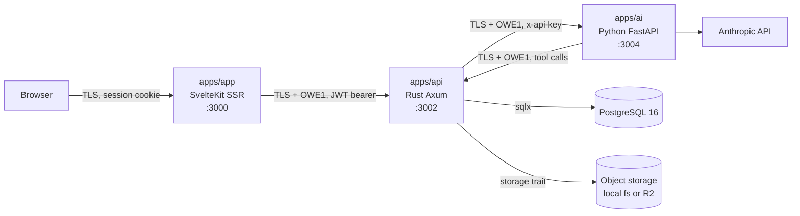

# Architecture

Status: draft v0.1, 2026-11-02. Part of the [oewang docs](README.md). Implements [PRD](prd.md) PLT-1 to PLT-5.

This doc describes the shape of the system: the three apps, what each one owns, how a request travels, and every decision that produced that shape.

## Update this doc when

- Adding, removing or renaming an app or a Rust crate.
- Changing a request lifecycle, in particular the chat stream path.
- Changing what a process is allowed to talk to.
- Making a decision worth keeping. Add it to the [decision log](#decision-log).
- Changing how the apps are built or run in production. The detail lives in [deployment.md](deployment.md); the shape belongs here.

## System context



Four rules hold the shape together.

1. **The API is the only process with a database connection** (D3, PLT-2). The AI service is never given a `DATABASE_URL`.
2. **The AI service performs side effects by calling back into the API** (D4, PLT-3). It holds no storage credentials and no user JWT.
3. **The browser never talks to the API or the AI service** (D5, PLT-4). SvelteKit server routes are the only client of the API.
4. **Every body on the two service hops is encrypted at the application layer** with OWE1 (D22, SEC-1), on top of TLS. Specification in [payload encryption](api/encryption.md). The browser hop stays on TLS alone for v1 (D26), for the reason given in [which hops are protected](api/encryption.md#which-hops-are-protected).

## What each app owns

| App | Stack | Owns | Does not own |
|---|---|---|---|
| `apps/app` | SvelteKit 3, Svelte 5 runes, Tailwind 4, shadcn-svelte | Rendering, the session cookie, form handling, proxying to the API | Business rules, database access, LLM calls |
| `apps/api` | Rust, Axum, sqlx, tokio | Every business rule, all database access, file storage, tool execution, audit logging, async jobs | Prompt construction, LLM calls |
| `apps/ai` | Python 3.13, FastAPI, Anthropic SDK | System prompts, the tool loop, streaming, receipt OCR, statement extraction, title generation | Database access, storage, authorization decisions |

### Landed versions

Recorded at scaffold time (US-001, 2026-11-02) so later drift is visible. The docs name the major version; these are what the lockfiles resolved to.

| Component | Version |
|---|---|
| Rust | 1.x via the `rust:1-bookworm` image, `rust-version` pinned at 1.84 |
| Axum | 0.8 |
| sqlx | 0.8 |
| SvelteKit | 3.0 |
| Svelte | 5.57 |
| Vite | 8.3 |
| TypeScript | 6.0 |
| Tailwind | 4.3 |
| Bun | 1.3 |
| Python | 3.13 |
| FastAPI | 0.162 |
| Pydantic | 2.14 |
| anthropic | 2.3 |
| PostgreSQL | 16.15 |

One deviation from the plan: `httpx` is pinned below 1.0, because only pre-releases satisfy `>=0.30` today.

## Repo layout

```
oewang/
├─ apps/
│  ├─ app/              SvelteKit web app
│  ├─ api/              Rust cargo workspace
│  └─ ai/               Python service, uv managed
├─ docs/                this documentation
├─ infra/
│  └─ docker-compose.yml   PostgreSQL 16, MinIO
├─ references/
│  └─ oewang-old/       the previous implementation, read-only
├─ .env.example
├─ CLAUDE.md
└─ README.md
```

There is no shared package layer (D18, PLT-5). The apps agree on HTTP contracts documented in [api/endpoints.md](api/endpoints.md), not on imported types. A generated OpenAPI client is a later optimization, not a day-one requirement.

## Rust crate layout

```
apps/api/
├─ Cargo.toml              [workspace]
├─ crates/
│  ├─ server/              binary: router, middleware, extractors, main()
│  ├─ domain/              types, errors, money, role and permission rules
│  ├─ db/                  sqlx pool, repositories
│  └─ clients/             HTTP clients: ai-service, storage
└─ migrations/             sqlx SQL migrations
```

Layer flow, carried over from the old ElysiaJS discipline, which was sound:

```
Router -> Auth extractor -> Handler -> Service -> Repository -> PostgreSQL
```

- **Handlers** parse, validate and map to HTTP. Nothing else.
- **Services** hold business rules and are the only layer that opens a database transaction.
- **Repositories** are the only code that imports `sqlx`.
- **`domain`** has no dependency on `db` or on Axum, so rules are unit-testable without a database.

The detailed rules are in [Rust API best practices](best-practices/rust-api.md).

## Request lifecycles

### Page load

```
Browser
  -> SvelteKit +page.server.ts load
     reads the session cookie
     fetch(API, Authorization: Bearer <jwt>)
  -> API: auth extractor -> handler -> service -> repository -> PostgreSQL
  <- JSON envelope
  <- SSR HTML
```

### Mutation

```
Browser (form action or +server.ts)
  -> SvelteKit server
  -> API: auth extractor -> role guard -> handler -> service
     BEGIN
       SELECT ... FOR UPDATE on affected wallets
       write rows
       write audit_logs row
     COMMIT
  <- JSON envelope
  <- redirect or invalidated load
```

The audit row is written inside the same database transaction as the mutation (D14, OPS-1). The old app wrote it after commit, which could drift from reality when the commit failed.

### Chat stream

```
Browser (fetch with a streaming body reader)
  -> SvelteKit /chat/stream
     attaches the JWT from the cookie
     opens each sealed event and writes it on in the clear, event by event
  -> API POST /v1/ai/chat/stream
     verifies the JWT, resolves workspace_id and role
     loads session history, wallets and categories
     persists the user message
     POST to the AI service with x-api-key and an explicit workspace context
     opens each event from that hop and re-seals it for the web app
     persists the assistant message when the stream ends, or the partial
     reply when the caller disconnects
  -> AI service POST /chat/stream
     builds the system prompt
     runs the Claude tool loop, at most 8 rounds
     for each tool call: POST API /v1/internal/tools/execute
     emits SSE events: token, tool_call, tool_result, receipt_draft, done, error
```

Buffering is disabled at every hop. The event protocol is specified in [AI service](ai/service.md#streaming-protocol); only the chat UI parses it.

### Receipt OCR

```
Browser uploads an image
  -> SvelteKit
  -> API POST /v1/vault/files           chunked; store the bytes, insert a vault_files row
  -> API POST /v1/ai/receipt/parse      body is { vault_file_id }, never the bytes (D69)
       API reads the chunks back, base64s them
       -> AI  POST /receipt/parse       the quality ladder, with no tools at all (D24)
       <- draft plus a quality score
       API checks the arithmetic in Rust: items sum, subtotal plus tax,
       unit price times quantity, the date, the currency (D30, AI-7)
  <- draft, quality, and what arithmetic replaced. Nothing persisted
  Browser shows the confirmation sheet, user edits
  -> API POST /v1/transactions          items, attachment_ids and source: "receipt" (D72, D74)
```

The draft is never auto-committed (AI-2). The bytes travel to the model from the vault rather than from the request, because a 1 MB body cannot carry a 10 MB receipt and the file has to be stored anyway: it stays attached to the transaction the user confirms.

### Telegram

```
API poller task (one per process, D84)
  -> Telegram getUpdates, 50 s long poll
  <- updates; claim each update_id in telegram_updates (once, ever)
     queue per chat, so one chat's messages run in order

  /start <token>    claim the hashed one-time token, link the private chat
                    to its member (D85)
  photo or PDF      look up the link by chat id and sender, re-read the role
                    -> download from Telegram's file host (size capped)
                    -> vault begin / put_chunk / complete, in process
                    -> parse_receipt exactly as the web flow (no tools, D24)
                    -> AI POST /receipt/categorize  strings only, no tools
                    -> create_with_items, source "telegram" (D86)
                    -> sendMessage: the saved transaction, this month's
                       totals, a button per category and Delete
  button tap        re-read link, sender and role; ids looked up in the
                    link's workspace; recategorise or soft-delete; edit
                    the message in place
  text              begin_turn on the link's conversation, channel
                    "telegram"; the stream pump runs with no crypto
                    context and the reply is collected, reduced to plain
                    text and sent
```

Inbound needs no route. Telegram is asked, never told, so there is no public endpoint, no webhook secret and no plaintext exception to OWE1. The cost is that exactly one process may poll a bot, which D75 already makes true.

### Async statement import

```
Browser uploads a statement, then picks the wallet it belongs to
  -> API POST /v1/transactions/import   { vault_file_id, wallet_id }
     insert transaction_import_jobs row (status pending, carrying the file id)
     spawn a tokio task
     return 202 { job_id }
  tokio task:
     POST (AI) /import/extract          also with no tools at all
     shape each row into the CSV wizard's own RawRow and hand the batch
       to service::import_rows, so fingerprinting, duplicate counting,
       per-row rate resolution, wallet locking and the audit rows are the
       ones that path already proves (D70)
     a failed row is counted as skipped, never aborts the job
     write back the three counts, plus a per-row review list
  Browser polls GET /v1/transactions/import/:job_id every 2 seconds
```

The old app ran this in a Go worker (D10). A tokio task is enough at this size, and the job row keeps the same polling contract, so the UI is unchanged.

One thing worth knowing before changing it: the rows of one import commit in **one** database transaction, not one each. That is inherited from the CSV path, which is the point of reusing it, and it is a real trade-off. A row that cannot be read is filtered out before the statement runs and a row that cannot be written is counted as skipped, so neither takes the batch down; but a database-level failure rolls the whole import back rather than leaving half a statement in the ledger. At 5,000 rows that is also a long hold on the wallet row's lock. If a file ever grows past what one transaction should carry, the answer is to chunk the batch, not to give each row its own transaction and lose the all-or-nothing property.

## Configuration

All configuration comes from environment variables, validated at startup. A missing required variable fails the process immediately rather than at first use.

| Variable | Used by | Notes |
|---|---|---|
| `DATABASE_URL` | api | PostgreSQL connection string. Never set on the AI service (D3). |
| `JWT_SECRET` | api, app | HS256 signing secret, at least 32 characters. |
| `ACCESS_TOKEN_TTL` | api | Access JWT lifetime, default 15 minutes (D38). |
| `REFRESH_TOKEN_TTL` | api | Refresh token lifetime, default 30 days. |
| `RESEND_API_KEY` | api | Transactional email, for password reset (D40). |
| `EMAIL_FROM` | api | Sender address on a DNS-verified domain. |
| `FX_API_URL` | api | Exchange rate source, default `https://api.apilayer.net/exchangerate` (D96). |
| `FX_ACCESS_KEY` | api | Key for the rate source. Without it no rates are fetched and the ladder works from the cache (D96). |
| `TELEGRAM_BOT_TOKEN` | api | Optional. The bot's token from BotFather. Unset, there is no poller and the Apps page says Telegram is not set up (D84). Set without the username, the API refuses to start. |
| `TELEGRAM_BOT_USERNAME` | api | The bot's username without the `@`, for the deep link. Required when the token is set. |
| `TELEGRAM_API_URL` | api | Default `https://api.telegram.org`. Only a test changes it. |
| `API_URL` | app | Base URL of the API, server-side only. |
| `APP_URL` | api | Used for invite links. |
| `AI_SERVICE_URL` | api | Base URL of the AI service. |
| `AI_SERVICE_API_KEY` | api, ai | Shared service-to-service key. |
| `API_INTERNAL_URL` | ai | Base URL the AI service calls back on. |
| `AI_BASE_URL` | ai | Where the model lives. Empty calls Anthropic directly; a gateway speaking the Anthropic protocol goes here (D67). |
| `AI_API_KEY` | ai | Key for whichever of the two `AI_BASE_URL` selects. |
| `AI_CHAT_MODEL` | ai | Model id as the provider or gateway names it. Default `claude-sonnet-5-5`. |
| `AI_VISION_PRIMARY` | ai | Default `claude-haiku-5-5`. Pass 1 of the [extraction ladder](ai/service.md#extraction-quality-ladder) (D36). |
| `AI_VISION_SECONDARY` | ai | Default `claude-sonnet-5-5`. Pass 2 and targeted re-extraction. |
| `AI_VISION_TERTIARY` | ai | Default `claude-opus-5`. Pass 2 when pass 1 scored very low. |
| `AI_QUALITY_THRESHOLD` | ai | Default 70. The score at which the ladder stops escalating. |
| `AI_EXTRACTION_BUDGET_MS` | ai | Default 45000. Wall-clock budget per document. |
| `AI_MAX_STEPS` | ai | Tool-loop cap, default 8 (CHAT-5). |
| `CHAT_MAX_TOOL_AMOUNT` | api | The ceiling on an amount one chat tool call may write, in the wallet's own currency. Default `100000000`. A parse error that shifts a decimal point stops there (D25). |
| `AI_REQUEST_TIMEOUT_SECS` | api | How long one AI service call may take, default 60. |
| `RATE_LIMIT_PER_MINUTE` | ai | Requests per caller per minute, default 600. |
| `HANDSHAKE_RATE_LIMIT_PER_MINUTE` | ai | The lower ceiling on the handshake, default 30. |
| `CRYPTO_SIGNING_KEY_FILE` | api, ai | Ed25519 private key, PKCS#8 PEM, mode `0600`. Each service signs its own handshake, so each holds its own key. Created on first start in development (D22). |
| `CRYPTO_SIGNING_PUBLIC_KEYS` | app | The API's pinned public keys, `kid:base64url` pairs. A production client with none refuses to start. |
| `AI_SIGNING_PUBLIC_KEYS` | api | The AI service's pinned public keys, same format. Required in production. |
| `OWE1_ENABLED` | api, app, ai | Default true. Plaintext mode only when `APP_ENV=development` on localhost. |
| `STORAGE_BACKEND` | api | `local` or `s3`. |
| `STORAGE_LOCAL_PATH` | api | Used when the backend is `local`. |
| `S3_*` | api | Endpoint, bucket, region, key pair, used when the backend is `s3`. |

Every variable is listed with an example in `.env.example` at the repo root.

## Local development

```bash
docker compose -f infra/docker-compose.yml up -d   # PostgreSQL 16, MinIO
cd apps/api && sqlx migrate run && cargo run       # :3002
cd apps/ai  && uv run fastapi dev                  # :3004
cd apps/app && bun run dev                         # :3000
```

A seed command creates a demo workspace with wallets, categories and sample transactions (CAT-3).

## Deployment

Three containers plus PostgreSQL on Coolify, on the existing Hostinger VPS, matching the other projects on this machine (D41). Files live in Cloudflare R2.

- `apps/app` and `apps/api` are public. `apps/ai` is reachable only from the internal network.
- Internal API routes (`/v1/internal/*`) are additionally gated by the service API key (OPS-6). They are not routable from the internet.
- Files live in Cloudflare R2 in production.
- A production image per app: `apps/api/Dockerfile`, `apps/ai/Dockerfile`, `apps/app/Dockerfile`. Multi-stage, unprivileged, with no compiler or package manager in the image that runs.
- **One instance of each service, one worker** (D75). Crypto sessions, per-turn tool budgets, rate limit windows and in-flight imports all live in process memory.
- The whole of it is in [deployment.md](deployment.md), including what is still undecided.

## Decision log

Each decision is permanent unless superseded by a later numbered decision.

| ID | Date | Decision | Why |
|---|---|---|---|
| **D1** | 2026-11-02 | Rewrite rather than trim the old repository. | Twelve feature areas across seven apps are coupled through a shared Drizzle schema. Deleting ten of them is more work than rebuilding two. |
| **D2** | 2026-11-02 | Three apps: SvelteKit, Rust Axum, Python FastAPI. | The owner wants Rust and Svelte. Python keeps the LLM SDK ecosystem, which is where that work is easiest. |
| **D3** | 2026-11-02 | The API is the only process with a database connection. | In the old app, the API, the AI service and the Go worker all wrote to Postgres. Workspace scoping, balance arithmetic, soft delete and audit logging were implemented twice and had drifted. |
| **D4** | 2026-11-02 | The AI service executes tools by calling back into the API. | Follows from D3. One place enforces role checks and writes audit rows. |
| **D5** | 2026-11-02 | SvelteKit SSR acts as a BFF. The browser never calls the API directly. | Keeps the session token out of client JavaScript and gives one place to attach it. |
| **D6** | 2026-11-02 | The session is a JWT in an `httpOnly` cookie set by the SvelteKit server. | Same model as the old app, which worked. |
| **D7** | 2026-11-02 | Keep multi-workspace with roles `owner`, `admin`, `member`. | Owner's decision. Household and small-team use is a real case. |
| **D8** | 2026-11-02 | Carry the full transaction and chat schema from the old app; drop the other domains. | The old schema was tuned against real queries. Reinventing it would lose that for nothing. |
| **D9** | 2026-11-02 | ~~Drop application-layer payload encryption. TLS only.~~ **Superseded by D22 on 2026-11-02.** | Reversed the same day at the owner's request. The original reasoning applied to the old app's static shared key, not to a handshake-based scheme. |
| **D10** | 2026-11-02 | No background worker. Async work runs as tokio tasks inside the API. | One async job remains (statement import). A separate Go service for it is not worth the operational cost. |
| **D11** | 2026-11-02 | Claude is the LLM provider (A1). | Already the house default. Tool use and vision both fit the two needs here. |
| **D12** | 2026-11-02 | Money crosses the wire as a string, never a number. | `decimal(19,4)` in Postgres round-tripped through a JavaScript `number` loses precision silently. |
| **D13** | 2026-11-02 | Lock wallet rows with `SELECT ... FOR UPDATE` during a balance change. | The old app did not lock. Two concurrent edits to one wallet could interleave and produce a wrong balance. |
| **D14** | 2026-11-02 | Write the audit row inside the mutation's database transaction. | The old app logged after commit. A failed commit left a log row describing something that never happened. |
| **D15** | 2026-11-02 | English only, resolved through a dictionary. | The owner wants one language now and a second later without touching call sites. |
| **D16** | 2026-11-02 | The database starts empty. No migration from the old app (A2). | Confirmed on 2026-11-02: there is no production data in the old app worth carrying. No migration story. |
| **D17** | 2026-11-02 | Eleven chat tools, down from thirty-four. | The other twenty-three belong to features that are out of scope. |
| **D18** | 2026-11-02 | No shared code package between the apps. They speak HTTP. | Three languages. A shared package would only be possible between two of them, and would reintroduce the coupling D1 is removing. |
| **D19** | 2026-11-02 | File storage sits behind one trait: local filesystem in development, S3-compatible in production (A3). | Keeps development free of cloud credentials. |
| **D20** | 2026-11-02 | A chat delete needs a confirmation turn. | A model that misreads "remove that" should not be able to soft-delete a row on the first turn. |
| **D21** | 2026-11-02 | Email and password only. No OAuth providers. | Three providers in the old app, each with its own callback path and edge cases, for a feature nobody asked to keep. |
| **D22** | 2026-11-02 | Encrypt every request and response body at the application layer, with OWE1: per-session X25519 and HKDF, AES-256-GCM per direction, Ed25519-signed handshake, AEAD binding and replay protection. Supersedes D9. | Owner's requirement. The scheme fixes what made the old app's version pointless: ephemeral per-session keys instead of one static shared key, forward secrecy, and binding of each message to its method, path, request ID, timestamp and status. Full specification in [payload encryption](api/encryption.md). |
| **D23** | 2026-11-02 | File bytes are served through the API in encrypted chunks. No signed object-storage URLs. | A signed URL puts receipt bytes outside the envelope and leaks the URL into history and logs. The cost is API bandwidth and no CDN for file delivery, which is accepted ([file bytes](api/encryption.md#file-bytes)). This changes VLT-3 as originally written. |
| **D24** | 2026-11-02 | The component that reads attacker-controlled text has no tools. The component that has tools never reads raw attacker-controlled text. | Receipts and bank statements are text somebody else controls, and the assistant can write to the ledger. Extraction calls pass no tools at all, so an injected instruction has nothing to call ([AI safety](security/ai-safety.md)). |
| **D25** | 2026-11-02 | Blast-radius caps per chat turn, enforced in the API: 3 write calls, 1 delete, 3 transactions created, an amount ceiling. No bulk write tools exist. | A prompt instruction is a preference. A cap in the API is a rule. It holds when the model fails ([blast radius](security/ai-safety.md#layer-2-blast-radius)). |
| **D26** | 2026-11-02 | The browser-to-SvelteKit hop stays on TLS alone (option 1A). Confirmed by the owner on 2026-11-02. | Under SSR, page data reaches the browser inside rendered HTML, which cannot be encrypted and still render. Encrypting only the JSON surface while the same rows travel in plaintext HTML would be a mislabel, not a control. The web app and the API sit behind the same proxy, so the two hops share a trust boundary in practice. Revisit if the web app is ever served from a CDN that terminates TLS ([which hops are protected](api/encryption.md#which-hops-are-protected)). |
| **D27** | 2026-11-02 | The model never does arithmetic. Every number is computed in Rust, formatted, and handed to the model as a prepared value. | A finance assistant that computes its own totals will eventually be confidently wrong, and the error looks plausible. Midday's insight pipeline does all maths in code and lets the model write only prose ([research](research/midday.md#5-insights-the-model-writes-prose-never-numbers)). P3. |
| **D28** | 2026-11-02 | CSV and spreadsheet import: one model call maps **columns**, never rows. Every row is transformed by deterministic code. | Removes the class of "the model misread an amount" entirely, and costs one small call per file at any row count. The old plan sent whole statements to a model ([research](research/midday.md#31-the-csv-path-the-model-maps-columns-never-rows)). P1. |
| **D29** | 2026-11-02 | Every imported transaction carries a deterministic content fingerprint used as a natural key, unique per workspace. | Re-importing the same statement becomes a no-op instead of a doubled ledger. Neither the old app nor the plan had anything preventing that ([research](research/midday.md#32-deterministic-deduplication)). P2. |
| **D30** | 2026-11-02 | Extraction output passes through cross-field consistency checks and arithmetic fixes, in code, before the user sees it. | A vision model misreading one digit in a total is the most common receipt error, and summing the line items catches it without another model call. P4. |
| **D31** | 2026-11-02 | The chat canvas is the real application component mounted in a side panel, driven by URL parameters. No artifact schema, no model-authored UI. *Partly superseded by D88: the analysis canvases have an artifact schema; nothing the model writes is rendered, which still holds.* | Strictly less code than a bespoke canvas, and it cannot drift from the real editor. The old oewang built the opposite and paid for it in `components/organisms/chat/canvas/` ([research](research/midday.md#2-the-canvas)). P11. |
| **D32** | 2026-11-02 | A tool-name to cache-invalidation map in the web app invalidates the derived surface, not only the written table. | oewang has no realtime channel, so a chat write otherwise leaves every other view stale ([research](research/midday.md#17-cache-invalidation-after-a-tool-write)). P5. |
| **D33** | 2026-11-02 | Assistant output uses an entity deep-link scheme (`[Name](#txn:ID)`) that the Markdown renderer intercepts. | Turns an answer into an index instead of a dead end, for one regex and one prompt block. P6. |
| **D34** | 2026-11-02 | Tool results are a compact projection of the row, truncated to a byte budget that sets an explicit `truncated` flag. | A database row is the wrong shape and the wrong size for a model. Direct token cost on every turn. P7. |
| **D35** | 2026-11-02 | No embedding-based tool selection. All tools stay in the prompt until the catalog passes roughly 25. | Midday needs a semantic selector at roughly 90 tools. oewang has 11. The machinery would be cost with no benefit ([research](research/midday.md#12-semantic-tool-selection)). P17. |
| **D36** | 2026-11-02 | Extraction runs a quality ladder: a cheap model first, a computed quality score, escalation to a stronger model only when the score is poor, then targeted re-extraction of only the bad fields. Bounded by a call cap and a wall-clock budget. | Most receipts are easy and do not need the most capable model on every upload. Escalating on evidence rather than on principle cuts the common-case cost without lowering the worst-case result ([ladder](ai/service.md#extraction-quality-ladder)). The budget is oewang's addition: the receipt flow is synchronous, so a ladder that runs long is a spinner the user is watching. P13. |
| **D37** | 2026-11-02 | A wallet has its own currency, defaulting to the workspace currency. Its balance is denominated in it. A transaction may additionally be entered in a third currency, converted once at entry. Every row stores `base_amount` in the workspace currency for reporting. | Owner's decision on Q1, settled after two passes through a single-currency alternative. The default keeps the ordinary case free of ceremony: a workspace that never adds a foreign wallet never sees any of it. The per-wallet currency is what lets a USD account reconcile against its own statement, which a workspace-currency-only balance cannot do. `base_amount` keeps every report a plain sum, so the performance target survives ([multicurrency](data-model.md#multicurrency)). **Amended by D105:** an owner may convert the workspace currency at one rate after the first transaction. |
| **D38** | 2026-11-02 | Sessions are a 15 minute access JWT plus a 30 day refresh token, rotated on every use, with family revocation on reuse. Supersedes the 7 day static token. | Answer to Q2. The old app's token could not be revoked and a stolen copy was good for a week. Rotation turns theft into a detectable event ([rotation](security/auth.md#rotation-and-reuse-detection)). |
| **D39** | 2026-11-02 | Exchange rates are prefilled from an API and editable by the user. The rate actually used is stored on the transaction row. | Answer to Q1. A bank's rate is not the market rate, so a locked automatic rate is wrong at the cent level on every foreign transaction. Storing the rate on the row means history does not move when today's rate does. |
| **D40** | 2026-11-02 | Transactional email goes through Resend. | Answer to Q3. One API key and a DNS verification. SES fits the existing AWS account but needs a sandbox exit and is not available in Jakarta, for a feature that sends a few password resets a month. |
| **D41** | 2026-11-02 | Deployment is Coolify on the existing Hostinger VPS, with Cloudflare R2 for files. | Answer to Q6. Same pattern as the other projects on this machine, already covered by an existing deployment skill. |
| **D42** | 2026-11-02 | Statement import accepts both images and PDFs. A PDF with a text layer is parsed deterministically first; vision is the fallback. | Answer to Q5. Text extraction from a real PDF is cheaper and more accurate than looking at a picture of it, and it fits the ladder's principle of escalating only on evidence. |
| **D43** | 2026-11-02 | At write time the rate resolves in order: same currency, then the rate in the request, then the live source, then the newest cached rate, then `FX_RATE_UNAVAILABLE`. **Step 3 restated by D96:** "live" is now the day's stored snapshot; no write calls the source. A write never fails while any cached rate exists. | Owner's decision. Recording an expense must not depend on a third party's uptime. The accepted cost is that a stale rate can be used; it is mitigated by storing `base_rate_source` and `base_rate_date` and marking such a row in the UI, so the drift is visible rather than silent ([rate resolution](data-model.md#rate-resolution-at-write-time)). |
| **D44** | 2026-11-02 | Exchange rates come from exchangerate.host, pulled by a daily job into the `exchange_rates` cache. **Superseded in part by D96:** the source and the per-pair pull changed; the daily job and the cache stand. | Free, no API key, and it serves historical dates, which the per-row import conversion in D45 needs. The rate stays editable by the user either way (D39). |
| **D45** | 2026-11-02 | An import converts each row with the rate for that row's own date. A row with no rate available is skipped and reported, never failing the file. | A statement spans months, so one rate for the whole file would be wrong for most of it. Skipping is consistent with how every other row-level import error is handled. |
| **D46** | 2026-11-02 | Audit rows are surfaced as a per-transaction history in the detail sheet, not as a workspace-wide activity page. | Answer to Q4. The question a user actually asks is "why is this number what it is", at the row they are looking at, and the answer matters most for writes the assistant made. |
| **D47** | 2026-11-02 | Port the old app's visual system literally: square corners, Hedvig Letters Sans and Serif, Geist Mono, 15px root, the bordered table grid. The radius scale is zero rather than stripping `rounded-*` from generated components. **Restated by D52 after a detour through a live scale.** **Primary restated by D99** (the brand green). | The old primitives carry no radius at all; matching them by zeroing the scale survives the next `shadcn-svelte add`, which would put the classes back. |
| **D48** | 2026-11-02 | ~~Keep a visible `:focus-visible` outline, against the old app's global rule.~~ **Superseded by D51 the same day.** | Raised as an accessibility concern, then reversed when the owner confirmed the exact match. |
| **D49** | 2026-11-02 | The Content-Security-Policy is issued by SvelteKit's own `csp` config, never by a hand-written header. | Only SvelteKit can nonce its own inline bootstrap script. A hand-written `script-src 'self'` blocks it and the app stops hydrating with no visible error, which is exactly what happened here. |
| **D50** | 2026-11-02 | The live app at `app.oewang.com` is the visual reference, not the `references/oewang-old` snapshot. Measure it, do not estimate from a screenshot. | The snapshot is older than production: its shell differs in sidebar width, header height and nav metrics. Every value in [measured reference](features/transactions.md#measured-reference) came from `getComputedStyle` on the live page. |
| **D51** | 2026-11-02 | ~~No focus indicator anywhere: `:focus` and `:focus-visible` set `outline: none`, matching the live app.~~ **Superseded by D62 the same day.** | Matched the live app at the cost of every keyboard user. The audit measured 64 tab stops on one page with no indication of where focus was. |
| **D52** | 2026-11-02 | ~~No radius and no shadow anywhere; the radius scale is zero at every step.~~ **Superseded by D66.** | The owner asked for square and flat, then, seeing it, asked for the old app's own shape rules instead, which are not the same thing: the scale is live and a handful of components are round. |
| **D53** | 2026-11-02 | The type scale is a set of role tokens (`--text-h1` to `--text-h4`, `--text-body`, `--text-small`, `--text-caption`), each carrying its own line height, weight and letter spacing, applied to `h1`-`h4` in the base layer. | Sizes were being spelled out per page as `text-lg font-medium tracking-tight`, which cannot be changed in one place and drifts. The values are the measured ones (D50); naming them by role is what makes them reusable. `h1` is the serif, at its only weight (400). |
| **D54** | 2026-11-02 | A focused field turns its border `primary`, on `:focus` rather than only `:focus-visible`. Every `ring-*` and `shadow-*` class is removed from the components, so a computed `box-shadow` reads `none` rather than a cleared-but-present shadow. | The owner asked for no box-shadow at all, and a ring is a box-shadow; `shadow-none` is not enough, because Tailwind composes it from custom properties and leaves the property set. That removed the last thing that marked focus, so the border carries it instead. This is a partial answer to the cost recorded in D51: text fields, the select trigger, the input group and the checkbox now show focus, while buttons and links still do not. The design system page measures the focused border and counts every element whose `box-shadow` is not `none`. |
| **D55** | 2026-11-02 | View state is held in the URL query string, not in component state (UI-8). `src/lib/url-state.ts` has the two helpers: `readParam`, which constrains a value to what the page accepts, and `writeParams`, which replaces the history entry unless a step is wanted. | A filter that lives in a component is lost on refresh and cannot be shared, which is the complaint that prompted this. Reading the URL back is also what makes `?tab=nonsense` harmless: a URL is user input. Replacing rather than pushing keeps a search box from leaving one back-button step per keystroke; `push: true` is for a step a user would expect to undo, such as paging. |
| **D56** | 2026-11-02 | Components are organised by atomic design, in `atoms/`, `molecules/` and `organisms/`, mirroring the old app's `packages/ui/src/components` one to one. `components.json` points shadcn-svelte's `ui` alias at `atoms/`. | The old package already splits this way, so the same split makes a port a move rather than a redesign, and makes it obvious where a new component belongs: an atom that would know what a wallet is, is a molecule. The alias change keeps generated components landing in the right layer. What was ported and what was deliberately left is listed in [component organization](best-practices/svelte-app.md#component-organization); the short version is that charts, the React-only pieces and the out-of-scope features did not come across, and the chat surface lands with M4. |
| **D57** | 2026-11-02 | The transactions table is laid out the way the old `organisms/data-table` lays its tables out: a flex row of fixed-width cells per record, 45px tall, the last visible column flexing to fill, the rule on the cell, and the header in its own sticky block. Column widths come from the old `STICKY_COLUMNS.transactions`. TanStack Table, row virtualisation, column drag and drop and the resize handle are **not** ported. **Partly superseded by D60** (the resize handle is built) and **by D76** (row virtualisation and column reordering are adopted, written here rather than taken from a library). | The old layout is what keeps columns aligned while the body scrolls sideways, and a browser-sized table cannot do it, which is why the first attempt looked untidy next to the original. The four pieces left out are a dependency and roughly two thousand lines for behaviour this table does not have yet; US-017 can add them when the row count calls for it. |
| **D58** | 2026-11-02 | The filter bar is the old `organisms/data-table-filter`: one search field with the magnifier inside it on the left and the filter menu inside it on the right, and a row of chips underneath, one per applied value, each clearing itself on click. | The first version put every filter in its own button beside the search box, which does not scale past two filters and is not what the product looks like. The chip list is also the only part that shows what is filtering at a glance. |
| **D59** | 2026-11-02 | ~~A table cell is edited in place by expanding it into an input drawn over its neighbours.~~ **Superseded by D60 the same day.** | Built from a misreading of "expanded cell", confirmed wrong when the owner saw it: what was meant was a column the user can widen, not a cell that becomes an editor. The description and the amount are plain text again. |
| **D60** | 2026-11-02 | "Expanded cell" means a **resizable column**: every data column carries a 4px handle on its right edge, dragging it changes that column's width and a double click puts it back. Four columns are **sticky**: select, date and description to the left at offsets 0, 50 and 160, and actions to the right. Widths, order and stickiness were measured on app.oewang.com, not guessed: select 50, date 110, description 320, amount 170, account 200, category 161, actions 100. Every cell carries a rule on its right as well as under it, except the last column. | Measured directly on the live table after two wrong readings: the header cells report `position: sticky` with those exact left offsets, the actions header reports `right: 0`, and each resizable header holds a 4px child with `cursor: col-resize`. A sticky offset is the sum of the sticky columns before it, so hiding or resizing one moves the rest, which is why the offsets are computed rather than written down. |
| **D61** | 2026-11-02 | The account and category cells use ported `select-account` and `select-category` molecules, not a generic combobox. In a table they take the old app's own class string, `ghost`, `h-full w-full justify-start border-none px-3 hover:bg-transparent`, with the chevron pinned at the right edge, the landmark mark or the category's colour square beside the name, and the spinner overlay the old cell shows while a change is in flight. They take their options as a prop. | Asked for directly. The generic combobox looked like a control dropped into a cell; these fill the cell and read as part of the row, which is what the old table does. The old components fetch their own lists with react-query; here a component that fetches is a mistake (component organization), so the page loads them once and every cell shares the list. One deliberate difference from the live app: its picker is 33.75px inside a 45px row, while the old source gives it the cell's full height, and the owner asked for the old behaviour. |
| **D62** | 2026-11-02 | ~~A visible focus ring on `:focus-visible`, with fields exempt.~~ **Superseded by D66.** | Reversed D51 on the audit's evidence, then reversed again when the owner asked for the old CSS verbatim. The old rule suppresses focus everywhere, and the cost is recorded in UI-7. |
| **D63** | 2026-11-02 | ~~Colour tokens set from measured contrast: `--green`, `--red` and `--input` darkened.~~ **Partly superseded by D66**: the colour values go back to the old app's, and the literals-to-tokens half stands. | The measurements were right (2.30:1 and 3.91:1 against a 4.5:1 requirement) and the owner chose the old look anyway. The gap is recorded rather than hidden. |
| **D64** | 2026-11-02 | Motion is opt-in: one base rule collapses animation and transition durations under `prefers-reduced-motion: reduce`. | Ten components animate and nothing guarded them. Two of those animations never stop, the skeleton shimmer and the spinner, which is also why this is one blanket rule rather than a guard per component. |
| **D65** | 2026-11-02 | The transactions table carries `role="table"` and `role="rowgroup"` around its rows, the row itself is not a widget (no `tabindex`, no `aria-expanded`), and the column resize handle is a `button` that answers Arrow keys and Home. | A `role="row"` with no table ancestor is dropped, so the whole table reached a screen reader as unlabelled divs with no column names or counts. The row's click stays as a pointer convenience, and the chevron button beside the description carries the name, the state and the keyboard path. Resizing was pointer-only, which is no control at all for a keyboard user; arrows step 16px, Shift steps 64px, Home resets. |
| **D66** | 2026-11-02 | The design system is the old app's, copied: `packages/ui/src/globals.css` values verbatim (radius `0.5rem` scale, `--green: 142 71% 45%`, `--red: 358 75% 59%`, `--input: 240 5.9% 90%`, shadows where only `sm` paints, the `*:focus { outline: none !important }` rule), and each component's own radius, shadow and ring classes as its old source carries them: a pill badge, a round avatar, switch, radio, progress and kbd, a `rounded-md` toggle, a 10px dialog and sheet. | The owner reviewed the squared-and-flattened version and rejected it. The old scale being live while almost nothing applies it is the actual rule, and the same for shadows: a component keeps its `shadow-md` class and paints nothing because the token is `none`. This knowingly reinstates two audit findings, the contrast gap on amounts and the absent focus indicator, both recorded in UI-7. What the audit found that does **not** touch the look is kept: the table's roles, the keyboard path for column resizing, the reduced-motion rule, the `main` landmark, the type scale and the semantic tokens, which hold the same values the old literals did. |
| **D67** | 2026-11-03 | The model is reached through `AI_BASE_URL`, a gateway speaking the Anthropic protocol, rather than Anthropic's endpoint directly. The SDK, the tool loop and the extraction ladder are unchanged; the model id is whatever the gateway calls it. | The owner runs 9Router, which fronts many providers behind one endpoint, so a model outside the Claude family becomes a configuration change rather than a second client. D11 stands for what the code is written against: the protocol, the tool-use shape and the vision calls are still Anthropic's, and a provider the gateway cannot express in that shape is not reachable from here. Empty `AI_BASE_URL` keeps the direct path, which is what production uses unless a gateway is deployed with it. |
| **D68** | 2026-11-03 | Per-turn tool caps are counted against a `turn_id` the API mints in `begin_turn` and sends to the AI service with the turn. The service echoes it on every tool call and never mints one; the API refuses an id it did not mint. | A cap needs a unit to count against, and that unit cannot be something the counted party can manufacture. The alternative was to count against the chat session inside a rolling time window, and it was rejected because a window is not a bound anybody can reason about: set it short and a slow legitimate turn, one waiting on a vision pass or a chain of reads, is cut off part-way through work the user asked for; set it long and a fast second turn inherits whatever the first one left of the budget. An id minted where the turn begins has exactly the turn's lifetime, which is the thing the cap is actually about. Same reasoning as the `role` field being a claim the API re-checks rather than a fact ([blast radius](security/ai-safety.md#layer-2-blast-radius)). |
| **D69** | 2026-11-03 | A document reaches an extraction route as a `vault_file_id`, never as bytes in the body. The browser uploads it through the chunked vault path first, and `POST /v1/ai/receipt/parse` and `POST /v1/transactions/import` each name the file. | The body limit is 1 MB and a receipt is up to 10 MB (SEC-18, VLT-1), so bytes in the body would mean a second upload path with its own limit, its own type sniffing and its own storage. The vault already does all three, and the file has to be stored anyway: the receipt stays attached to the transaction the user confirms. The cost is that the client makes two calls instead of one, which it was already making. |
| **D70** | 2026-11-03 | The statement import path shapes the model's extracted rows into the same `RawRow` the CSV wizard produces and hands them to `service::import_rows`. It writes nothing of its own except the job row. | The two paths differ in exactly one way, that one is asynchronous, and everything else about them is the same problem: fingerprint each row, count a repeat as a duplicate rather than an error, resolve a rate for the row's own date, lock the wallet, write an audit row. A second implementation of that would be a second place for a duplicate to slip through. The extracted direction decides which of the two synthetic amount columns a figure lands in, so even the sign rule stays written once, in `csv_import::read_amount`. |
| **D71** | 2026-11-03 | `transaction_import_jobs` carries the `vault_file_id` it was read from. | A failed job keeps its document, and a retry re-reads it rather than asking the user to upload a statement again (AI-6). It also closes a gap in the record: the transactions a job created carry `source = 'import'`, but nothing said which document they were imported from. |
| **D72** | 2026-11-03 | A transaction and its line items are written in one database transaction, through `create_with_items`. The create body carries `items`; the item routes exist for editing one afterwards. | Confirming a receipt is a single act by the user. Expressed as a create plus six item calls it becomes six acts that can each half-fail, and a crash after the third leaves a transaction whose items do not add up and nothing recording why. Items move no money, so this changes no balance arithmetic (TXN-12). |
| **D73** | 2026-11-03 | A correction carries the figure the model gave, not only the name of the field: `corrected_fields: [{field, model_value}]`. | AI-11 asks that the user see which numbers the model read and which the code computed. A field name alone says a figure changed without saying from what, which is half the promise. `model_value` is null when the model gave nothing and arithmetic supplied the field outright: that is a different event and the sheet reads it differently. Rejected: carrying both a name list and a detail list, which would be two spellings of one fact. |
| **D74** | 2026-11-03 | The create body may claim a `source` of `web` or `receipt`, and nothing else. | The audit trail is worth only what its surface column is worth. `chat` and `import` are minted by the API's own paths, so a client naming one of them is either confused or lying; refusing both keeps the column a fact about the system rather than a value the client preferred. `web` and `receipt` are the two things a browser can truthfully be, and the difference between them is worth recording (OPS-8). |
| **D75** | 2026-11-03 | `api` and `ai` each run as exactly one instance with one worker, and a production image per app is built from its own `Dockerfile` (multi-stage, unprivileged, no compiler in the image that runs). | Four pieces of state live in process memory and are correct only while one process holds them: OWE1 crypto sessions, the per-turn tool budgets a cap is counted against (D68), the rate limit windows, and in-flight statement imports as tokio tasks (D10). A second instance does not degrade any of these gracefully; it breaks them intermittently, which is the worst way for them to break. This is a constraint to design around rather than a deficiency to apologise for: a Rust process doing database round trips has a long way to go vertically, and the day it runs out, moving sessions and budgets to shared storage is its own decision record. Recorded here because "just add a replica" is the obvious wrong move and nothing in the code says so. |
| **D76** | 2026-11-03 | **D57 is reversed in part.** Row virtualisation and column reordering are adopted, and both are written against this table's own row model. TanStack Table is still refused, and so are a virtualiser dependency and a drag and drop dependency. Net new browser dependencies: zero. | Four reasons, each kept because each is a proposal that comes back otherwise. First, the old app fabricates fake TanStack row objects, about a hundred lines of them, because grouping plus virtualisation does not fit that library's row model; adopting the library here means porting the workaround with it. Second, our sorting, column visibility, sizing and selection already work, and our column resize has a keyboard path (D65) that TanStack's `columnSizing` has not. Third, `@tanstack/svelte-virtual` 3.x is the store-era adapter, and what it buys is dynamic measurement, which this table does not need: a day group's height is analytic, `40` collapsed and `40 + rows * 45` expanded. Fourth, a drag and drop library would fight the resize handle's own pointer capture, since both want the pointer on the same header edge. The zero matters more here than it would on the server: [hardening](security/hardening.md#dependencies) weighs a browser dependency harder, because it runs in the same context as the session. |
| **D77** | 2026-11-03 | The amount filter on the transactions list compares on `base_amount`, the workspace's own currency, not on `t.amount`. `min_amount` and `max_amount` travel as strings and are parsed to `Decimal` (D12); absent and empty both mean no bound. | One bound has to mean the same thing across wallets. A list holding a USD wallet beside an IDR one has no single scale on `t.amount`, so "at most 50000" would match everything in one wallet and nothing in the other. Both the filter bar and the assistant speak in the workspace currency, so the column the bound compares on should be the one already converted at write time. The chat `search_transactions` tool shares this filter and so shares the change. Empty is not an error because a cleared filter sends `?min_amount=` rather than dropping the key, and a stale bookmark should still render a list. |
| **D78** | 2026-11-04 | Components are grouped by module and named after it: `organisms/<module>/<module>-<part>.*`, reached only through that folder's `index.ts`. Nothing under `molecules/` names a feature. **One table serves every screen**: `molecules/data-table` owns the scrollport, the geometry, the table roles, column resizing, the sideways arrows, group rows and the next-page trigger, and a caller passes columns plus `head`, `cell` and `groupRow` snippets; `TRANSACTION_COLUMNS`, `TransactionRow` and the day grouping live in `organisms/transactions/`. A molecule that needs the network takes it as a prop: the dropzone takes `upload`, the attachment view takes `load`, and `$lib/files.ts` holds the routes, the limits and the strings. The select is one molecule with `items` as a prop and two engines, searchable and plain. *Partly superseded by D90: `molecules/attachment-view` is gone, `molecules/file-preview` takes `load` in its place, and the dropzone also takes the picker's props. The rule that a molecule is handed its transport still holds.* | The owner asked for modular components with repeated names, and for the table to be the same component on every page. The first pass only shared the geometry constants: the accounts table rendered the shell while the transactions table carried its own copy of the scrollport, the sticky header, the resize handles and the arrows, 1116 lines of it, so the two could drift on exactly the part a reader would notice. Lifting those into the shell took that file to about 620 lines and left the accounts table at 180. Naming by module makes the owner visible in the path, and a barrel per folder means the next rename touches one file rather than every call site. The two fetching molecules were the other half of the same leak: they knew the transactions routes, which made a design-system piece unusable anywhere else and broke the rule that a component never fetches. The select had its trigger, panel and row assembled by hand at every call site, five class strings each. |
| **D79** | 2026-11-04 | A select whose options are data uses the app's own picker, never a native `<select>`. Each dynamic list gets a molecule of its own, named after what it picks: `select-account`, `select-category`, `select-group`, `select-currency`, `select-column`, each a thin wrapper over `molecules/select`, which a caller feeds domain data. `atoms/native-select` is kept for a list fixed in the source and for the `<noscript>` copy of a form, where a button that submits nothing is no use. | The owner opened the accounts table's group cell and got the operating system's drop-down: its own typeface, its own size, a tick glyph nobody chose, floating over the row in a colour this product does not use. None of that is styleable, so one cell in a design system the rest of which is measured to the pixel was drawn by the platform. The wrapper per list, rather than one generic picker at every call site, is what the account and category pickers already proved: the placeholder, the search text, the mark and the empty-value convention are stated once instead of at every call site, and a call site reads as what it picks. The cost is a small file per list and a hidden input wherever the value has to post, since the trigger is a button. The `<noscript>` exception keeps the no-JavaScript path honest rather than pretending a button can submit. |
| **D80** | 2026-11-04 | The workspace's own lists (wallets, groups, categories) load once in `(dashboard)/+layout.server.ts` and are published through context by `$lib/workspace-data.svelte.ts`. A picker given no list reads that context, so a call site is `<SelectCategory type="expense" creatable />`; a caller that passes a list still wins. `creatable` points the create row at `POST /workspace`, this app's own route, which calls the API with the session's token. | The owner asked for the lists and their create to live in the component rather than at every call site, and for one workspace's rows never to reach another. Three pages were each mapping the same three arrays, and every create row had to be wired by hand through two or three components; the accounts page carried a `createGroup` helper, the transactions page a `createNamed` helper and two extra form actions for the same job. Isolation is not a new control: the lists come from a server load and the create from a server route, both of which call the API with the cookie's token, and the workspace is a claim inside it (AUTH-4). Nothing the browser sends names a workspace, so a session cannot ask for another one's rows, and the context holds only what that session was served. The component still fetches no lists: it reads what the layout already loaded, and the one request it makes is a create the reader asked for. The context is read by the product pickers, not by `molecules/select`, which stays generic. |
| **D81** | 2026-11-05 | A list screen has one standard shape (header line, optional summary, the shared data table filling the rest, sheets and modals off the page, two empty states), every view choice lives in the query string, and sorting and paging are the server's. Separately: a component's look belongs to the component. A call site passes data, a documented variant, and only the classes that place it; colour, radius, shadow, border, font and padding overrides at a call site are a review failure, and a genuinely different look is a named variant with its own specimen. | Written down after the second list screen, because the first two had already drifted: the accounts table and the transactions table disagreed about the shell, and the group cell had a native control nobody had looked at. A standard shape makes the third screen a data problem rather than a layout one. The restyling rule has the same root. The shape rules are measured against the live app (D52, D66) and the design system re-measures them on every render; a class string at a call site is a value nothing measures, so it drifts silently and is only found by someone comparing two screens. Changing the component instead is the same edit, in the one place that is checked. |
| **D82** | 2026-11-05 | Settings is a sidebar plus one route per section, the old app's shape: `settings/+layout.svelte` puts `organisms/settings/settings-sidebar` at a fifth of the width beside the section, and `/settings` redirects to the first section. The sidebar lists the old app's sections in its order; a section not built yet is shown with a "Soon" tag and not linked, and a section that belongs to a non-goal (notifications, alarm, budget, billing, a second UI locale) is not listed at all. Income and expense categories are one route, `[type=category_type]-category` (the matcher is in `src/params.ts`), whose actions take the type from the path. The assistant tab became the Assistant section. Both sidebars render `organisms/layouts/layouts-sidebar-item`, so the active hatch is defined once. A settings section opens with a title, a description and a rule (`settings-section-header`). Supersedes the two-tab settings page. **Amended by D103:** budget is no longer a non-goal; the old budget section still is not listed, because budgets are managed on their own page. **Amended by D104:** no section is left "Soon"; Display, Transaction, Backup and Passcode are not listed. | The owner asked for settings to look like the old app's, sidebar and all, with every section shown. Tabs held two sections; a sidebar holds a dozen and is what users of the old app know. Listing unbuilt sections as "Soon" was the owner's call; leaving out the non-goal sections is not optional, because "Soon" on budget or billing promises a feature the PRD rejects. One route for both category types keeps one set of actions, and taking the type from the path means an income page cannot create an expense category whatever the form says. A settings section keeps a title although D81 drops it on list screens: the app sidebar only says "Settings", and the settings row alone does not say what the page edits. A category section is the old app's sortable table, not `molecules/data-table`: `atoms/table` with a drag handle, a pencil and a trash on each row (`settings-category-list`). The drag is written on pointer events rather than taking a drag library: the grabbed row follows the pointer, the others slide with a FLIP animation, and the arrow keys on the focused handle stand in for dnd-kit's keyboard sensor. The finished order posts once, through `reorderCategories`, which rewrites `sort_order` for that type. Reordering needs JavaScript, as it did in the old app; create, rename and delete still work without it. |
| **D83** | 2026-11-05 | Telegram is in scope: a member links a private chat from a new Apps page, receipts sent there are saved, and text there is the assistant. It moves out of the non-goals into PRD section 6.11 (TG-1 to TG-10) with milestone M7. Every other integration, webhooks, and the rest of the old Apps page stay non-goals. | The owner asked for it as the old app had it, receipts and chat both. It adds no feature of its own: the receipt path is the vault, extraction and transaction services the web uses, and the chat path is the same turn with a different last mile, so the controls are the ones already tested. The old implementation is not ported. Its link was `/start <workspace-slug>___<user-id>`, which let anyone who knew a slug act in that workspace as an arbitrary member, and it ran in the Go worker D10 removed. |
| **D84** | 2026-11-05 | The API long-polls Telegram from one tokio task rather than taking a webhook. Each update id is claimed in `telegram_updates` before it is handled, and a chat's updates run one at a time, in order. The feature is off when `TELEGRAM_BOT_TOKEN` is unset. | A webhook is a public route that cannot speak OWE1, so it would be a fifth plaintext exception, a secret header, a per-route rate limit that cannot be per address (every update comes from Telegram's own addresses), and a tunnel to develop against. Polling needs none of them and works on localhost. Its one constraint, a single poller per bot, is already the deployment's (D75). Acknowledging is asking for the next update, so a crash between handling and asking redelivers; the claim table is what makes that harmless, and a receipt is never saved twice. |
| **D85** | 2026-11-05 | A chat is linked by a one-time token minted for one member in one workspace: 32 random bytes as URL-safe base64 (43 characters, inside Telegram's 64-character `start` limit), stored as SHA-256, ten minutes, single use. Only a private chat, and only the Telegram account that opened the link, can act through it. One live link per member per workspace and per chat. Signing out everywhere, resetting the password and removing the member end it; every update re-reads the membership row. | The `password_reset_tokens` rules (AUTH-8), because the token is the same kind of thing: a bearer credential shown to one person. A group chat is refused because everyone in it would act as whoever linked it. Re-reading the role per update is what a tool call already does (CHAT-4), so a demotion reaches Telegram as fast as it reaches the web. Ending the link on a password reset follows from why a reset ends sessions: the old credentials may be someone else's, and a linked chat is a session that never expires on its own. |
| **D86** | 2026-11-05 | A receipt sent to the bot is saved on arrival, then answered with what was saved and buttons to recategorise or delete it (amends AI-2 and AI-11 for this channel). The category comes from a tool-less call over the merchant, the item names and the expense category names, kept only on an exact name match. Transactions saved from Telegram carry `source = 'telegram'` (amends D74). The bot sends plain text only, and the assistant is told so through a `channel` field on the turn. Deleting from a button takes a second tap. | The owner's reference was a bot that saves and then offers the fix, and in a chat a confirmation step is one more message for every receipt rather than one tap for the few that are wrong. What AI-2 protects is still protected: the extraction has no tools, the arithmetic is checked in Rust, a receipt with no readable total is never saved, and AI-11's flags become a "Please check" line. A category the model invents cannot match an id, so the worst outcome of a bad guess is a wrong label the reply shows with a button beside it. Plain text, because in Markdown mode a stray `*` from a receipt or the model fails the whole send; the prompt is told so that the answer is written for it rather than stripped after. Two taps to delete is D20's confirmation in the only shape a button has. |
| **D87** | 2026-11-05 | The overview is the front page, ported from the old app: a greeting, one range in `?from&to`, and two tabs in `?tab=`, figures and metrics. Its numbers come from one endpoint, `GET /v1/overview`, built by the same Rust report module the analysis canvases use. A question asked there creates a session and opens it; the first message is handed over in browser memory and sent by the conversation page. The chat page takes the old layout: header, centred column, floating composer, history behind the composer. | Owner's request to bring back the old overview and chat. The old overview turned itself into the chat in place, which made two chat screens; navigating to the session keeps one, and a reload of either page sends nothing twice. One report module for both surfaces means the overview and a canvas cannot disagree about the same month. The tracked balance stays in the app, because the accounts page already converts balances there and a second conversion path would drift. |
| **D88** | 2026-11-05 | Analysis canvases come back as typed artifacts: `spending`, `income` and `burn-rate`, one per call of three new read tools. The API builds the payload from the database, holds it in the turn store keyed by the model's tool call id, and its stream pump sends it as an `artifact` event right after that call's result. The payload never passes through the AI service, and an `artifact` event arriving from upstream is dropped. It is stored on the tool call in `ai_messages.attachments`. Supersedes D31 in part and the PRD non-goal "Canvas artifacts, chat charts". **Amended by D103:** a fourth kind, `budget`, from `get_budget_status`. | Owner's decision, choosing to port the old artifact system over an app-owned report panel. What made the old one risky is kept out: no figure is the model's (D27, the payload is the same report the model reads), no payload is model-authored or relayed through the hop the model's output crosses, and a kind the app does not know renders nothing. Debt and budget canvases stay out with their features. The stored payload is a snapshot of the answer, which is what a conversation is; the overview is where live figures are. |
| **D89** | 2026-11-05 | Charts use `layerchart` 2.x, wrapped once as `molecules/chart` (area, bar, donut), monochrome. An amount becomes a JavaScript number in one function, `chartValue`, for geometry only; every figure a reader sees is formatted from the decimal string. | The library shadcn-svelte's chart builds on, and the atoms here are shadcn-svelte ports. A pixel height is a float whatever the input, so this is the one place D12 bends, and it is fenced: the number is never shown, summed or compared. |
| **D90** | 2026-11-05 | The vault is a browsable feature again, at `/vault`, at the owner's request. This reverses the PRD non-goal "Vault as a browsable feature" and restores `vault_files.tags`. The page copies the old app's vault page, with three kinds of difference: bug fixes; a file opens in its own right-side sheet (`organisms/vault/vault-file-sheet`, `?file=<id>`) instead of the old 400px inline detail panel; and the old right column is gone, its storage bar moved into the page header. The page keeps the old `h1` title and description, a deliberate exception to D81's "no page title" rule, and its list view is the old `VaultItemList` rather than `molecules/data-table`. The same file sheet opens stacked over the transaction detail sheet from an attachment tile. On a transaction, attachments become the old square tiles, and the dashed box opens the old vault picker (`molecules/file-picker`). Deleting a file detaches it from every transaction in the same database transaction. Document RAG and a `search_documents` tool stay out. Supersedes D78 in part. | The owner asked for the old vault back as it was. The files already exist, are workspace-scoped and are served through the API (D23), so browsing them is a list query and a page, not a new storage path. The sheet replaces the inline panel because the owner asked for it, and because one sheet that opens from the vault and from a transaction means a file looks and behaves the same wherever it is opened. The title is kept because the page is a copy of one that had it; it is recorded here so it reads as a choice rather than as drift from D81. The fixes are the old page's own bugs: rename did nothing, delete asked nothing, and the picker's search, sort and filters only narrowed the page already loaded, so a file on page two could not be found by name. Detaching on delete keeps both sides true: a soft-deleted file with live attachment rows is a tile on a transaction that opens nothing, and the audit row records how many were detached. |
| **D91** | 2026-11-05 | A tile shows a server-made thumbnail. The API makes it lazily, on the first request for it: decoded in `spawn_blocking` with the `image` crate (features `jpeg`, `png` and `webp` only), limited to 8000px per side and 128 MB of allocation, EXIF orientation applied, cropped to 320x320, encoded as JPEG at quality 80 and stored at `{key}/thumb`. `vault_files.thumbnail` records the outcome: null for not asked yet, false for cannot be made (a PDF, or bytes that do not decode, never retried), true for stored. The preview travels through the API inside OWE1 like a chunk; no signed URL (D23 holds). The web app's CSP gains `frame-src blob:` so the file sheet can show a PDF in an iframe from a Blob URL. Supersedes the [hardening](security/hardening.md#file-uploads) rule that the API never decodes, resizes or thumbnails an image. | Without it a grid of fifteen files pulls every one of them whole through the chunk route, up to 150 MB, to draw fifteen small squares. Lazy, because a preview nobody asks for is wasted work, and the first request pays once. JPEG, not WebP: the `image` crate's WebP encoder is lossless only, so a photo's preview would be several times larger. Decoding an untrusted image is the memory-bug class the hardening rule refused; what bounds it now is a narrow decoder set, a pixel limit and an allocation cap, so a decompression bomb fails the decode instead of the process, and `spawn_blocking`, so a slow decode does not stall the async runtime. Recording false means a bad file costs one decode, ever. `frame-src` allows `blob:` and nothing else: no remote page can be framed, and the only blob URL is one this page minted from bytes the API sniffed as a PDF (SEC-12). |
| **D92** | 2026-11-05 | Every model call's tokens are recorded in `ai_usage`, append-only, one row per call: workspace, user, feature (`chat`, `telegram`, `receipt`, `categorize`, `import`, `columns`), model, input and output tokens. Storage used is derived as `SUM(size)` over ready, live files; there is no counter column. `GET /v1/workspaces/current/usage` and `/settings/usage` show both to any member, for this month and all time, by feature. Nothing is limited: billing and quotas stay a non-goal. The API records, at two places: `ai/extraction.rs`, the one module that calls the AI service for extraction, through a `Meter`, and the chat stream pump, through a `TurnMeter`. The AI service reports `usage` on every response and keeps nothing. Recording is best effort. | The owner wants to see what a workspace costs before deciding whether to limit it, and a limit needs a record to be built on. Append-only for the reason `audit_logs` is: a sum over it is the whole history, and "this month" and "all time" are both one query. A storage counter would be a second copy of a number the rows already hold, and it drifts the first time a delete path forgets to update it. The API records because it is the only process with a database (D3), and recording at the one extraction module means a new extraction call cannot skip the ledger. Best effort, because the row describes a call that already happened and was already paid for; failing a user's receipt because the bookkeeping write failed punishes the wrong party. A failed write is logged. Known gap: a refused extraction (an AI service error response) carries no usage, so failed calls are not counted. |
| **D93** | 2026-11-05 | The diagonal hatch is the chart style and part of this project's design system: every chart is drawn as the old app drew it. A measured series is a 2px solid line (`--chart-actual-line`) over a 45° one-pixel hatch on an eight-pixel tile (`--chart-pattern-stroke` on `--chart-pattern-bg`), at a density named in `HATCH` (area 0.6, outflow 0.4, bar 0.35); a comparison or average is a dashed line; the grid is dashed (`--chart-grid-stroke`, 3 3); axes have no rule and no tick marks, 10px grey labels (`--chart-axis-text`); curves are monotone; a breakdown is upright hatched columns with a one-pixel outline and a 2px rounded top; the legend is a 2px swatch per series, hatched for a hatched series; the tooltip is a square box at 10px. The hatch lives in one component, `molecules/chart/chart-hatch.svelte`, and the tokens in `app.css`; `chart-panel` is the old `CanvasChart` (serif 18px title, legend on the right, dashed empty box). The donut stays the old grey solid ring. `d3-shape` is a direct dependency for `curveMonotoneX`. | The user asked for the old charts back and named the hatch as the look of this product, not of one page. The first port (D89) used layerchart's defaults with a translucent fill, which read as a different product. One hatch component and one set of tokens means a new chart cannot invent its own fill, and dark mode follows from the tokens. The sidebar's active row already used the same stroke token, so the hatch was already a signature of the shell. |
| **D94** | 2026-11-05 | A person's own pages live outside the app shell, in a `(standalone)` route group with no sidebar and no top bar: `/workspaces` (every workspace with the current one marked, a click switches, and a create form) and `/account` (its own settings-style sidebar: Profile with name, read-only email and a photo; Password & sessions). Profile left the settings sidebar. The sidebar's workspace switcher and the top bar's avatar menu are the old app's, copied, with fixes: the current workspace is ticked, the role replaces the plan, the never-bound ⌘1… shortcuts are gone, a created workspace is switched into. Switching and creating are the workspaces page's form actions, posted as plain forms so the shell reloads in the new workspace. New API: `POST /v1/workspaces` (owner, seeded, at most 10 owned per person), `PATCH /v1/auth/me` (name), `POST /v1/auth/change-password` (current password; every other session and Telegram link ends; answers a fresh session), `GET/PUT/DELETE /v1/auth/me/avatar` (a 256px JPEG kept at `usr/{user_id}/avatar`, made by the same bounded decoder as vault previews, `users.profile_picture` holding a version id). | A workspace and a profile belong to the person, not to the workspace on screen, so drawing them inside that workspace's shell said the wrong thing; the user asked for both outside it. The old app had neither page, so the workspaces page borrows its onboarding look and the account area borrows the settings layout, to read as the same product. A photo is per person, so it cannot live in a workspace's vault. A wrong current password is a field error, never `INVALID_CREDENTIALS`: that is a 401, and a 401 signs the browser out. The owned-workspace ceiling is not a plan limit (billing stays a non-goal); it bounds what a script can mint. |
| **D95** | 2026-11-05 | A receipt the reader cannot answer for (`AI_UNAVAILABLE`, `EXTRACTION_NO_ANSWER`) is queued, not failed. The photo is already in the vault, so a `receipt_jobs` row keeps asking: an in-process tokio loop every 30 s claims up to 3 due jobs with `FOR UPDATE SKIP LOCKED`, backs off 1, 2, 5, 10, 30 minutes then hourly, and gives up 24 hours after the receipt arrived. When it reads, the expense is saved exactly as the bot saves one (shared `receipts::service::read_and_save`): default account in the receipt's currency, model-picked category, the file attached. Both channels save automatically: Telegram is answered in its chat, the web is told by a toast on the next page (`GET /v1/receipts/notices`). Refusals a retry cannot fix (no total, no account, wrong currency) end the job at once. A file already attached to a live transaction counts as saved, so a crash between the save and the `done` mark never saves twice. Vault tiles show the job's state as a hatched *Pending* or a red *Not read*. | The user had to resend the same photo every time the reader was down, though nothing was wrong with the photo. In-process rather than a worker, for the reasons the rate refresher and the statement import are (D10, D44): one loop on a fixed tick, its state in rows, so a restart loses nothing; a worker service stays a non-goal. The web saves without the confirmation sheet here, by the user's choice, because nobody is waiting at the sheet hours later; the saved row is an ordinary transaction they can edit or delete. A day bounds what a dead reader costs in retries. |
| **D96** | 2026-11-06 | Exchange rates come from APILayer's Exchange Rate API (`api.apilayer.net/exchangerate`, Fixer format, `access_key` required). The daily job makes one `/latest` call per UTC day and stores the whole snapshot, every currency against the source's base (EUR on the free plan), including the base's own row at 1. Any pair is read from it as a cross rate, `quote / base` through the shared base, rounded to 8 places; a direct row wins when one exists. Nothing on the write path calls the source any more: step 3 of the ladder is "the snapshot for the day", step 4 the newest snapshot. The job looks hourly, calls only when today's snapshot is missing, and at most three times a day. Supersedes D44 in part and the live-call half of D43's step 3. | exchangerate.host stopped answering without a key (401), and the key the owner has is on the free plan: 100 calls a month, no base switching. The old shape could not live inside that: one call per pair per day, plus a live call on every cache miss from a form, a backdated transaction or the AI tools, plus a fresh run on every restart, which under `cargo watch` is every save. One call returning ~170 currencies replaces all of them, and the cross rate is arithmetic on two cached numbers, done by Postgres in `numeric`, so no float touches it (D12). The cost is that a date with no snapshot (before the job's first run, or a gap) is no longer fetched on demand; it falls back to the newest snapshot, marked stale, and the rate stays editable (D39). The database check is what makes restarts free; the per-day cap is what stops a failing source from spending the month. The free plan's terms exclude commercial use, which is the owner's to settle before the product charges anyone. |
| **D97** | 2026-11-06 | A Database group in the sidebar, below Settings, holds read-only reference pages: Currency rates (the stored snapshot, D96) and Items. An item is a line item's name, trimmed and lowercased, together with the currency of the wallet that paid for it. Its price per purchase is `unit_price`, else `amount / quantity`, else `amount`, computed in SQL. The rows are a query over `transaction_items`, not a table of their own. | The owner wanted to see what was bought, what it cost last time and how the price moved. Grouping at read time keeps one source of truth: an edited or deleted item changes the list on the next read, with nothing to keep in step. Name plus currency rather than name alone, because a lowest and a highest price across IDR and SGD compare numbers that do not mean the same thing. Case and surrounding spaces are folded because receipts write the same thing several ways; anything looser (fuzzy matching, a product catalogue) would guess, and a wrong merge hides a price. The owner asked for the normal row size and the group below Settings, so no smaller sidebar variant was added. Discount lines (a negative amount) are left out of the items and reported per purchase as the receipt's discount sum: the owner wants to know a purchase came with a discount, but rows are stored without their position on the receipt, so pinning a discount to the item printed above it would be a guess. Doing that properly means the receipt reader returning the discount on the item it belongs to, which is its own change. |
| **D98** | 2026-11-06 | Every currency picker offers the newest snapshot's currencies (`GET /v1/fx/currencies`), loaded once by the dashboard layout into the workspace lists (D80) with each rate against the workspace currency. The transaction form prefills its entry rate from them, through the workspace currency when neither side is it, and suggests the base rate for the wallet actually chosen. The server-side suggestion for the default wallet only, and the per-currency `/v1/fx/rate` lookups for wallet totals, are gone. | The owner asked for one currency picker on the rate data, in every form. A hard-coded four-currency list could not express a wallet in anything else, and the rate the form needed was already in the snapshot. One list in the layout means one read per navigation instead of one per currency, and a picker with no props (D80). The prefill is a suggestion: a typed figure is never overwritten and the stored rate is the one sent (D39). The cross rate is a decimal division on strings (`divideDecimals`), so no float is involved (D12). Outside the shell no snapshot is loaded, so the workspace page keeps its fixed list. |
| **D99** | 2026-11-06 | Primary is the brand green of oewang.com: `hsl(168 84% 40%)` with white on it in light mode, `hsl(168 84% 45%)` with near-black on it in dark, and the focus ring follows. Restates D47 for this one token. | The owner asked for the website's green as the app's primary. D47 ported the old app's near-black primary literally; this is a deliberate change of one token, taken from the site's own `--brand-accent` rather than picked by eye, so the app and the site are the same green. Everything else D47 settled stands. |
| **D100** | 2026-11-06 | The colours income and expense are drawn in are a per-user preference: `users.income_color` and `users.expense_color`, `#rrggbb` or null, set in Settings, Appearance. A chosen colour overrides `--color-green` and `--color-red`, on the shell element for the server render and on the document root for portals. | The owner asked for the two colours to be settable. Per user, because it is how one person reads figures, and a member's choice should not repaint everyone else's ledger. Overriding the Tailwind colour variables means every existing `text-green` and `text-red` follows with no change at a call site. A category's square takes its type's colour (`categoryColorClass`): income categories in the income colour, expense in the expense colour, since categories carry no colour of their own. The value lands in a style attribute, so it is checked as six hex digits by a database constraint, by the API and again by the app before it is written. The page states that every amount also carries its sign, so a colour a user picks never becomes the only carrier of meaning (UI-7). |
| **D101** | 2026-11-06 | Error pages speak in the brand's voice: one root `+error.svelte` with its own words per status (404, 401, 403, 500, 503, other), the eyebrow and the serif headline with its last words in italic green as oewang.com's hero sets them, over the status as a faint numeral as the site's 404 does; and `src/error.html` as a static last resort in the same layout. The page never shows the error's message. | Asked for directly. One root page rather than one per group, because a failure in the dashboard layout's own load has to land somewhere outside the shell anyway. The message is not shown because an unexpected error's message is SvelteKit's generic one and an expected one is not written for a reader. `error.html` gets no app code and no stylesheet, and the policy refuses an un-nonced `<style>`, so it is styled with attributes and `light-dark()`; its words are literal, the one place that cannot reach the dictionary (UI-1). |
| **D102** | 2026-11-06 | A new workspace is seeded with the old app's defaults, verbatim: 7 income and 24 expense categories (emoji included, income first), 11 wallet groups and 3 wallets. **Amended the same day:** existing workspaces get the categories too, through migration 0013: each of the eleven old placeholders that no live transaction or line item uses is retired, the defaults a workspace lacks are added, and "Other" moves to the end of its type; each change is audited to the workspace's owner with `source = 'migration'`. Wallets in existing workspaces are not touched. | The owner asked for the old seed. The eleven categories the rewrite started with were a placeholder nobody chose. Verbatim, because people moving from the old app know these names; two entries that look like duplicates ("🤖 Hobby" and "📚 Hobby", and "💵 Salary" under expense as well as income) are kept because they are in the source and are distinct rows. The owner then asked for existing workspaces to have them as well, choosing to retire only the placeholders nothing uses: a used one stays, because removing it would strip a category off someone's rows, so a workspace can hold "Salary" beside "💵 Salary" until its owner merges them. The wallet defaults come over the same way: the old app's eleven wallet groups and its three wallets (Cash, Accounts, Card, each in its own group, balance zero), with Cash the default, replacing the single ungrouped Cash wallet. Tests pin each name to emoji, one space, a capitalised word. |
| **D103** | 2026-11-06 | Budgets come back, from the old app, with their chat canvas. A budget is a monthly limit in the workspace currency on one expense category (`budgets`, migration 0014): one live budget per category by a partial unique index, no `period` column, only the limit editable. What it used is read from the ledger at request time: live expenses in that category, `sum(base_amount)`, over the calendar month in UTC as a half-open range. Percentage and state (`warning` from 80%, `over` past 100%), totals, remaining and the summary sentence are computed in Rust (`domain::budget`, `budgets::service::status`). The page is the old one plus a month stepper, with the month, search and sort in the URL. One read tool, `get_budget_status`, returns that same report and leaves a `budget` canvas (D88's mechanism, fifteenth tool). Deleting a category deletes its budget. Supersedes the PRD non-goal for budgets and the budget halves of D82 and D88. | Owner's decision, asking for the old page as it was. What made the old one wrong is not ported: uniqueness was an application check two quick saves could both pass; the month was lost on every refetch because no control set it; the sort headers did nothing; the window ended at 23:59:59 in server-local time, so the last second and anything west of the server fell outside it; the `period` column was never read. `base_amount` is the only sum that is already in one currency (TXN-19), and the old budget had no currency of its own, so it was always in the workspace's. Reading spent at request time means there is no running total to drift or recompute after an edit to an old transaction. Budget-exceeded notifications stay out: notifications are still a non-goal, and a budget is useful without one. No budget write tools in chat: a budget is set once a month at most, and the page does it; adding writes is its own decision with its own caps. |
| **D104** | 2026-11-06 | The "Soon" settings sections are settled. Built: Members (`/settings/members`, the old page's two tabs over the WS-3 routes, plus `/accept-invite`), Currency (`/settings/currency`, the workspace currency until the first transaction, with `currency_locked` on `GET /v1/workspaces/current`) and Feedback (`/settings/feedback`, a `feedback` table, migration 0015, `POST /v1/feedback` for any role). Removed from the sidebar: Display, Transaction, Backup and Passcode. Members also gains rules the API lacked: an invitation is accepted only by the account with its address; accepting never changes a live member's role (`join_membership` revives a left row and leaves a live one alone); only an owner acts on an owner; inviting a member is refused and inviting again replaces the pending link; every member write is audited. The rules moved from the handler into `workspaces::service`. Amends D82 and the PRD's out-of-scope line for feedback. | Owner's decisions, section by section. Display, Backup and Passcode were placeholders in the old app too, on web and native, so there was nothing to port and "Soon" promised something nobody planned. Transaction was mostly settings stored and never read on web; the one that was read, income and expense colours, is already per-user in Appearance (D100), and its month start date would contradict the calendar month budgets and the overview use (D103). Backup and restore were dropped by the owner after weighing a JSON export; CSV export and import stay on Transactions. Feedback is stored rather than mailed, as the old app did, without its screenshot or review status, because no screen here would show them. The invite fixes close holes found while wiring the page: the accept upsert overwrote the role (an owner accepting a member invite was demoted), the token admitted whoever held it, an admin could demote an owner because only the new role was checked, and none of it was audited (OPS-1). |
| **D105** | 2026-11-06 | The workspace currency can be converted after the first transaction, by an owner, at one rate (WAL-7). `POST /v1/workspaces/current/currency/convert` locks the workspace row `FOR UPDATE` and, in one statement, sets each transaction's `base_rate` to `1` if its wallet is already in the new currency, otherwise to `round8(old base_rate × rate)` with `base_amount = round4(amount × base_rate)` and source `user`; deleted rows too. Budgets are repriced at the same rate, floored at 0.0001. Every write that computes a `base_amount` re-reads the currency under `FOR SHARE` inside its own transaction and fails with `WORKSPACE_CURRENCY_CHANGED` (409) if a conversion committed since its rate was resolved. A preview endpoint returns the newest stored rate for the pair and the counts. Amends D37 and WAL-6. | Owner's decision, choosing one rate over per-day historical rates: the rate snapshot only exists since the daily job began (D96), so most old rows have no rate for their day, and one rate keeps every month comparable with every other. The cost is that old figures read as their value today, which is exactly what the page warns about before the owner confirms. Chaining the old `base_rate` keeps `base_amount = round(amount × base_rate)`, the invariant the write path holds, instead of multiplying an already-rounded `base_amount`. Owner only, because it rewrites the whole ledger, like deleting the workspace. The share lock costs writes nothing against each other and closes the window in which a row resolved in the old currency could commit after the conversion. An edited old row afterwards re-resolves its rate for its own date like any edit, so it can differ from the conversion rate. |
| **D106** | 2026-11-06 | An MCP server for external AI apps. The app hosts the public `/mcp` (stateless Streamable HTTP, JSON-RPC) and relays each message to `/v1/mcp` over OWE1; the API owns the protocol, the tokens and every rule. Tools are a Rust registry in `mcp/tools/` that call the web's own handlers with extractors built from the token (`Auth`/`AuthWrite` now carry `source`, `mcp` here), so every web rule applies unchanged. Tokens (`mcp_tokens`, migration 0016) are personal: SHA-256 only, a reach of every workspace or a picked set, re-checked against live memberships on every call; a multi-workspace token takes `workspace_id` per tool, the one sanctioned exception to AUTH-4 and never trusted on its own. Caps per token per rolling minute (120 calls, 30 writes, 5 deletes) and a two-step confirmation on every delete live in `mcp::budget`. Not exposed: workspace deletion, currency conversion, account and token management, file bytes, bulk update and delete. OAuth 2.1 for connector apps (MCP-9): the app serves discovery, registration, the token endpoint and the consent page, and relays to `/v1/oauth/*`; public clients, exact redirect URIs, PKCE S256 required, single-use codes claimed before comparison, one-hour access tokens and rotating thirty-day refresh tokens whose replay revokes the grant. Supersedes the PRD non-goal for the MCP server. | Owner's decision: CRUD over all data, following the rules that already exist. Calling the web's handlers is what makes that literal rather than a promise: a second implementation of each rule would drift. Hosting the public URL on the app keeps the API's surface what it was (no plaintext exception, D84's reasoning) and lets the consent page live in the real app with the real session. One registry in Rust rather than the Python chat schemas, because MCP's surface is wider than the assistant's and must not widen the assistant's (SEC-26 still binds the chat). The minute window replaces D68's turn because an MCP client has no turns, and keying it by the looked-up token keeps D68's point: the party being counted cannot reset the count. The old app's MCP is a reference for flows only; it stored tokens in plaintext, skipped redirect and membership checks and exposed every tool without scope. |
| **D107** | 2026-11-06 | The transaction ready flag is removed: the `is_ready` column (migration 0017), the list filter, the form checkbox, the detail badge, the bulk "Mark ready" action, the API field and filter, and the MCP and chat fields. A bulk edit now sets only the category, and `null` clears it. Amends TXN-8 and TXN-14. | Owner's decision: the flag marked a transaction as reviewed and nothing else read it, so it was a step people were asked to take for no effect. A column that means nothing invites code that thinks it does, which is why it is dropped rather than hidden. The values stored in it are lost, by choice. |

## Related docs

- [Docs index](README.md) and [PRD](prd.md)
- [Data model](data-model.md)
- [API conventions](api/conventions.md) and [endpoints](api/endpoints.md)
- [Auth and access control](security/auth.md)
- [AI service](ai/service.md)
- [Rust API best practices](best-practices/rust-api.md) and [Svelte app best practices](best-practices/svelte-app.md)
- [Legacy app](reference/legacy-app.md)
