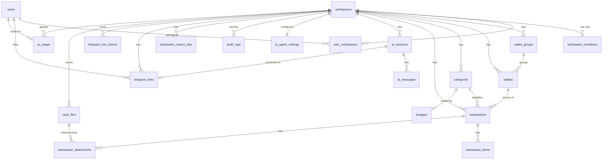

# Data Model

Status: draft v0.1, 2026-11-02. Part of the [oewang docs](README.md). Implements [PRD](prd.md) WAL, CAT, TXN, VLT, CHAT, USG and OPS requirements.

PostgreSQL 16. This doc is the source of truth for every table and column. No other doc repeats a column list.

## Update this doc when

- Adding, removing or renaming a table, a column or an index.
- Changing the balance arithmetic or the soft-delete rules.
- Changing seed data.

## Conventions

| Rule | Detail |
|---|---|
| Primary keys | CUID2 strings, generated by the `cuid2` crate in Rust. Carried over from the old app so sample data and screenshots stay meaningful. |
| Tenancy | Every workspace-scoped table carries `workspace_id`. Every read filters by it and by `deleted_at IS NULL`. |
| Soft delete | `deleted_at timestamp`. No `DELETE` statement runs against a workspace-scoped table (OPS-2). |
| Timestamps | `created_at` and `updated_at`, both `timestamptz` with `DEFAULT now()`. Every timestamp column is `timestamptz`: a naive timestamp means whatever the writer's clock meant, which is wrong for a product with a workspace timezone (changed at US-002, from the old app's `timestamp`). |
| Money | `decimal(19,4)`. Read in Rust as `rust_decimal::Decimal`. Serialized as a string (D12). |
| Naming | `snake_case` for tables and columns, plural table names. |
| Migrations | sqlx SQL files under `apps/api/migrations/`, one per logical group: identity, accounts, vault, ledger, chat, audit. Vault precedes ledger because `transaction_attachments` references it. Later changes are numbered after them; the newest is `0010_vault_usage.sql` (D90 to D92). |

## Tables in scope

Twenty-four tables. The sixteen carried from the old app's schema, plus `refresh_tokens` and `password_reset_tokens` (D38, AUTH-10), `exchange_rates` (D44), the three Telegram tables (D83), `ai_usage` (D92), and `budgets` (D103). Carried (see [legacy app](reference/legacy-app.md#schema-mapping)) with the billing, quota and integration columns stripped (D8).



### Identity and tenancy

#### `users`

| Column | Type | Notes |
|---|---|---|
| `id` | text | CUID2, primary key |
| `email` | text | Unique, not null |
| `name` | text | Nullable |
| `profile_picture` | text | Nullable. The current photo's version id; the photo itself is a 256px JPEG at `usr/{user_id}/avatar` in object storage, served through the API (D94) |
| `income_color`, `expense_color` | text | Nullable, `#rrggbb` lowercase (checked). The colours this user sees income and expense in; null is the default (D100) |
| `password_hash` | text | Argon2id. Never returned by any endpoint (AUTH-1) |
| `created_at`, `updated_at` | timestamp | |

Dropped from the old table: `oauth_provider`, `providers` (D21), `system_role`, `workspace_id` (membership lives in `user_workspaces`), `mobile`.

#### `workspaces`

| Column | Type | Notes |
|---|---|---|
| `id` | text | CUID2, primary key |
| `name` | text | Not null |
| `slug` | text | Unique, not null |
| `country` | text | Nullable, ISO 3166-1 alpha-2 |
| `currency_code` | text | Not null, default `IDR`. ISO 4217 |
| `created_at`, `updated_at`, `deleted_at` | timestamp | |

Dropped: every `plan_*`, `pending_plan_*`, `mayar_*`, `ai_tokens_*`, `extra_*`, `vault_size_used_bytes`, `storage_violation_at`. Billing is out of scope.

#### `user_workspaces`

| Column | Type | Notes |
|---|---|---|
| `id` | text | CUID2, primary key |
| `workspace_id` | text | FK workspaces, cascade |
| `user_id` | text | FK users, cascade |
| `role` | text | `owner`, `admin` or `member` (WS-1) |
| `joined_at` | timestamp | |
| `deleted_at` | timestamp | |

Indexes:

```sql
CREATE UNIQUE INDEX workspace_user_idx ON user_workspaces (workspace_id, user_id);
CREATE INDEX user_workspaces_user_idx ON user_workspaces (user_id, deleted_at);
```

The second index matters: authentication resolves membership by `user_id` alone on every request, and the composite unique index above cannot serve that lookup.

#### `refresh_tokens`

| Column | Type | Notes |
|---|---|---|
| `id` | text | CUID2, primary key |
| `user_id` | text | FK users, cascade |
| `workspace_id` | text | FK workspaces. The workspace the issued access token is scoped to |
| `token_hash` | text | SHA-256 of the token. The token itself is never stored (AUTH-8) |
| `family_id` | text | Shared by every token descended from one login. Reuse detection works on the family |
| `expires_at` | timestamp | 30 days from issue |
| `used_at` | timestamp | Set on rotation. A second use of the same row is a reuse |
| `revoked_at` | timestamp | Set on logout, password change, or reuse detection |
| `user_agent`, `ip` | text | For the user's session list. Truncated, never used for authorization |
| `created_at` | timestamp | |

```sql
CREATE UNIQUE INDEX refresh_tokens_hash_idx ON refresh_tokens (token_hash);
CREATE INDEX refresh_tokens_family_idx ON refresh_tokens (family_id);
CREATE INDEX refresh_tokens_user_idx ON refresh_tokens (user_id, revoked_at);
```

#### `password_reset_tokens`

| Column | Type | Notes |
|---|---|---|
| `id` | text | CUID2, primary key |
| `user_id` | text | FK users, cascade |
| `token_hash` | text | SHA-256 of the token. Unique |
| `expires_at` | timestamp | 1 hour from issue (AUTH-10) |
| `used_at` | timestamp | Single use |
| `created_at` | timestamp | |

#### `workspace_invitations`

| Column | Type | Notes |
|---|---|---|
| `id` | text | CUID2, primary key |
| `workspace_id` | text | FK workspaces, cascade |
| `email` | text | Invited address |
| `role` | text | Role granted on acceptance |
| `token` | text | Unique, random, 32 bytes base64url |
| `invited_by` | text | FK users |
| `expires_at` | timestamp | 7 days from creation |
| `accepted_at` | timestamp | Nullable |
| `created_at`, `deleted_at` | timestamp | |

### Accounts

#### `wallet_groups`

| Column | Type | Notes |
|---|---|---|
| `id` | text | CUID2, primary key |
| `workspace_id` | text | FK workspaces, cascade |
| `name` | text | Not null |
| `sort_order` | integer | Default 0 |
| `created_at`, `updated_at`, `deleted_at` | timestamp | |

#### `wallets`

| Column | Type | Notes |
|---|---|---|
| `id` | text | CUID2, primary key |
| `workspace_id` | text | FK workspaces, cascade |
| `group_id` | text | FK wallet_groups, set null |
| `name` | text | Not null |
| `currency_code` | text | Not null, ISO 4217. **Defaults to the workspace currency** (WAL-5) |
| `balance` | decimal(19,4) | Default `0`, not null, **in this wallet's currency** (WAL-2) |
| `is_included_in_totals` | boolean | Default true |
| `is_default` | boolean | Default false. At most one true per workspace (WAL-3) |
| `sort_order` | integer | Default 0 |
| `created_at`, `updated_at`, `deleted_at` | timestamp | |

```sql
CREATE INDEX wallets_workspace_idx ON wallets (workspace_id) WHERE deleted_at IS NULL;
CREATE UNIQUE INDEX wallets_one_default_idx
  ON wallets (workspace_id) WHERE is_default AND deleted_at IS NULL;
```

The partial unique index enforces WAL-3 in the database, not only in the service. The old app enforced it in application code alone.

Moving the default is two statements in one transaction, clearing first and setting second, never one statement that does both. The index is checked per row as a statement writes, so a combined statement trips it the moment it reaches the new default before the old one. The service locks every live wallet of the workspace in ascending ID order first (D13), so two concurrent calls serialize rather than race.

Deleting the default wallet hands the flag to the next wallet in display order, because WAL-3 says exactly one, not at most one.

#### `categories`

| Column | Type | Notes |
|---|---|---|
| `id` | text | CUID2, primary key |
| `workspace_id` | text | FK workspaces |
| `name` | text | Not null |
| `type` | text | `income` or `expense` (CAT-1) |
| `sort_order` | integer | Default 0 |
| `created_at`, `updated_at`, `deleted_at` | timestamp | |

Deleting a category also deletes its budget (BUD-4).

#### `budgets`

Migration `0014`, D103. A monthly limit on one expense category, in the workspace currency. What a budget used is never stored: it is `sum(base_amount)` of the category's live expenses in the month, read when the budget is (BUD-2).

| Column | Type | Notes |
|---|---|---|
| `id` | text | CUID2, primary key |
| `workspace_id` | text | FK workspaces, cascade |
| `category_id` | text | FK categories. An expense category, checked by the service |
| `amount` | decimal(19,4) | `CHECK (amount > 0)`. The monthly limit; the only column an edit changes |
| `created_at`, `updated_at`, `deleted_at` | timestamptz | |

Indexes: `budgets_workspace_idx (workspace_id) WHERE deleted_at IS NULL`, and `budgets_one_per_category_idx` unique on `(workspace_id, category_id) WHERE deleted_at IS NULL`, so a category has one live budget whatever two saves race. The old app's `period` column is not carried: it was never read.

### Ledger

#### `transactions`

| Column | Type | Notes |
|---|---|---|
| `id` | text | CUID2, primary key |
| `workspace_id` | text | FK workspaces, cascade |
| `wallet_id` | text | FK wallets, cascade. Source wallet, required |
| `to_wallet_id` | text | FK wallets, set null. Only for `transfer` (TXN-7) |
| `category_id` | text | FK categories, set null |
| `assigned_user_id` | text | FK users, set null. Defaults to the creator |
| `amount` | decimal(19,4) | Always positive, required. **In the source wallet's currency.** This is what moves that wallet's balance (TXN-2) |
| `to_amount` | decimal(19,4) | **In the destination wallet's currency.** Required for `transfer`, null otherwise (TXN-18) |
| `original_amount` | decimal(19,4) | What the user actually entered, when its currency differed from the wallet's. Null otherwise |
| `original_currency_code` | text | ISO 4217 currency of `original_amount` |
| `exchange_rate` | decimal(19,8) | Rate used at entry. `amount = original_amount * exchange_rate` (TXN-20) |
| `base_amount` | decimal(19,4) | `amount` converted to the workspace currency, computed at write time. Every report sums this (TXN-19) |
| `base_rate` | decimal(19,8) | Rate from the wallet currency to the workspace currency |
| `base_rate_source` | text | `same` (rate is 1), `user`, `live` or `cache`. How the rate was obtained (TXN-22) |
| `base_rate_date` | date | The day the rate belongs to. Differs from `date` only when a stale cached rate was used |
| `date` | timestamp | Transaction date, required |
| `type` | text | `income`, `expense` or `transfer` (TXN-1) |
| `name` | text | Label or payee |
| `description` | text | Free text note |
| `is_ready` | boolean | Reviewed flag, default false |
| `is_exported` | boolean | Included in a CSV export, default false (TXN-10) |
| `source` | text | `web`, `chat`, `import`, `receipt` or `telegram`. How the row was created (D74, D86) |
| `fingerprint` | text | Deterministic content hash, set on imported rows only. Null for manual entry (TXN-16, D29) |
| `created_at`, `updated_at`, `deleted_at` | timestamp | |

```sql
CREATE INDEX transactions_workspace_date_idx
  ON transactions (workspace_id, date DESC, created_at DESC)
  WHERE deleted_at IS NULL;
CREATE INDEX transactions_wallet_id_idx ON transactions (wallet_id);
CREATE INDEX transactions_category_id_idx ON transactions (category_id);

CREATE UNIQUE INDEX transactions_fingerprint_idx
  ON transactions (workspace_id, fingerprint)
  WHERE fingerprint IS NOT NULL AND deleted_at IS NULL;
```

The first index covers every list and summary query: workspace scope, live rows, date sort. It is carried over unchanged from the old app, where it was tuned against the real query shape.

Multicurrency is live (Q1, D37). The rules are in [multicurrency](#multicurrency).

#### `exchange_rates`

A daily rate cache. Not workspace-scoped: a rate is a fact about the world, not about a tenant.

| Column | Type | Notes |
|---|---|---|
| `id` | text | CUID2, primary key |
| `base_code` | text | ISO 4217 |
| `quote_code` | text | ISO 4217 |
| `date` | date | The day the rate applies to |
| `rate` | decimal(19,8) | 1 base equals `rate` quote |
| `source` | text | `api` or `manual` |
| `fetched_at` | timestamp | When the daily job wrote it |
| `created_at` | timestamp | |

```sql
CREATE UNIQUE INDEX exchange_rates_pair_date_idx
  ON exchange_rates (base_code, quote_code, date);
```

Filled by a daily job with one call to APILayer's Exchange Rate API (D44, D96): the whole snapshot for the day, every currency against the source's base (EUR), including the base itself at 1. A pair is read as a cross rate through that base, `rate(base→quote) / rate(base→from)`, computed in the query and rounded to 8 places; a direct row for the pair wins if one exists. The base's own row is also how the job knows the day is already stored. A rate the user typed by hand is stored on the transaction row, never written back here.

The table is read when prefilling a form and when resolving a rate at write time ([rate resolution](#rate-resolution-at-write-time)). No report path consults it, because `base_amount` was already computed.

#### Import fingerprint

Every row created by an import carries a content hash (TXN-16, D29). Re-importing the same statement is then a no-op rather than a doubled ledger, enforced by the database rather than by a dialog.

```
normalize(v) = lowercase(trim(v)) with runs of whitespace collapsed to one space

fingerprint = sha256(
    normalize(wallet_id)   || "|" ||
    normalize(date)        || "|" ||   -- YYYY-MM-DD
    amount                 || "|" ||   -- canonical decimal string
    normalize(currency)    || "|" ||
    normalize(name)        || "|" ||
    normalize(counterparty)
  ) truncated to 24 hex characters
```

Rules:

- Set on `import` and `receipt` rows. Null for manual and chat entry, where a user creating two identical expenses on purpose is legitimate.
- Computed from the **transformed** values, after date parsing and sign normalization, so two files with different date formats produce the same hash for the same transaction.
- A collision on insert is counted as `skipped`, not as an error.
- The index is partial on `deleted_at IS NULL`, so deleting an imported row makes it importable again.

This is adapted from Midday's `internal_id` ([research](research/midday.md#32-deterministic-deduplication)).

#### `transaction_items`

| Column | Type | Notes |
|---|---|---|
| `id` | text | CUID2, primary key |
| `workspace_id` | text | FK workspaces, cascade |
| `transaction_id` | text | FK transactions, cascade |
| `name` | text | Item name, required |
| `brand` | text | Nullable |
| `quantity` | decimal(10,3) | Nullable |
| `unit` | text | Nullable, for example `kg`, `pcs` |
| `unit_price` | decimal(19,4) | Nullable |
| `amount` | decimal(19,4) | Item total, required |
| `category_id` | text | FK categories, set null. Per-item category |
| `notes` | text | Nullable |
| `created_at`, `updated_at`, `deleted_at` | timestamp | |

Item totals are not forced to match the transaction amount. A mismatch raises a warning badge in the UI, nothing more (TXN-12).

#### `transaction_attachments`

| Column | Type | Notes |
|---|---|---|
| `id` | text | CUID2, primary key |
| `workspace_id` | text | FK workspaces, cascade |
| `transaction_id` | text | FK transactions, cascade |
| `vault_file_id` | text | FK vault_files, cascade |
| `created_at`, `deleted_at` | timestamp | |

Removing an attachment soft-deletes this row, never the file (VLT-5).

#### `transaction_import_jobs`

| Column | Type | Notes |
|---|---|---|
| `id` | text | CUID2, primary key |
| `workspace_id` | text | FK workspaces, cascade |
| `user_id` | text | FK users, cascade |
| `status` | text | `pending`, `succeeded` or `failed` |
| `vault_file_id` | text | FK vault_files. The document the rows were read from, so a retry does not re-upload it (D71). Nullable: the CSV path writes no job row at all |
| `imported` | integer | Nullable until the job finishes |
| `skipped` | integer | Rows that failed validation. Nullable until the job finishes |
| `duplicates` | integer | Rows whose fingerprint already existed (TXN-16). Nullable until the job finishes |
| `error` | text | An error code, never a message: a message could quote the statement back (OPS-3). Nullable |
| `review` | jsonb | What became of each row: `{rows: [{date, name, amount, direction, status}], truncated}`, `status` one of `imported`, `duplicate`, `skipped`. Capped at 200 rows while the counts stay exact for the whole file. Nullable until the job finishes |
| `created_at`, `updated_at` | timestamp | |

```sql
CREATE INDEX transaction_import_jobs_workspace_idx
  ON transaction_import_jobs (workspace_id, id);
```

In the old app a Go worker owned the transition to a terminal status. Here a tokio task does (D10), but the polling contract is identical (AI-6).

`review` is jsonb rather than a table because it is a report, not ledger data: nothing joins it, nothing updates it, and it is written once and read whole. A table would add a foreign key and an index to carry a list that is never read in parts.

There is no `stale` column. A job that stopped reporting did so because its task died with the process, and nothing was left running to write that down; the API computes staleness from `created_at` when the modal polls.

### Files

#### `vault_files`

| Column | Type | Notes |
|---|---|---|
| `id` | text | CUID2, primary key |
| `workspace_id` | text | FK workspaces |
| `name` | text | Original filename |
| `key` | text | Storage key prefix, generated by the API as `wsp/{workspace_id}/{file_id}`. Never derived from the filename (SEC-13). Each chunk is its own object at `{key}/{index:05}` |
| `size` | bigint | Bytes. Maximum 10 MB (VLT-1) |
| `type` | text | MIME type, sniffed from the bytes and checked against the declared type (SEC-12). One of `image/jpeg`, `image/png`, `image/webp`, `application/pdf` |
| `sha256` | text | Content hash, recorded at upload completion |
| `status` | text | `pending` or `ready`. Chunked upload ([file bytes](api/encryption.md#file-bytes)) |
| `tags` | text[] | Not null, default `'{}'`. Free labels a member puts on a file. At most 10 of at most 32 characters, deduplicated case-insensitively; the bound is enforced by the API, not here, so the rule lives in one place with its tests (VLT-9). Added in `0010` |
| `thumbnail` | boolean | Nullable. Whether a preview exists at `{key}/thumb`: null means nobody has asked yet, false means it cannot be made (a PDF, or bytes that do not decode) and is never retried, true means it is stored (D91, VLT-12). Added in `0010` |
| `created_at`, `updated_at`, `deleted_at` | timestamp | |

```sql
CREATE INDEX vault_files_workspace_idx ON vault_files (workspace_id) WHERE deleted_at IS NULL;
```

A file is stored as its chunks, one object per chunk, because that is how it is uploaded and how it is served back ([file bytes](api/encryption.md#file-bytes)). Nothing assembles the whole file except the SHA-256 at completion, which is also where the declared type is checked against the bytes: checking the first chunk alone would let a client send a valid header and anything it liked afterwards. A file that fails that check is soft-deleted and its chunks dropped, so a rejected upload leaves nothing behind.

Dropped from the old table: `metadata`, `inactive_at`. `tags` was dropped too, while the vault was only the backing store for attachments and receipts, and came back when the vault became a browsable feature again (D90, migration `0010`).

The stored preview is one more object at `{key}/thumb`, beside the chunks, and it goes with them when the file is deleted. Deleting a file also soft-deletes its live `transaction_attachments` rows in the same database transaction (VLT-11).

A file's storage is not counted anywhere: storage used is `SUM(size)` over the workspace's `ready`, non-deleted rows ([usage](#usage)).

### Chat

#### `ai_sessions`

| Column | Type | Notes |
|---|---|---|
| `id` | text | CUID2, primary key |
| `workspace_id` | text | FK workspaces |
| `title` | text | Generated from the first user message (CHAT-8) |
| `created_at`, `updated_at`, `deleted_at` | timestamp | |

```sql
CREATE INDEX ai_sessions_workspace_idx
  ON ai_sessions (workspace_id, updated_at DESC)
  WHERE deleted_at IS NULL;
```

#### `ai_messages`

| Column | Type | Notes |
|---|---|---|
| `id` | text | CUID2, primary key |
| `session_id` | text | FK ai_sessions, cascade |
| `workspace_id` | text | Denormalized for workspace-wide queries |
| `role` | text | `user`, `assistant` or `system` |
| `content` | text | Message text |
| `attachments` | jsonb | Tool calls, tool results, receipt drafts, file references |
| `created_at`, `deleted_at` | timestamp | |

```sql
CREATE INDEX ai_messages_session_created_idx
  ON ai_messages (session_id, created_at)
  WHERE deleted_at IS NULL;
```

The `attachments` shape is defined in [chat](features/chat.md#message-attachments).

#### `ai_agent_settings`

One row per workspace, created lazily.

| Column | Type | Notes |
|---|---|---|
| `id` | text | CUID2, primary key |
| `workspace_id` | text | FK workspaces, unique |
| `custom_instructions` | text | Nullable. Appended to the system prompt (CHAT-10) |
| `response_language` | text | `auto`, `english` or `indonesian`. Default `auto` |
| `created_at`, `updated_at` | timestamp | |

Dropped: `model`, `temperature`, `max_steps`. The old app stored and exposed all three but never read them; the loop used hardcoded values and an environment variable. Columns nobody reads are worse than no columns.

### Audit

#### `audit_logs`

| Column | Type | Notes |
|---|---|---|
| `id` | text | CUID2, primary key |
| `workspace_id` | text | FK workspaces, cascade |
| `user_id` | text | FK users. The real user, even for a tool call |
| `action` | text | `{entity}.{verb}`, for example `transaction.deleted` |
| `entity` | text | Entity name |
| `entity_id` | text | Affected row ID |
| `before` | jsonb | Nullable |
| `after` | jsonb | Nullable |
| `source` | text | `web`, `chat`, `import`, `receipt` or `telegram`, matching `transactions.source`; or `migration` for a change a data migration made, attributed to the workspace's owner (0013, D102). New in this rewrite |
| `created_at` | timestamp | |

```sql
CREATE INDEX audit_logs_workspace_entity_idx
  ON audit_logs (workspace_id, entity, entity_id, created_at DESC);
```

Append-only. The row is written inside the mutation's database transaction (D14, OPS-1). `source` is new: in the old app there was no way to tell a chat-driven write from a manual one.

### Usage

Added by D92 in `0010_vault_usage.sql`. The feature is in [Usage](features/usage.md).

#### `ai_usage`

| Column | Type | Notes |
|---|---|---|
| `id` | text | CUID2, primary key |
| `workspace_id` | text | FK workspaces, cascade |
| `user_id` | text | Nullable, FK users, set null. Who the call was made for; null for work no person started directly |
| `feature` | text | `chat`, `telegram`, `receipt`, `categorize`, `import` or `columns`, by check constraint (USG-2) |
| `model` | text | Nullable. The model the AI service reported, the last one asked when a ladder escalated |
| `input_tokens` | integer | Not null, `>= 0`. Summed across every model request the call made |
| `output_tokens` | integer | Not null, `>= 0` |
| `created_at` | timestamptz | |

```sql
CREATE INDEX ai_usage_workspace_idx ON ai_usage (workspace_id, created_at);
```

Append-only, like `audit_logs`: nothing updates or deletes a row, so a sum over it is the whole history (USG-2). There is no `deleted_at`, because there is nothing to soft-delete; the soft-delete rule protects rows a user can remove, and nobody removes a record of a call that was made. "This month" is `created_at` since the first of the current calendar month in UTC, which is what the index serves.

There is no storage table and no counter column. Storage used is `SUM(size)` and `COUNT(*)` over `vault_files` where `status = 'ready'` and `deleted_at IS NULL` (USG-1). A counter would be a second copy of a number the rows already hold, and it drifts the first time a delete path forgets it.

### Receipt jobs

`receipt_jobs` (migration `0011`, D95): a receipt waiting for the reader.

| Column | Type | Notes |
|---|---|---|
| `id` | text | |
| `workspace_id`, `user_id` | text | Who the expense is saved for |
| `vault_file_id` | text | Unique: one job per file |
| `channel` | text | `web` or `telegram`, where the outcome is told |
| `chat_id` | bigint | The Telegram chat, or null |
| `status` | text | `pending`, `processing`, `done`, `failed` |
| `attempts` | integer | Reads tried |
| `next_attempt_at` | timestamptz | When the loop may take it |
| `last_error` | text | The last refusal's code, never a message (OPS-3) |
| `transaction_id` | text | The saved expense, once `done` |
| `seen_at` | timestamptz | When the web told the person |

No `deleted_at`: a job is a record of an attempt, not workspace data a person deletes, and the file it points at is soft-deleted the usual way.

### Telegram

Added by D83. The flows are in [Telegram](features/telegram.md).

#### `telegram_links`

| Column | Type | Notes |
|---|---|---|
| `id` | text | CUID2, primary key |
| `workspace_id` | text | FK workspaces, cascade |
| `user_id` | text | FK users, cascade. The member the chat acts for |
| `chat_id` | bigint | Telegram's chat id. Every update is looked up by it |
| `telegram_user_id` | bigint | The Telegram account that opened the link. Every update must come from it (TG-2) |
| `telegram_username` | text | Nullable. Shown on the Apps page, never used to decide anything |
| `ai_session_id` | text | Nullable, FK ai_sessions, set null. The conversation text goes to, made on the first message |
| `linked_at` | timestamptz | |
| `created_at`, `updated_at`, `deleted_at` | timestamptz | Soft delete ends a link (OPS-2) |

```sql
CREATE UNIQUE INDEX telegram_links_member_idx
  ON telegram_links (workspace_id, user_id) WHERE deleted_at IS NULL;
CREATE UNIQUE INDEX telegram_links_chat_idx
  ON telegram_links (chat_id) WHERE deleted_at IS NULL;
```

One live link per member per workspace, and one per chat: a chat acting for two workspaces would have to guess which one a receipt belongs to (D85).

#### `telegram_link_tokens`

| Column | Type | Notes |
|---|---|---|
| `id` | text | CUID2, primary key |
| `workspace_id` | text | FK workspaces, cascade |
| `user_id` | text | FK users, cascade |
| `token_hash` | text | SHA-256 of the `start` value, unique. The value itself is never stored (AUTH-8) |
| `expires_at` | timestamptz | Ten minutes after minting |
| `used_at` | timestamptz | Set by the claim, in the same statement that checks it |
| `created_at` | timestamptz | |

The same shape and rules as `password_reset_tokens`.

#### `telegram_updates`

| Column | Type | Notes |
|---|---|---|
| `update_id` | bigint | Primary key. Telegram's own id |
| `received_at` | timestamptz | |

Not workspace-scoped: an update is claimed before anyone knows which workspace it is for. A row means the update was handled, so one delivered again after a restart is skipped (D84). Rows older than 48 hours are deleted, which is the one hard delete in the schema and is on a table with no workspace data: Telegram never redelivers an update older than a day.

## Balance arithmetic

Carried over unchanged from the old app. The implementation lives in the transaction service.

**On create** (TXN-3):

| Type | Effect |
|---|---|
| `expense` | `wallet.balance -= amount` |
| `income` | `wallet.balance += amount` |
| `transfer` | `wallet.balance -= amount` and `to_wallet.balance += to_amount` |

`amount` is in the source wallet's currency and `to_amount` in the destination wallet's currency, so a balance update is a plain addition and no conversion happens at write time. A transfer between two wallets of the same currency simply has `to_amount` equal to `amount`.

**On soft delete** (TXN-5): reverse the original effect.

**On update** (TXN-4): reverse the old effect, then apply the new one. All nine type transitions, plus a changed amount, a changed wallet or a changed destination wallet, follow the same two steps.

**Locking** (TXN-6, D13): every affected wallet row is locked with `SELECT ... FOR UPDATE` before any balance is read, inside the same database transaction as the write. Lock wallets in a stable order (by ID, ascending) so two concurrent transfers in opposite directions cannot deadlock.

**Validation** (TXN-7):

- `to_wallet_id` is required when `type = 'transfer'`, and must differ from `wallet_id`.
- `to_wallet_id` must be null for `income` and `expense`.
- `to_amount` is required and greater than zero when `type = 'transfer'`, null otherwise.
- `amount` must be greater than zero.
- Both wallets must belong to the caller's workspace and not be soft-deleted.
- `original_amount`, `original_currency_code` and `exchange_rate` are either all three set or all three null.
- When they are set, `original_currency_code` must differ from the source wallet's currency, and `amount` must equal `original_amount * exchange_rate` rounded to 4 decimal places.
- `base_amount` and `base_rate` are always set, computed by the service and never accepted from the client.

## Multicurrency

A wallet has its own currency, defaulting to the workspace currency (WAL-5, D37). Most workspaces never change that default and never see any of the machinery below.

Three currencies can be in play for one transaction. Keeping them straight is the whole of this section.

| Currency | Column | Role |
|---|---|---|
| Wallet currency | `wallets.currency_code` | What this wallet's balance is denominated in. Defaults to the workspace currency |
| Entry currency | `transactions.original_currency_code` | What the user typed, when it differed from the wallet's. Null otherwise |
| Workspace currency | `workspaces.currency_code` | What every report and total is expressed in |

### Worked examples

Workspace currency IDR. Wallet `BCA` is IDR (the default). Wallet `Wise` is USD.

**The ordinary case.** Lunch for 50,000 from BCA. One currency, no conversion, three columns stay null:

```
amount          = 50000.0000
original_*      = null
base_amount     = 50000.0000
base_rate       = 1.00000000
BCA.balance    -= 50000.0000
```

**Expense in the wallet's own currency.** USD 50 from Wise:

```
amount          = 50.0000        (USD, the wallet currency)
original_*      = null           (nothing differed)
base_amount     = 812500.0000    (IDR, for reporting)
base_rate       = 16250.00000000
Wise.balance   -= 50.0000
```

**Expense entered in another currency.** USD 50 paid from the IDR wallet:

```
amount                 = 812500.0000   (IDR, the wallet currency)
original_amount        = 50.0000
original_currency_code = USD
exchange_rate          = 16250.00000000
base_amount            = 812500.0000
BCA.balance           -= 812500.0000
```

**Cross-currency transfer.** USD 50 from Wise to BCA. Two different figures move:

```
amount          = 50.0000        (USD, out of the source)
to_amount       = 812500.0000    (IDR, into the destination)
exchange_rate   = 16250.00000000
base_amount     = 812500.0000
Wise.balance   -= 50.0000
BCA.balance    += 812500.0000
```

### Display

A transaction list row shows the wallet-currency `amount` as its primary figure, because that is what moved the wallet. When the entry currency differed, the original sits beside it, muted (TXN-21):

```
Warung Tekko        Rp 812.500
Food · BCA          $50,00
```

A row with no `original_currency_code` shows one line. The detail sheet shows all three figures plus both rates, so nothing is hidden.

Wallet balances render in each wallet's own currency. Every total, summary and chart renders in the workspace currency.

### Reporting

`base_amount` is computed once, at write time, and stored. Every summary is then a plain `SUM(base_amount)` with no conversion and no rate lookup at read time.

That is why the 100 ms list target in [success metrics](prd.md#7-success-metrics) survives with multicurrency on, and why a historical report does not shift when today's rate moves. The rate that was true on the transaction date stays on the row.

### Rate resolution at write time

`base_amount` is computed when the row is written, so the service needs a rate from the wallet currency to the workspace currency. It resolves in this order and stops at the first that works (TXN-22, D43):

| # | Source | `base_rate_source` | When |
|---|---|---|---|
| 1 | No conversion | `same` | Wallet currency equals the workspace currency. Rate is 1 and nothing is looked up. This is the ordinary case |
| 2 | The request | `user` | The client sent a rate the user saw and confirmed in the form |
| 3 | Live source | `live` | The source's rate for the transaction's date, read from that day's snapshot (direct or through the base) |
| 4 | Cache | `cache` | The day has no snapshot. The newest snapshot for the pair is used, and `base_rate_date` records how old it is |
| 5 | Nothing | n/a | No cached rate has ever existed for this pair. `FX_RATE_UNAVAILABLE`, and the form asks the user to type one |

No step calls the source (D96). The free plan allows 100 calls a month, so the daily job is its only caller and every step here is a local read. Step 3 reports `live` because the value is the source's rate for that day; `cache` means the fallback in step 4, where the day asked for has no snapshot at all.

Resolution happens before the write transaction opens, so the transaction holds wallet locks only for the writes.

Step 5 is the honest end of the ladder. A rate cannot be invented from nothing, and a brand-new foreign wallet on a day the source is down has no history to fall back on. The form already accepts a typed rate, so the user is never stuck, only asked.

**A stale rate is marked, not hidden.** When `base_rate_source` is `cache` and `base_rate_date` is older than the transaction date, the row carries a visible marker in the list and the detail sheet, naming the rate and its date. The alternative, a silently wrong figure in a financial record, is the failure this product exists to avoid.

A row written with a stale or typed rate is never silently recomputed later. Correcting it is an edit the user makes, with the usual audit trail.

### Locked currencies

Two locks, for the same reason: a currency change would silently reinterpret numbers already written.

| Lock | Condition | Error |
|---|---|---|
| Wallet currency | Once the wallet has a live transaction (WAL-6) | `WALLET_CURRENCY_LOCKED` |
| Workspace currency | Once any transaction exists in the workspace | `WORKSPACE_CURRENCY_LOCKED` |

Changing either after that point is a data migration, not a setting. `base_amount` is denominated in the workspace currency, so moving the workspace currency would require recomputing every row at its own historical rate.

## Seed data

Run with `sqlx migrate run` and then the seed file; both commands are in the [README](../README.md#database).

A new workspace gets (CAT-3):

- Eleven wallet groups: Cash, Accounts, Card, Debit Card, Savings, Top-Up / Prepaid, Investments, Overdrafts, Loan, Insurance, Others.
- Three wallets, each at balance `0`, counted in totals, in the workspace currency: `Cash` in the Cash group (`is_default = true`), `Accounts` in Accounts, `Card` in Card.
- Income categories (7): 💵 Salary, 💰 Allowance, 💵 Petty cash, 🏅 Bonus, 🐒 Chip in, 💰 Freelance, Other.
- Expense categories (24): 🍜 Food, 🧑‍🤝‍🧑 Social Life, 🐶 Pets, 🚕 Transport, 🪑 Household, 🧥 Apparel, 💄 Beauty, 🧘 Health, 📙 Education, 🎁 Gift, ⚽ Sport, 🧣 Laundry, ☕ Coffee, 💹 Investment, 🏡 Rent, 💸 Subscription, 🛵 Motorbikes, 🤖 Hobby, 💳 Credit, 📶 Internet, 🏡 Parents, 📚 Hobby, 💵 Salary, Other.

The list is the old app's (`packages/constants/src/default/category.ts`), verbatim (D102). It lives once, in `crates/db/src/seed.rs`, which registration and workspace creation both call.
- One `ai_agent_settings` row with defaults.

The development seed command additionally creates a demo user and roughly 200 sample transactions spread over three months, so list performance and grouping can be judged honestly.

## Related docs

- [Docs index](README.md) and [PRD](prd.md)
- [Architecture](architecture.md) and the [decision log](architecture.md#decision-log)
- [Transactions](features/transactions.md) and [chat](features/chat.md)
- [API endpoints](api/endpoints.md)
- [Rust API best practices](best-practices/rust-api.md)
- [Legacy app](reference/legacy-app.md#schema-mapping)
