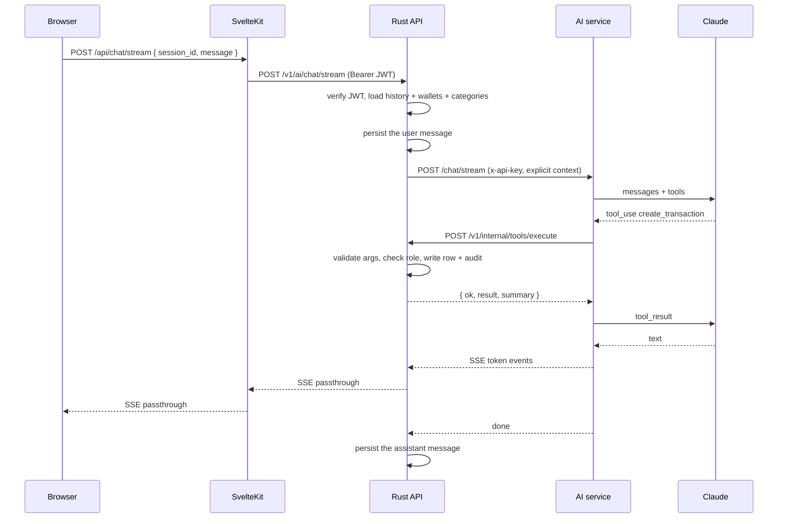

# Feature: Chat

Status: draft v0.1, 2026-11-02. Part of the [oewang docs](../README.md). Implements [PRD](../prd.md) CHAT-1 to CHAT-10 and AI-1 to AI-6.

An in-app assistant that reads and writes the same ledger the UI writes. It answers questions about the workspace's money, records transactions on request, and turns a photographed receipt into a draft.

## Update this doc when

- Changing the chat UI, the session list, or the message rendering.
- Changing the receipt flow.
- Adding or removing a tool. The catalog lives in [AI service](../ai/service.md#tool-catalog).

## How it is split

Three processes, one conversation.

| Process | Job |
|---|---|
| `apps/app` | Renders the conversation, pipes the stream, uploads attachments |
| `apps/api` | Verifies the user, loads history and context, persists messages, executes every tool, writes audit rows |
| `apps/ai` | Builds the prompt, runs the Claude tool loop, emits events |

The AI service holds no database connection (D3) and no user token (D4). It says who it is acting for; the API decides whether that is allowed.



## Sessions

One conversation is one `ai_sessions` row with its `ai_messages` ([data model](../data-model.md#chat)).

- The session list is ordered by `updated_at` descending.
- A title is generated from the first user message (CHAT-8), by a separate short call, not by the main loop.
- Rename and delete are available from the list. Delete is a soft delete and asks for confirmation (UI-4). The messages are marked deleted with their session rather than left behind a deleted parent.
- Routes: `/chat` opens the newest session or an empty one; `/chat/{id}` opens a specific session.
- The list lives in `/chat`'s layout, so it survives switching sessions. A layout cannot own form actions, so rename, delete and new all post to `/chat`'s actions and redirect from there.

### Message attachments

`ai_messages.attachments` is a JSON object. Only these shapes are written:

```json
{
  "tool_calls": [
    { "id": "t1", "name": "create_transaction",
      "args": { "…": "…" },
      "result": { "ok": true, "summary": "Created expense 50,000 in Cash." } }
  ],
  "files": [ { "vault_file_id": "clx…", "name": "receipt.jpg", "type": "image/jpeg" } ],
  "receipt_draft": { "merchant": "…", "date": "2026-11-02", "total": "87500.0000", "items": [] },
  "usage": { "input": 1204, "output": 311 }
}
```

The old app also stored canvas artifacts, provider metadata and invoice drafts here. Those features are out of scope, so those keys do not exist.

## Streaming

Server-sent events, passed through two hops unchanged. The event protocol is specified in [AI service](../ai/service.md#streaming-protocol).

- Tokens render as they arrive. Markdown is parsed after the stream ends, so a half-written table does not flicker.
- Tool calls render above the answer as one line of plain English, never as JSON. The shape is in [tool call presentation](#tool-call-presentation).
- Aborting the request stops generation and still persists the partial reply (CHAT-9).
- Buffering is disabled at every hop. A proxy that buffers turns a streaming chat into a slow request.

## Tools

Eleven tools (D17), listed with their schemas in [AI service](../ai/service.md#tool-catalog). Four read, six write, one for asking the user to disambiguate.

| Kind | Tools |
|---|---|
| Read | `get_workspace_context`, `get_recent_transactions`, `search_transactions`, `get_spending_summary` |
| Write | `create_transaction`, `update_transaction`, `delete_transaction`, `add_transaction_items`, `create_wallet`, `create_category` |
| Interaction | `present_choices` |

Every tool runs through `POST /v1/internal/tools/execute` in the API (CHAT-4). The API validates the arguments against the schema, checks the role, performs the work through the same services the web UI uses, and writes an audit row with `source: "chat"`.

### Role gating

A write tool called by a `member` is refused by the API with `TOOL_FORBIDDEN` ([permission matrix](../security/auth.md#permission-matrix)). The AI service relays the refusal as plain text and does not retry. The system prompt also tells the model what the caller may do, but that is guidance; the gate is the control.

The `role` in the tool-execute body is a claim. The API re-reads the membership row before acting on it (SEC-23, [AI safety](../security/ai-safety.md#layer-1-authorization)).

### Blast radius

Caps enforced in the API per turn, whatever the model asks for (D25): at most 3 write calls, 1 delete, 3 transactions created, and a configurable ceiling on a tool-created amount. There is no bulk write tool and no tool that touches members, settings or the workspace. Full reasoning in [AI safety](../security/ai-safety.md#layer-2-blast-radius).

### Untrusted text

A receipt or a bank statement is text somebody else wrote, and the assistant can write to the ledger. The control is structural: **extraction runs with no tools at all**, so an instruction hidden in a receipt has nothing to call (D24). The tool-capable loop sees only the typed, validated draft, plus a fenced summary. See [AI safety](../security/ai-safety.md).

### Confirmation

`delete_transaction` requires `confirmed: true` (CHAT-6, D20). The first call returns `CONFIRMATION_REQUIRED` with a description of what would be deleted. The assistant presents that to the user and only calls again, with `confirmed: true`, after the user agrees in a later turn.

### Loop safety

- At most 8 tool rounds per user turn (CHAT-5). On exceeding it, the loop stops and returns what it has.
- A tool failure is returned to the model as a tool result, not raised as an exception. The model reports it rather than crashing the turn.
- Arguments are validated in the API before execution, so a malformed call becomes `TOOL_ARGS_INVALID`, never a 500.

## Context

Every turn's system prompt carries the workspace's current wallets and categories (CHAT-7), fetched by the API from `GET /v1/internal/context`. This is why `get_workspace_context` is rarely needed: the data is already there. The tool exists for the case where the model needs to re-read after creating a wallet mid-turn.

Workspace-level `custom_instructions` and `response_language` from `ai_agent_settings` are appended (CHAT-10). `response_language` has three values: `auto` (match the user's language), `english`, `indonesian`.

## Receipt OCR

The capture path that makes the assistant worth using (AI-1 to AI-3).

1. The user attaches a photo, from the chat input or from the transactions page's **Scan a receipt** button. Both open the same dropzone, so there is one upload path (D23).
2. The file uploads to `POST /v1/vault/files` and gets a `vault_file_id`.
3. The web app posts that id to its own `/transactions/receipt`, which calls `POST /v1/ai/receipt/parse`. The browser never calls the API (D5), and the bytes are already in the vault, so only an id travels on this hop.
4. The API calls the AI service, which returns a structured draft: merchant, date, total, subtotal, tax, currency, line items.
5. The API returns the draft, the file id and a `quality` report. **Nothing is persisted as a transaction** (AI-2).
6. The confirmation sheet opens in the [canvas](#canvas) with every field editable. The wallet defaults to the workspace default (WAL-3); the category is preselected when the parsed merchant or a line item matches an existing one, as a whole word and never from an income category.
7. Confirming posts to `/transactions?/confirmReceipt`, which calls `POST /v1/transactions` with `attachment_ids` and then adds the line items one by one. The create route takes attachments but not items.
8. Cancelling leaves the uploaded file and creates nothing.

The response shape, which the web app checks field by field in `src/lib/receipt.ts` rather than casting:

```json
{ "data": {
    "vault_file_id": "clx…",
    "draft": { "merchant": "Warung Tekko", "date": "2026-11-02", "total": "87500.0000",
               "subtotal": "80000.0000", "tax": "7500.0000", "currency": "IDR",
               "line_items": [ { "name": "Iga bakar", "amount": "45000.0000",
                                 "quantity": "1", "unit_price": "45000.0000" } ] },
    "quality": { "score": 62, "low_confidence_fields": ["date"], "corrected_fields": ["total"] }
} }
```

**The two field lists are what the panel marks** (AI-11), and the difference between them is the point: a `corrected` field is a figure the API's cross-field arithmetic replaced, and a `low_confidence` one is a figure nobody checked. `corrected` wins when a field is in both, because it is the stronger statement. Each renders as a badge beside the field's own label, so the user can see which numbers came from the model and which came from the code.

What the panel cannot yet show is the model's original figure beside the corrected one. The response names the corrected fields but not what they were, so the badge says the figure was recomputed and the explainer says why. Carrying the replaced value, for example `quality.corrections: [{ field, model_value }]`, is the change that would close it.

A date the model wrote in prose, a figure that is not a decimal string and a line with neither a name nor an amount are all dropped on the way in rather than guessed at. An empty date field asks the user; a wrong one does not.

**Subtotal and tax are editable but not stored.** A transaction has no column for either ([data model](../data-model.md#ledger)); they are shown so the user can check the total against the paper before confirming it.

An unreadable image returns `RECEIPT_UNREADABLE` (422), and the panel offers manual entry with the image already attached (AI-3). A 200 carrying nothing usable takes the same path: the image did not become a draft either way.

One gap worth naming: `POST /v1/transactions` carries no source field, so the audit row for a confirmed receipt reads `web` rather than `receipt` ([transactions](transactions.md#audit)). The surface is recorded correctly for a chat write, which goes through the tool route, and not for this one.

## Entity deep links

The assistant writes entity names as links in a private scheme, and the Markdown renderer intercepts them (D33, CHAT-11):

```
Transactions: [Warung Tekko](#txn:clx7f2…)
Wallets:      [Cash](#wallet:clx9k1…)
Categories:   [Food](#cat:clxa3b…)
Receipts:     [receipt.jpg](#file:clxb8c…)
Navigation:   [Settings](#navigate:/settings)
```

A regex (`/^#(txn|wallet|cat|file|navigate):/`) decides whether a link becomes a button or stays text. Anything else renders as plain text, because an external link in assistant output is an injection surface ([AI safety](../security/ai-safety.md#output-handling)).

The two halves live apart, so each is testable on its own. `src/lib/markdown.ts` renders a known scheme as a button carrying `data-entity-scheme` and `data-entity-value`, and nothing else as a link at all. `src/lib/chat-entities.ts` decides what that button opens:

| Scheme | Opens |
|---|---|
| `#txn:` | `/transactions?detail={id}`, which is the transaction's detail sheet |
| `#wallet:` | `/transactions?wallet_id={id}`: that wallet's money |
| `#cat:` | `/transactions?category_id={id}`: that category's money |
| `#file:` | The attachment, in a dialog on the conversation. No URL: the bytes come down as counted chunks (D23) |
| `#navigate:` | The path, if it is one of ours |

The conversation column binds one delegated click handler rather than one per link, because the buttons arrive inside `{@html}` and there is no component to bind to.

**A `#navigate:` path is checked before it is followed.** It must start with a single `/`: `//evil.test` and `/\evil.test` are read by a browser as another origin, and this string is written by the model, which is reachable through a receipt (SEC-11). The value is decoded first, because markdown-it percent-encodes the href and `%2F%2Fevil.test` is the same attack spelled differently. A path that fails renders as a button that does nothing rather than as a navigation somewhere else.

The effect: "You spent 50,000 at Warung Tekko on 2 November" becomes clickable, and the answer is an index instead of a dead end. Cost is one regex, one prompt block and one renderer override.

## Canvas

When the assistant produces something the user needs to see rather than read, the UI opens a side panel. The panel holds **the real application component**, not a model-authored artifact (D31, CHAT-13).

| `?canvas=` | Panel contents | Opened by |
|---|---|---|
| `receipt` | The receipt confirmation sheet, the same component the transactions page mounts | An upload finishing, in the composer or on the transactions page |
| `transaction` | The transaction form sheet, with the uploaded file attached | The confirmation panel's "Enter it by hand", and an unreadable image (AI-3) |

`id` is the vault file in both cases, which is what makes a reload reproduce the panel.

Mechanics:

- State lives in URL search parameters (`?canvas=receipt&id=clx…`), read through `src/lib/canvas.ts`, so the panel survives a reload and the URL is shareable. A kind this app does not have and a missing id both open nothing: a URL is user input, and an empty panel is a worse answer to a mistyped link than no panel.
- The conversation column animates its own margin so it reflows beside the panel instead of being covered. The transactions page does the same.
- The panel is 100 percent width below the medium breakpoint and a fixed 560 px above it.
- **It is a panel, not a dialog.** There is no overlay and no focus trap, because the column beside it stays usable, which is the whole point of a canvas. So it is a labelled region: focus moves to its heading when it opens and back to whatever had it when it closes, and Escape closes it. While closed it is `inert` and `aria-hidden`, so it slides rather than appears without leaving anything in the tab order.
- **A reload re-reads the receipt.** The API persists no draft (AI-2), so reopening `?canvas=receipt&id=…` asks for the parse again. That is the price of nothing being written until the user agrees, and it is a model call per reload. Caching it would mean storing a draft, which is the thing AI-2 forbids.
- The prompt tells the model the panel exists: after creating a draft it writes **one short sentence** and stops. No tables, no line items, no totals, no repetition of what the user can already see. Nothing in the conversation column renders a receipt draft either, so the two cannot disagree.

Two things on the original list are not built this way, and both were decisions:

- **A `create_transaction` or `update_transaction` tool call does not open the panel.** The `tool_result` event carries `ok` and a summary, not the id of the row it wrote ([streaming protocol](../ai/service.md#streaming-protocol)), and the panel is keyed by an id. Carrying the written id on the result is the change that would enable it.
- **A transaction clicked in an answer opens on the transactions page**, not in the chat canvas, as [entity deep links](#entity-deep-links) already specifies. The detail sheet needs the row's history and its attachments, which that page's load fetches and this one does not.

Why this shape: the canvas is the real editor, so it cannot drift from it, its edits go through the normal validation and mutation path, and the model renders nothing. The old oewang built the opposite, a bespoke artifact system under `components/organisms/chat/canvas/` and `charts/` fed by model-produced payloads, which is more code and more ways to be wrong ([research](../research/midday.md#2-the-canvas)).

## Keeping the rest of the app fresh

A chat write leaves every other view stale, because there is no realtime channel ([PRD non-goals](../prd.md#non-goals-for-v1)). The fix is a tool-name to invalidation map in the web app, deduplicated by tool call ID (D32, CHAT-12):

| Tool | Invalidates |
|---|---|
| `create_transaction`, `update_transaction`, `delete_transaction`, `add_transaction_items` | Transaction list, transaction detail, summary, wallet balances, overview |
| `create_wallet` | Wallet list, wallet balances, transaction filters |
| `create_category` | Category list, transaction filters, summary |

A write invalidates the whole derived surface, not only the table that changed. A new transaction moves a wallet balance and every total computed from it, and a user who switches tabs to a stale balance has lost trust in the number, which is the product.

The map is `src/lib/chat-invalidation.ts`. Each entry is a key a load declares with SvelteKit's `depends()`, not a URL, because the same rows reach several screens through different requests:

| Key | Declared by |
|---|---|
| `app:transactions`, `app:transaction-detail`, `app:transaction-filters` | The transactions page load |
| `app:wallets` | The [accounts](accounts.md) page load, plus the conversation's own load, which needs wallets for the canvas |
| `app:categories` | The accounts page's sibling, the settings page load, plus the conversation's own load |
| `app:wallet-balances` | The accounts page load and the conversation's own load |
| `app:summary`, `app:overview` | Nothing. No load declares either |

**The last row is stale and needs a decision, not an edit.** It says the summary and overview screens arrive in M6, and no M6 story builds them: [M6](../backlog.md) is hardening, the safety corpus and the deployment, and the [non-goals](../prd.md#non-goals-for-v1) do not rule the screens out either. So the two keys name data nothing produces. Either a story is added for the screens or the keys come out of the map; leaving the claim in the table is the one option that is wrong.

A receipt confirmed from the canvas invalidates the same keys, through `invalidationsForTool('create_transaction')`. The write did not come from a tool, but it moved the same money, and reusing the map is what keeps the two from drifting.

Two rules in the collector, both tested:

- **Deduplicated by tool call id.** The stream hands the same call back on every event that follows it, so the set of ids already acted on is what stops one write refetching the ledger once per token.
- **Only a call that answered `ok` invalidates anything.** A `TOOL_FORBIDDEN`, a cap and a `CONFIRMATION_REQUIRED` all changed nothing, and refetching because the model was told no buys nothing.

Invalidating reruns the loads that are mounted, which is how the shell refreshes while the user is still in the conversation. A page the user then navigates to runs its load anyway; the map is what keeps the screens that are already open honest.

## Screens

| Area | Contents |
|---|---|
| Session list | Sessions newest first, rename, delete, new chat |
| Message area | User and assistant messages, tool cards, receipt draft cards, copy and regenerate actions |
| Canvas | Side panel holding the real form or sheet, driven by URL parameters |
| Input | Auto-growing textarea, Enter to send, Shift and Enter for a newline, attachment button, stop button while streaming. The attachment button opens the same dropzone the transaction form uses, so a receipt photographed into the chat takes the one upload path there is (D23); the turn then carries the file ids |
| Empty state | Suggestion chips: "How much did I spend on food last month?", "Add a 50,000 lunch expense", "What is my biggest expense this month?" |
| Status | Thinking, calling a tool (with a human label), streaming |

### Tool call presentation

Tool calls are progress, not output. They never render as JSON.

- Every tool name maps to a human label: `create_transaction` renders as "Creating transaction", `get_spending_summary` as "Calculating summary". The eleven labels live in the dictionary (UI-1). A fallback derives a label from the name shape (`verb_noun` to gerund plus noun) so a tool added on the service side reads as progress the moment it streams, rather than as an identifier.
- One finished call renders as a check plus its label. Several collapse to "Used 4 tools", expandable.
- The in-flight call shows a shimmer on the current label and takes the line for itself: what is happening now is more informative than what has already finished.
- The arguments are not shown. They are the model's own account of what it was doing; the summary beside each finished call is the API's, and the API's is what happened.
- **Assistant text that arrives before the last tool call is suppressed while tools are still running.** This is what makes the prompt rule "do not narrate intermediate calls" actually hold; a prompt alone does not ([research](../research/midday.md#16-tool-call-presentation)).

The suppression has two edges worth stating, because both were decisions rather than consequences:

- It lasts for the whole working turn, not only while a call is unanswered. Lifting it between rounds would flash the narration back on screen each time a result arrived.
- It ends when the turn does. The API persists everything the model wrote, so the stored message that replaces the live one a moment later carries the narration anyway. Hiding it to the end would make the two disagree and buy nothing.

The rule is `visibleText` in `src/lib/chat-stream.ts`, next to the turn it reads, and it is unit tested. It is a control, not a nicety: it is implemented in the app, where it holds, rather than asked for in the prompt, where it does not.

## UI port map

| New component | Old reference | Old size |
|---|---|---|
| `chat/chat-interface.svelte` | `chat-interface.tsx`, `chat-provider-wrapper.tsx` | 694 lines |
| `chat/chat-messages.svelte` | `chat-messages.tsx` | 288 lines |
| `chat/message-actions.svelte` | `chat-message-actions.tsx` | 264 lines |
| `chat/chat-input.svelte` | `chat-input.tsx` | 541 lines |
| `chat/chat-history.svelte` | `chat-history.tsx` | 262 lines |
| `chat/chat-header.svelte` | `chat-header.tsx` | 99 lines |
| `chat/status-indicators.svelte` | `chat-status-indicators.tsx` | 143 lines |
| `chat/chat-suggestions.svelte` | `chat-suggestion-button.tsx` | 46 lines |
| `chat/tool-call-group.svelte` | new. Pattern from Midday's `tool-call-group.tsx` | |
| `chat/chat-canvas.svelte` | new. Pattern from Midday's `chat-invoice-canvas.tsx`, 90 lines | |

`chat/receipt-draft-card.svelte` is not built and should not be. It was to be a card in the conversation derived from `transaction-receipt-confirmation-modal.tsx`; the canvas mounts that modal's real successor instead ([transactions](transactions.md#ui-port-map)), so a card would have been a second rendering of the same draft, which is exactly what D31 exists to prevent.

Old files are at `references/oewang-old/apps/app/components/organisms/chat/`. The Midday references are at `references/midday/apps/dashboard/src/components/chat/`.

Not ported from the old app: `canvas/`, `charts/`, `chat-artifact-toggle.tsx`, `chat-favicon-stack.tsx`, `chat-insight-message.tsx`, `chat-web-search-button.tsx`, `chat-command-menu.tsx`, `quota-limit-card.tsx`. Those belong to model-authored canvas artifacts, web search, quotas and the command palette. The canvas is rebuilt on the different shape in [canvas](#canvas) (D31); the rest are out of scope.

## Settings

Two fields, on the settings page under `?tab=assistant` (CHAT-10), read with `GET /v1/ai/settings` and written with `PATCH /v1/ai/settings` through an ordinary form action.

- **Custom instructions.** Free text, appended to the system prompt. Takes effect on the next turn. Capped at 2,000 characters.
- **Response language.** `auto`, `english`, `indonesian`.

Three things the page is responsible for, each because of what the fields are rather than how they look:

- **It says that the instructions reach every message.** A user who thinks this is a note to the assistant writes a question in it. The field's own hint says it is for standing preferences, and that it costs a little on every message.
- **It counts down to the bound.** The text is prepended to every turn, so an unbounded field is an unbounded cost per turn, charged forever rather than once. The counter is characters as the API counts them, which is code points rather than UTF-16 units: counting the JavaScript way would refuse text the API accepts, and only for the users whose text leaves the basic plane. Over the bound, the save button is disabled and the count says by how much. The API validating again is the control (`VALIDATION_FAILED`, with the field named).
- **A member sees the values and the reason, not a disabled control.** Reading is open to any member, because what the assistant has been told explains the answers they get; writing is admin and above, and the API re-reads the membership row, so hiding the form is manners rather than the gate (AUTH-4). A disabled field with no explanation reads as a broken page.

Saving these settings invalidates nothing in [the chat invalidation map](#keeping-the-rest-of-the-app-fresh). That map exists for writes the assistant makes to the ledger; no tool writes agent settings, and the form action reloads this page's own data the way every other action here does.

The old app also exposed model, temperature and max steps. All three were stored and never read. They are gone ([data model](../data-model.md#ai_agent_settings)).

## Testing

| Layer | Coverage |
|---|---|
| Unit (Python) | Tool loop with a mocked model: a single tool call, a chain of calls, the round cap, a tool error |
| Unit (Rust) | Every tool's happy path and its role refusal; the confirmation gate on delete |
| Integration | A stream end to end against a stubbed AI service, asserting event order and message persistence |
| End to end (Playwright) | "Add a 50,000 lunch expense from my Cash wallet" creates the transaction and the list shows it |
| Fixtures | Three sample receipts with known totals and dates |

No test calls the real model. Model-dependent quality is judged by hand against the fixtures, not asserted in CI.

## Related docs

- [Docs index](../README.md) and [PRD](../prd.md)
- [AI service](../ai/service.md): tool catalog, prompt, streaming protocol
- [Data model](../data-model.md#chat)
- [API endpoints](../api/endpoints.md#chat) and [internal routes](../api/endpoints.md#internal)
- [AI safety](../security/ai-safety.md): prompt injection and the control layers
- [Auth and access control](../security/auth.md#permission-matrix)
- [Payload encryption](../api/encryption.md#chat-stream-events) (how stream events are sealed)
- [Transactions](transactions.md) (the assistant writes through the same service)
- [Legacy app](../reference/legacy-app.md#where-to-look-when-porting)
