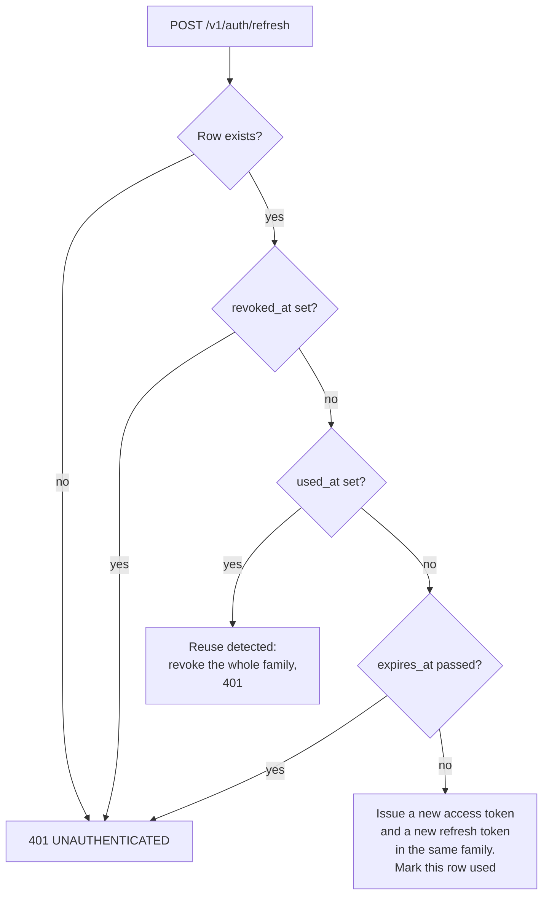

# Auth and Access Control

Status: draft v0.1, 2026-11-02. Part of the [oewang docs](../README.md). Implements [PRD](../prd.md) AUTH-1 to AUTH-6, WS-1 to WS-5, OPS-3 and OPS-6.

How a user proves who they are, how the system decides what they may do, and how the three processes authenticate to each other.

## Update this doc when

- Changing JWT claims, token lifetime or cookie attributes.
- Adding a role, or changing what a role may do. Update the [permission matrix](#permission-matrix).
- Changing service-to-service authentication.
- Changing how a passkey is added, checked or removed.

## Summary

- Email and password, and passkeys added once signed in (D21, D110). No OAuth providers.
- Passwords hashed with Argon2id.
- The session is a short-lived access JWT plus a rotating refresh token, both in `httpOnly` cookies set by the SvelteKit server (D6, D38).
- The API derives the workspace and the role from JWT claims and from nothing else (AUTH-4). A session opened at sign-up has neither until the user creates or joins a workspace (D109).
- Three roles per workspace: `owner`, `admin`, `member`.
- The AI service authenticates with a shared service key, never with a user token (D4).

## Passwords

- Argon2id, with the `argon2` crate's recommended parameters for an interactive login.
- Each password has its own salt; the salt is part of the stored hash string.
- `password_hash` is never selected into any response type. The user response struct has no such field, so it cannot leak by accident.
- Minimum length 10 characters. No composition rules, no forced rotation.
- Login answers `INVALID_CREDENTIALS` for both an unknown email and a wrong password, and performs a dummy verification when the email is unknown so the two paths take comparable time (AUTH-5).

## The token

HS256, signed with `JWT_SECRET` (at least 32 characters, validated at startup).

```json
{
  "sub": "clx_user_id",
  "wid": "clx_workspace_id",
  "role": "admin",
  "iat": 1762070400,
  "exp": 1762675200,
  "jti": "01JC0…"
}
```

| Claim | Meaning |
|---|---|
| `sub` | User ID |
| `wid` | The workspace this token is scoped to. Absent while the user has none (D109) |
| `role` | The user's role in that workspace, copied at issue time. Absent with `wid` |
| `exp` | Expiry. 15 minutes (D38) |
| `jti` | Token ID, logged on issue so a session can be traced |

**`role` is a snapshot.** If an owner demotes a member while that member holds a live token, the old role stays in the token until it expires or is refreshed. For write-sensitive operations the API re-reads the membership row, so a demotion takes effect immediately on writes. Read endpoints accept the snapshot. This is the deliberate trade: one database read on every write, none on every read.

## The session cookies

Two cookies, set by the SvelteKit server, never by client JavaScript (D5, AUTH-3).

| | `__Host-oewang-session` | `__Host-oewang-refresh` |
|---|---|---|
| Holds | The access JWT | An opaque 32-byte random token |
| Lifetime | 15 minutes | 30 days |
| `Path` | `/` | `/` |
| `HttpOnly` | yes | yes |
| `Secure` | yes in production | yes in production |
| `SameSite` | `Lax` | `Lax` |

In production both names carry the `__Host-` prefix, so the browser refuses them unless they are `Secure`, on `/` and without a `Domain`. That also keeps them apart from oewang old's `oewang-session`, which browsers that used the old app still send and whose token this API cannot verify. Development runs over plain http and drops the prefix.

When the API answers 401 to a call that carried the access token, the SvelteKit server clears both cookies and redirects to `/login?next=`, rather than failing the page. A rotated `JWT_SECRET` or a removed user then costs a sign-in, not an error page.

The refresh token is opaque, not a JWT. It carries no claims, so it proves nothing on its own: the server looks it up. Only its SHA-256 is stored (AUTH-8), so a database leak does not yield usable tokens.

### Rotation and reuse detection

Every refresh issues a new refresh token and marks the old row `used_at` (AUTH-9). The old token stops working immediately.



A token used twice means either a stolen copy or a race. Both are handled the same way: the entire family, meaning every token descended from that login, is revoked and the user signs in again. The cost of a false positive is one re-login. The cost of ignoring it is an attacker keeping a parallel session alive indefinitely.

### Revocation

Unlike the old app, logout really ends the session (D38).

| Event | Effect |
|---|---|
| Logout | Revoke the refresh row, clear both cookies |
| Logout everywhere | Revoke every live row for the user, and end every Telegram link they hold (D85) |
| Password change or reset | Revoke every live row for the user, and end every Telegram link they hold (D85) |
| Removed from a workspace | Revoke every live row for the user, and end their Telegram link in that workspace |
| Reuse detected | Revoke the family |

The access token still lives up to 15 minutes after revocation, because nothing is checked on a read. That window is the deliberate trade for not hitting the database on every request; writes re-read the membership row, so an access token that outlives a removal cannot write.

## Sessions without a workspace

Signing up opens a session with no workspace (D109): no `wid`, no `role`, and a null `refresh_tokens.workspace_id`. Logging in does the same for someone who belongs to no workspace. Such a session passes the `AuthUser` extractor, which serves the routes that belong to a person: `me`, the workspace list, creating a workspace, accepting an invitation, switching, the session list and signing out. The `Auth` extractor, which every workspace route takes, refuses it with `NO_WORKSPACE`. A refresh keeps it without a workspace; joining one is a switch.

The app sends every sign-in through `/sync`, which moves a session without a workspace into the first one the user belongs to, or to `/workspace-create`. `hooks.server.ts` reads `wid` from the access token to send a workspace-less session there from any other page. It reads, it does not verify: the API checks the signature on every call and refuses workspace data whatever the app decided.

## Passkeys

A second way in, beside the password (AUTH-14, D110). WebAuthn through `webauthn-rs`, with the app's origin from `APP_URL` as the relying party: the browser only ever talks to the app (D5), so the API's own address plays no part.

- **Adding.** From Account, Security. The API starts a registration that requires a resident (discoverable) key and user verification, and excludes the user's existing credentials, so a device that already holds one refuses to make a second. The answer is checked, the credential ID is refused if it was ever registered to any account, and the passkey is stored with an audit row `passkey.added`.
- **Signing in.** A button on the login page. The API starts a discoverable authentication, so no email is asked for. The answer names its credential and user handle; the passkey row is found by credential ID, the handle must be the one derived for that row's owner, and the signature, user verification and counter are checked. Then a session opens exactly as a password login's does. Every failure answers `INVALID_CREDENTIALS`, and the two routes share the credential rate limit (AUTH-6).
- **Ceremony state.** The server half of each ceremony is a `passkey_ceremonies` row, claimed once (`used_at`) within five minutes, and claimed before the answer is checked, so a failed answer spends it too. A registration can be claimed only by the user who started it.
- **User handle.** The first 16 bytes of SHA-256 of the user ID. Nothing on the authenticator names the account, and the same handle for every registration means a second passkey on the same device replaces the first.
- **Removing.** Soft delete, audited `passkey.removed`. The copy on the device stays until the person deletes it there; the server no longer accepts it.
- Passkeys do not end with a password change: they are separate credentials, each removable on its own.

## Password reset

Email and password are the only way in (D21), so a forgotten password with no reset flow means editing the database by hand. The flow ships in M1 (Q3).

1. `POST /v1/auth/forgot-password` with an email. Always answers 204, whether or not the address exists, so the endpoint cannot enumerate users.
2. If the user exists, generate 32 random bytes, store the SHA-256 with a 1 hour expiry (AUTH-10), and send the raw token in a link by email (D40).
3. `POST /v1/auth/reset-password` with the token and a new password. The token must exist, be unexpired and unused.
4. On success: set the new hash, mark the token used, and revoke every refresh token for that user.
5. Rate limited with the rest of `/v1/auth/*`: 10 requests per 15 minutes per IP (AUTH-6).

A reset link is a bearer credential in an email. It is single use, short lived, and never logged.

## Telegram links

A Telegram chat that acts for a member (D85, [Telegram](../features/telegram.md)) is authenticated by a link row, not by a token on each message, because a Telegram message carries none.

- The link is made with a one-time token minted for the signed-in member in the session's workspace: 32 random bytes, URL-safe base64, stored as SHA-256, ten minutes, claimed and marked used in one statement. The same rules as a reset token, for the same reason: it is a bearer credential shown to one person.
- The token travels in a `t.me` deep link the member opens. It is shown in the connect dialog and nowhere else; it is never put in an app URL.
- Only a private chat can be linked, and every later update must come from the Telegram account that opened the link (`telegram_user_id`), not merely from the chat.
- Every update re-reads the membership row, so the role that applies is the current one, and a member who left is disconnected on their next message.
- The link ends with the session events in [Revocation](#revocation), from the Apps page, and with `/disconnect`.

## MCP tokens

An opaque bearer (`owm_…`), not a JWT, looked up by SHA-256 (D106). It names a person and a set of workspaces, never a role: every call reads the membership row of the workspace it acts in, so a token can do exactly what the person's role allows there, and nothing after they leave. It is revoked by the person, by a password change or reset, and by signing out everywhere. A refused token is `MCP_TOKEN_INVALID`; the app's relay answers it with its own 401 and never treats it as the browser session ending. An OAuth connection (MCP-9) yields the same kind of token, living an hour, with a refresh token that rotates on each use; a replayed refresh token revokes the grant, as a replayed session refresh token revokes its family (D38). The consent page is the only place a grant is made, and only for a redirect URI the app registered.

## Request flow

```mermaid
sequenceDiagram
    participant B as Browser
    participant A as SvelteKit
    participant R as Rust API
    participant D as PostgreSQL

    B->>A: POST /login (form action)
    A->>R: POST /v1/auth/login
    R->>D: SELECT user by email
    R->>R: Argon2id verify
    R->>D: SELECT membership, pick workspace
    R-->>A: 200 { token, user, workspace }
    A-->>B: Set-Cookie __Host-oewang-session; redirect /transactions

    B->>A: GET /transactions
    A->>A: hooks.server.ts verifies the JWT, fills event.locals.user
    A->>R: GET /v1/transactions (Authorization: Bearer)
    R->>R: Auth extractor verifies signature and expiry
    R->>D: SELECT ... WHERE workspace_id = claims.wid AND deleted_at IS NULL
    R-->>A: 200 envelope
    A-->>B: SSR HTML
```

SvelteKit verifies the token so it can redirect an unauthenticated visitor without a round trip. The API verifies it again, independently. Neither trusts the other's verification.

## Workspace scoping

One rule, enforced in the auth extractor and relied on by every repository:

> `workspace_id` comes from `claims.wid`. A `workspace_id` in a body, a query string or a path is ignored if it matches, and rejected if it does not.

Every repository method takes `workspace_id` as its first argument and includes it in the `WHERE` clause together with `deleted_at IS NULL`. A repository method without a workspace filter is a review failure, not a style preference.

A row that exists in another workspace returns 404, never 403 (VLT-4). A 403 would confirm the row exists.

## Switching workspace

`POST /v1/auth/switch-workspace` with a target workspace ID:

1. Read the live membership row for `(user_id, workspace_id)`.
2. No live row, or a soft-deleted one: `NOT_A_MEMBER`.
3. Issue a new token with the new `wid` and the role from that row.
4. SvelteKit replaces the cookie.

The old token stays valid until expiry. It is scoped to the previous workspace, so it grants nothing extra.

## Roles

| Role | Who |
|---|---|
| `owner` | Created the workspace, or was promoted. At least one always exists (WS-4) |
| `admin` | Full read and write, no workspace deletion |
| `member` | Read everything, write nothing |

### Permission matrix

| Action | owner | admin | member |
|---|---|---|---|
| Read transactions, wallets, categories, summaries | yes | yes | yes |
| Create, update, delete a transaction | yes | yes | no |
| Bulk update or delete transactions | yes | yes | no |
| Export transactions to CSV | yes | yes | yes |
| Import transactions (CSV or AI) | yes | yes | no |
| Manage wallets, wallet groups, categories | yes | yes | no |
| Upload, rename, tag or delete a file | yes | yes | no |
| View a file, list the vault, read a thumbnail | yes | yes | yes |
| Read workspace usage (storage and tokens) | yes | yes | yes |
| Invite or remove a member, change a role | yes | yes (not an owner) | no |
| Update workspace settings | yes | yes | no |
| Delete the workspace | yes | no | no |
| Convert the workspace currency (WAL-7) | yes | no | no |
| Open chat, read sessions, use read-only tools | yes | yes | yes |
| Use write tools in chat | yes | yes | no |
| Update agent settings | yes | yes | no |
| Connect or disconnect their own Telegram chat | yes | yes | yes |
| Save a receipt or change a transaction from Telegram | yes | yes | no |
| Ask the assistant from Telegram | yes | yes | yes |
| Make, list and revoke their own MCP tokens (MCP-2) | yes | yes | yes |
| Send feedback (FB-1) | yes | yes | yes |

An admin cannot grant owner, nor change or remove an owner: only an owner acts on an owner. An invitation is a bearer token bound to an address: the API accepts it only from the account with that email, so a forwarded or leaked link admits nobody else, and a refused attempt leaves it usable for the right person. Accepting never changes the role of someone already in the workspace (D104).

A `member` who asks the assistant to record an expense gets a refusal from the tool layer, server-side, not from the prompt (CHAT-4). A prompt instruction is guidance; the role gate is the control.

## Service-to-service

| Direction | Mechanism |
|---|---|
| SvelteKit to API | The user's JWT as a bearer token |
| API to AI service | `x-api-key: $AI_SERVICE_API_KEY` |
| AI service to API (`/v1/internal/*`) | `x-api-key: $AI_SERVICE_API_KEY`, plus an explicit workspace context in the body |
| API to Telegram | The bot token in the URL path, over TLS to the configured host. Inbound is the API polling, so Telegram never calls in (D84) |

The AI service never holds a user JWT and never verifies one (D4). It states who it is acting for; the API decides whether that is allowed, by re-reading the membership row.

Internal routes are bound to the internal network in deployment and additionally require the key (OPS-6). The key is compared in constant time.

## Rate limits

| Scope | Limit |
|---|---|
| `/v1/auth/*` | 10 requests per 15 minutes per IP (AUTH-6) |
| Authenticated routes | 300 per minute per IP |
| Unauthenticated routes | 30 per minute per IP |

Limits are per IP address. A shared office address can exhaust the auth bucket; that is accepted at this scale and is visible in the logs when it happens.

## Logging rules

Never logged, in any process (OPS-3):

- Passwords, in any form, including inside a request body dump.
- JWTs, whole or partial.
- `JWT_SECRET`, `AI_SERVICE_API_KEY`, storage credentials, the Anthropic key.
- File contents, receipt images, and extracted receipt text.

Logged on every request: `request_id`, method, path, status, duration, `user_id`, `workspace_id`. A test asserts that the secrets above never appear in captured log output.

## Threat model

| Threat | Control |
|---|---|
| Token theft through XSS | `httpOnly` cookies, so client JavaScript reads neither token (AUTH-3) |
| A stolen access token | 15 minute lifetime. A write still re-reads the membership row |
| A stolen refresh token | Rotation on every use. A second use of one token revokes the whole family (AUTH-9) |
| A leaked database | Only SHA-256 hashes of refresh and reset tokens are stored (AUTH-8) |
| Email enumeration through password reset | `forgot-password` always answers 204 |
| Cross-site request forgery | `SameSite=Lax`, plus SvelteKit form actions with origin checking |
| Cross-workspace data access | `workspace_id` from claims only; every query filters on it; 404 rather than 403 |
| Privilege escalation through a request body | Role never read from the body; re-read from the database on writes |
| Brute force on login | Auth rate limit, Argon2id cost, uniform error and timing |
| Enumerating registered emails | Same error and comparable timing for unknown email and wrong password |
| The AI service acting beyond the user | Tool role gate server-side; destructive tools need confirmation (D20) |
| Secrets in logs | Explicit deny list and a test over captured output |
| An exposed internal route | Internal network binding plus a constant-time service key check |
| Linking someone else's workspace to a Telegram chat | One-time token minted for the signed-in member; nothing in a message names a workspace (the old app's `/start <slug>` did) |
| A group member acting through a linked chat | Private chats only, and every update must come from the linking account |
| A forged button (`callback_data`) | The ids are looked up in the link's workspace; anything else is not found |
| The bot token in a log | Kept out of `Debug`, and every HTTP error is stripped of its URL before it is logged |

Known gaps, accepted for now: an access token stays valid up to 15 minutes after revocation, there is no step-up verification for sensitive reads, and there is no audit UI (see [Q4](../prd.md#10-open-questions)).

## Related docs

- [Docs index](../README.md) and [PRD](../prd.md)
- [API conventions](../api/conventions.md) and [endpoints](../api/endpoints.md)
- [Architecture](../architecture.md) and the [decision log](../architecture.md#decision-log)
- [Data model](../data-model.md#identity-and-tenancy)
- [Chat](../features/chat.md#role-gating)
- [Rust API best practices](../best-practices/rust-api.md#tenancy-and-authorization)
