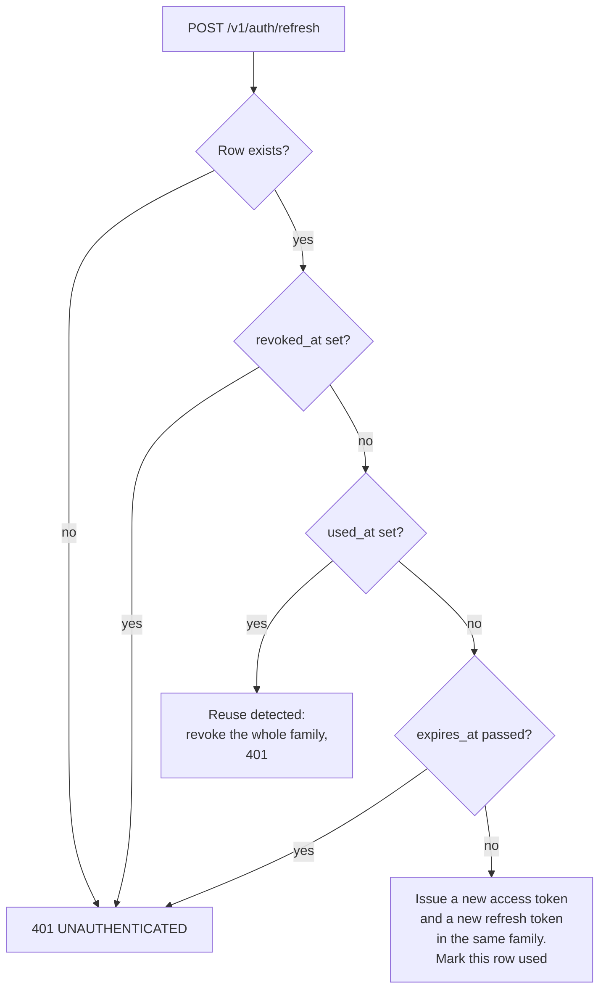

# Auth and Access Control

Status: draft v0.1, 2026-11-02. Part of the [oewang docs](../README.md). Implements [PRD](../prd.md) AUTH-1 to AUTH-6, WS-1 to WS-5, OPS-3 and OPS-6.

How a user proves who they are, how the system decides what they may do, and how the three processes authenticate to each other.

## Update this doc when

- Changing JWT claims, token lifetime or cookie attributes.
- Adding a role, or changing what a role may do. Update the [permission matrix](#permission-matrix).
- Changing service-to-service authentication.

## Summary

- Email and password only. No OAuth providers (D21).
- Passwords hashed with Argon2id.
- The session is a short-lived access JWT plus a rotating refresh token, both in `httpOnly` cookies set by the SvelteKit server (D6, D38).
- The API derives the workspace and the role from JWT claims and from nothing else (AUTH-4).
- Three roles per workspace: `owner`, `admin`, `member`.
- The AI service authenticates with a shared service key, never with a user token (D4).

## Passwords

- Argon2id, with the `argon2` crate's recommended parameters for an interactive login.
- Each password has its own salt; the salt is part of the stored hash string.
- `password_hash` is never selected into any response type. The user response struct has no such field, so it cannot leak by accident.
- Minimum length 10 characters. No composition rules, no forced rotation.
- Login answers `INVALID_CREDENTIALS` for both an unknown email and a wrong password, and performs a dummy verification when the email is unknown so the two paths take comparable time (AUTH-5).

## The token

HS256, signed with `JWT_SECRET` (at least 32 characters, validated at startup).

```json
{
  "sub": "clx_user_id",
  "wid": "clx_workspace_id",
  "role": "admin",
  "iat": 1762070400,
  "exp": 1762675200,
  "jti": "01JC0…"
}
```

| Claim | Meaning |
|---|---|
| `sub` | User ID |
| `wid` | The workspace this token is scoped to |
| `role` | The user's role in that workspace, copied at issue time |
| `exp` | Expiry. 15 minutes (D38) |
| `jti` | Token ID, logged on issue so a session can be traced |

**`role` is a snapshot.** If an owner demotes a member while that member holds a live token, the old role stays in the token until it expires or is refreshed. For write-sensitive operations the API re-reads the membership row, so a demotion takes effect immediately on writes. Read endpoints accept the snapshot. This is the deliberate trade: one database read on every write, none on every read.

## The session cookies

Two cookies, set by the SvelteKit server, never by client JavaScript (D5, AUTH-3).

| | `oewang-session` | `oewang-refresh` |
|---|---|---|
| Holds | The access JWT | An opaque 32-byte random token |
| Lifetime | 15 minutes | 30 days |
| `Path` | `/` | `/` |
| `HttpOnly` | yes | yes |
| `Secure` | yes in production | yes in production |
| `SameSite` | `Lax` | `Lax` |

The refresh token is opaque, not a JWT. It carries no claims, so it proves nothing on its own: the server looks it up. Only its SHA-256 is stored (AUTH-8), so a database leak does not yield usable tokens.

### Rotation and reuse detection

Every refresh issues a new refresh token and marks the old row `used_at` (AUTH-9). The old token stops working immediately.



A token used twice means either a stolen copy or a race. Both are handled the same way: the entire family, meaning every token descended from that login, is revoked and the user signs in again. The cost of a false positive is one re-login. The cost of ignoring it is an attacker keeping a parallel session alive indefinitely.

### Revocation

Unlike the old app, logout really ends the session (D38).

| Event | Effect |
|---|---|
| Logout | Revoke the refresh row, clear both cookies |
| Logout everywhere | Revoke every live row for the user |
| Password change or reset | Revoke every live row for the user |
| Reuse detected | Revoke the family |

The access token still lives up to 15 minutes after revocation, because nothing is checked on a read. That window is the deliberate trade for not hitting the database on every request; writes re-read the membership row, so an access token that outlives a removal cannot write.

## Password reset

Email and password are the only way in (D21), so a forgotten password with no reset flow means editing the database by hand. The flow ships in M1 (Q3).

1. `POST /v1/auth/forgot-password` with an email. Always answers 204, whether or not the address exists, so the endpoint cannot enumerate users.
2. If the user exists, generate 32 random bytes, store the SHA-256 with a 1 hour expiry (AUTH-10), and send the raw token in a link by email (D40).
3. `POST /v1/auth/reset-password` with the token and a new password. The token must exist, be unexpired and unused.
4. On success: set the new hash, mark the token used, and revoke every refresh token for that user.
5. Rate limited with the rest of `/v1/auth/*`: 10 requests per 15 minutes per IP (AUTH-6).

A reset link is a bearer credential in an email. It is single use, short lived, and never logged.

## Request flow

```mermaid
sequenceDiagram
    participant B as Browser
    participant A as SvelteKit
    participant R as Rust API
    participant D as PostgreSQL

    B->>A: POST /login (form action)
    A->>R: POST /v1/auth/login
    R->>D: SELECT user by email
    R->>R: Argon2id verify
    R->>D: SELECT membership, pick workspace
    R-->>A: 200 { token, user, workspace }
    A-->>B: Set-Cookie oewang-session; redirect /transactions

    B->>A: GET /transactions
    A->>A: hooks.server.ts verifies the JWT, fills event.locals.user
    A->>R: GET /v1/transactions (Authorization: Bearer)
    R->>R: Auth extractor verifies signature and expiry
    R->>D: SELECT ... WHERE workspace_id = claims.wid AND deleted_at IS NULL
    R-->>A: 200 envelope
    A-->>B: SSR HTML
```

SvelteKit verifies the token so it can redirect an unauthenticated visitor without a round trip. The API verifies it again, independently. Neither trusts the other's verification.

## Workspace scoping

One rule, enforced in the auth extractor and relied on by every repository:

> `workspace_id` comes from `claims.wid`. A `workspace_id` in a body, a query string or a path is ignored if it matches, and rejected if it does not.

Every repository method takes `workspace_id` as its first argument and includes it in the `WHERE` clause together with `deleted_at IS NULL`. A repository method without a workspace filter is a review failure, not a style preference.

A row that exists in another workspace returns 404, never 403 (VLT-4). A 403 would confirm the row exists.

## Switching workspace

`POST /v1/auth/switch-workspace` with a target workspace ID:

1. Read the live membership row for `(user_id, workspace_id)`.
2. No live row, or a soft-deleted one: `NOT_A_MEMBER`.
3. Issue a new token with the new `wid` and the role from that row.
4. SvelteKit replaces the cookie.

The old token stays valid until expiry. It is scoped to the previous workspace, so it grants nothing extra.

## Roles

| Role | Who |
|---|---|
| `owner` | Created the workspace, or was promoted. At least one always exists (WS-4) |
| `admin` | Full read and write, no workspace deletion |
| `member` | Read everything, write nothing |

### Permission matrix

| Action | owner | admin | member |
|---|---|---|---|
| Read transactions, wallets, categories, summaries | yes | yes | yes |
| Create, update, delete a transaction | yes | yes | no |
| Bulk update or delete transactions | yes | yes | no |
| Export transactions to CSV | yes | yes | yes |
| Import transactions (CSV or AI) | yes | yes | no |
| Manage wallets, wallet groups, categories | yes | yes | no |
| Upload or delete a file | yes | yes | no |
| View a file | yes | yes | yes |
| Invite or remove a member, change a role | yes | yes | no |
| Update workspace settings | yes | yes | no |
| Delete the workspace | yes | no | no |
| Open chat, read sessions, use read-only tools | yes | yes | yes |
| Use write tools in chat | yes | yes | no |
| Update agent settings | yes | yes | no |

A `member` who asks the assistant to record an expense gets a refusal from the tool layer, server-side, not from the prompt (CHAT-4). A prompt instruction is guidance; the role gate is the control.

## Service-to-service

| Direction | Mechanism |
|---|---|
| SvelteKit to API | The user's JWT as a bearer token |
| API to AI service | `x-api-key: $AI_SERVICE_API_KEY` |
| AI service to API (`/v1/internal/*`) | `x-api-key: $AI_SERVICE_API_KEY`, plus an explicit workspace context in the body |

The AI service never holds a user JWT and never verifies one (D4). It states who it is acting for; the API decides whether that is allowed, by re-reading the membership row.

Internal routes are bound to the internal network in deployment and additionally require the key (OPS-6). The key is compared in constant time.

## Rate limits

| Scope | Limit |
|---|---|
| `/v1/auth/*` | 10 requests per 15 minutes per IP (AUTH-6) |
| Authenticated routes | 300 per minute per IP |
| Unauthenticated routes | 30 per minute per IP |

Limits are per IP address. A shared office address can exhaust the auth bucket; that is accepted at this scale and is visible in the logs when it happens.

## Logging rules

Never logged, in any process (OPS-3):

- Passwords, in any form, including inside a request body dump.
- JWTs, whole or partial.
- `JWT_SECRET`, `AI_SERVICE_API_KEY`, storage credentials, the Anthropic key.
- File contents, receipt images, and extracted receipt text.

Logged on every request: `request_id`, method, path, status, duration, `user_id`, `workspace_id`. A test asserts that the secrets above never appear in captured log output.

## Threat model

| Threat | Control |
|---|---|
| Token theft through XSS | `httpOnly` cookies, so client JavaScript reads neither token (AUTH-3) |
| A stolen access token | 15 minute lifetime. A write still re-reads the membership row |
| A stolen refresh token | Rotation on every use. A second use of one token revokes the whole family (AUTH-9) |
| A leaked database | Only SHA-256 hashes of refresh and reset tokens are stored (AUTH-8) |
| Email enumeration through password reset | `forgot-password` always answers 204 |
| Cross-site request forgery | `SameSite=Lax`, plus SvelteKit form actions with origin checking |
| Cross-workspace data access | `workspace_id` from claims only; every query filters on it; 404 rather than 403 |
| Privilege escalation through a request body | Role never read from the body; re-read from the database on writes |
| Brute force on login | Auth rate limit, Argon2id cost, uniform error and timing |
| Enumerating registered emails | Same error and comparable timing for unknown email and wrong password |
| The AI service acting beyond the user | Tool role gate server-side; destructive tools need confirmation (D20) |
| Secrets in logs | Explicit deny list and a test over captured output |
| An exposed internal route | Internal network binding plus a constant-time service key check |

Known gaps, accepted for now: an access token stays valid up to 15 minutes after revocation, there is no step-up verification for sensitive reads, and there is no audit UI (see [Q4](../prd.md#10-open-questions)).

## Related docs

- [Docs index](../README.md) and [PRD](../prd.md)
- [API conventions](../api/conventions.md) and [endpoints](../api/endpoints.md)
- [Architecture](../architecture.md) and the [decision log](../architecture.md#decision-log)
- [Data model](../data-model.md#identity-and-tenancy)
- [Chat](../features/chat.md#role-gating)
- [Rust API best practices](../best-practices/rust-api.md#tenancy-and-authorization)
